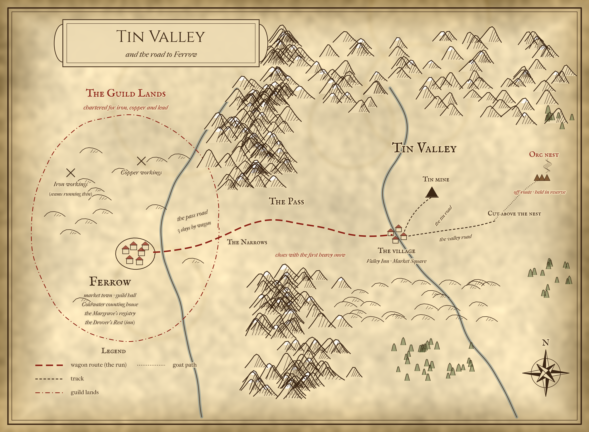
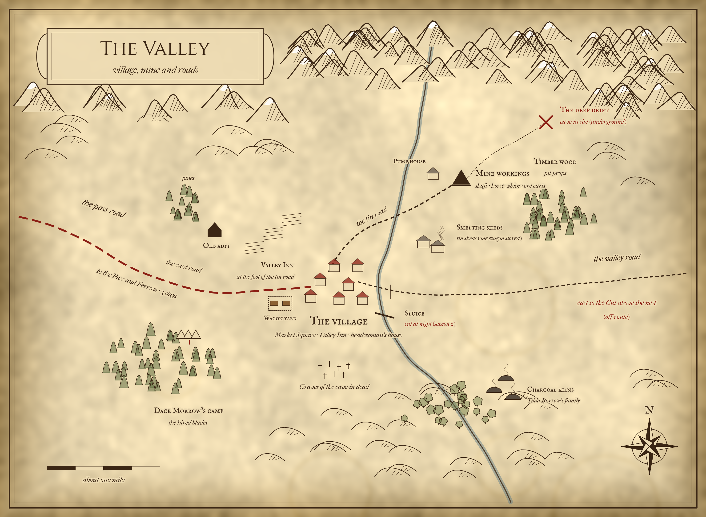
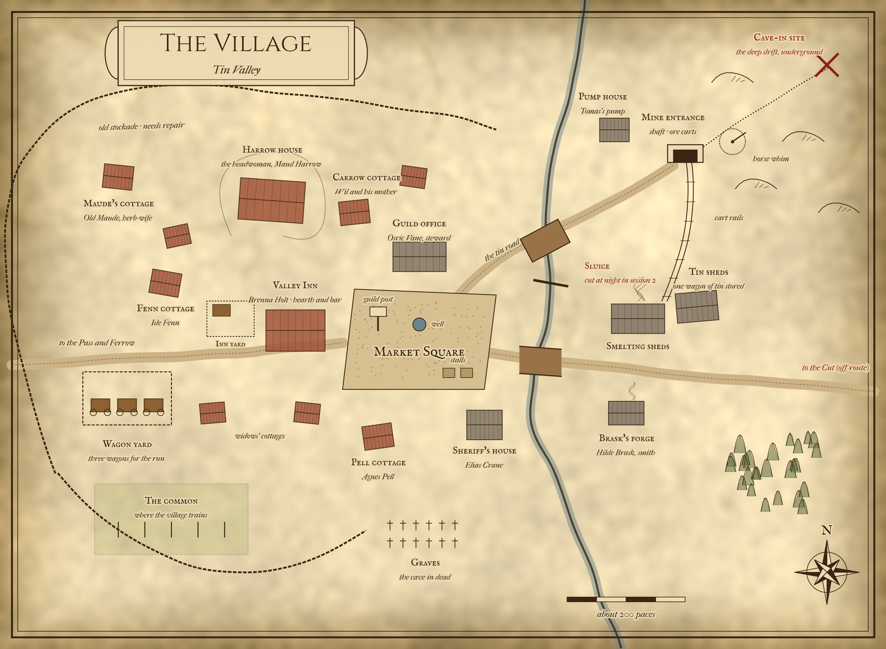

# Swords of Tin Valley

Status: design draft. It extends the idea doc of 2026-10-15 with Fredrik's decisions of 2026-10-15 and 2026-10-16 (population, no gunpowder, the Ferrow hook).
World: [Tin Valley](../worlds/tin-valley/).
Inspiration: *Seven Samurai* (Kurosawa, 1954), *Godless* (Netflix, 2017), and George R. R. Martin's way with factions.
Format: solo player. About 4 to 6 sessions.

## Why this adventure

The persona research (`docs/research/2026-10-15-persona-forum-research.md`, section 6) shows that players most remember three things:

- Choices that come back to them (D1).
- Emotional moments with NPCs (D2).
- Stories that end (D4).

This adventure builds relationships with NPCs over several sessions. The finale then uses those relationships. NPC interaction is the core. Fights happen, but most turns are talk.

## Design rules

- **No evil villains.** Every NPC wants something we can understand. Most of them hurt someone to get it.
- **Self-interests clash.** Two NPCs who both like the player can still want opposite things.
- **The cave-in is never solved.** The evidence points both ways. The GM never confirms the truth, not even in the epilogue.
- **Failure is a real ending.** The world remembers it.
- **Every session has a callback.** An earlier choice, NPC or deed comes back and matters.
- **Old-school mining.** No gunpowder and no blasting. Rock is broken by fire-setting and hand tools (see "How the mine works").

## Premise

The village tin mine is very rich. The Miners Guild wants it. The village has always refused to let the guild in.

Last spring a cave-in killed 27 of the 32 men who worked underground. One of the dead was Tomas Harrow. He led the refusal. Now the widows run the mine and the village, with old men, older boys and a few hired hands (see "Village and valley population").

Before he died, Tomas borrowed 60 gold from the Coldwater counting house in Ferrow, the market town beyond the pass. He paid for a water-wheel pump and its rod line, so the village could dig deeper without the guild. The loan falls due at the winter reckoning.

The widows have one way to pay. They must get tin to market in Ferrow. The road crosses the mountain pass, and the pass closes with the first heavy snow. After that, no wagon gets through until spring. The bank will foreclose, and the mine goes to auction.

The guild knows this. It does not need to take the mine by force. It only needs the wagons to be late. Then the bank forecloses, and the guild buys the mine at auction.

The guild hides a secret: its charter does not cover tin. In law, the guild cannot hold a tin mine.

The widows pool a small purse of tin. They send Maud's daughter Elin over the pass to Ferrow to hire a fighter. She finds the player. The player must hire a few more fighters, travel to the valley, train the village, and get the wagons through.

## The player's job

The headwoman's offer is simple. Keep the village safe. Get the tin to Ferrow before the pass closes.

The player can do it in three ways, and can mix them:

- **The road.** Mine and smelt enough tin, then run the wagons through the pass.
- **The banker.** Persuade the banker to extend the loan, or expose the guild's pressure on him.
- **The charter.** Prove that the guild cannot legally buy a tin mine. Then the auction has no guild buyer.

## Cast

OCEAN key: O openness, C conscientiousness, E extraversion, A agreeableness, N neuroticism. Each trait is an integer from 1 (very low) to 10 (very high), as in the NPC files (for example `npcs/guild_steward.json`).

### The village

| NPC | OCEAN | Maslow | Current concerns | Wants from the player | Secret |
| --- | --- | --- | --- | --- | --- |
| **Maud Harrow**, headwoman, Tomas's widow | O 3, C 8, E 5, A 3, N 8 | Esteem (to be the leader Tomas was) | The loan. The widows doubting her. Outsiders with swords. | Obedience to her terms. Later, honesty. | Tomas saved money on pit props to pay for the pump. She signed the timber order herself. |
| **Elin Harrow**, the recruiter, 16, Maud's daughter | O 7, C 6, E 6, A 6, N 7 | Esteem (to be trusted with something that matters) | The purse. Her mother's orders. Ferrow, which frightens and tempts her. | To say yes. To be treated as the widows' voice, not as a child. | She lost 1 gold of the purse to a card sharp on her first night in Ferrow. Part of her wants to stay in Ferrow and never go back. |
| **Wil Carrow**, the boy, 12 | O 8, C 3, E 8, A 8, N 5 | Love and belonging | His father is gone. His mother does not talk. He wants to matter. | To be taught to fight. To be taken along. | He heard his father say "Tomas is cutting the props too thin." He has told no one. |
| **Agnes Pell**, widow willing to sell | O 5, C 7, E 3, A 8, N 8 | Safety | Three small children. Food for the winter. | Help to make the others listen. A fair price. | Osric has already offered her 4 gold for her share. She has not said no. |
| **Ide Fenn**, widow who wants blood | O 2, C 5, E 7, A 2, N 9 | Esteem (her husband's name) | Proof that the guild killed him. Revenge. | A sword hand that hits the guild. | She once tried to fire the guild store and failed. Sheriff Crane let it go. |
| **Brenna Holt**, innkeep (existing world NPC) | O 5, C 8, E 6, A 5, N 3 | Safety (the inn) | Guild men pay her bills. The village is her kin. | Peace. No fighting in her inn. | Agnes is her sister. She holds an unopened letter to Tomas from a Ferrow lawyer. |
| **Elias Crane**, sheriff | O 3, C 2, E 2, A 7, N 9 | Safety | Drink. Not being asked to choose. | To be left alone. Under that, to be forgiven. | He dug out the bodies. He found a guild survey stake in the drift and hid it. |

### The guild and its people

| NPC | OCEAN | Maslow | Current concerns | Wants from the player | Secret |
| --- | --- | --- | --- | --- | --- |
| **Harlan Greaves**, guild master in Ferrow | O 5, C 8, E 5, A 5, N 6 | Safety (for 300 guild families) | The guild's iron and copper seams are running out. Without new ore, his miners starve this winter. | To step aside. Or to broker a deal he can sell to his members. | He knows the charter omits tin. He planned to petition for a new charter after the purchase. He fears Osric did something in the drift. |
| **Osric Vane**, guild steward in the valley (existing world NPC) | O 4, C 7, E 5, A 2, N 4 (as in `guild_steward.json`) | Esteem (promotion) | The delay. His own career. Harlan's letters. | To leave. To be bought off if needed. | He answers to Harlan but acts on his own. His survey men were in the deep drift a week before the cave-in, without leave. He does not know if they loosened anything. |
| **Dace Morrow**, leader of the hired blades | O 3, C 5, E 8, A 5, N 2 | Physiological, then safety (his men's pay) | The guild owes him for his last job. Winter quarters. | Respect. A way to get paid without killing women. | His orders say "delay the wagons". His bonus is paid only if the wagons are late. He grew up in a mining village. |
| **Caldern Voss**, guild-hired prospector (existing world NPC) | O 6, C 3, E 7, A 5, N 8 | Physiological (wages) | The deep is "wrong". He wants out before winter. | Copper. Protection if he talks. | On the morning of the cave-in he smelled fresh smoke in the deep drift, where no fire had been set the night before. He also took Osric's coin to survey it. |

### Ferrow

| NPC | OCEAN | Maslow | Current concerns | Wants from the player | Secret |
| --- | --- | --- | --- | --- | --- |
| **Jory Malwick**, banker at Coldwater | O 5, C 8, E 3, A 5, N 8 | Safety, then esteem | The bank is short of silver. The guild is his biggest depositor. Harlan has hinted he could move his money. | A reason to extend that protects him. No public scandal. | He made a bad loan to a wool merchant. A quick foreclosure would cover the hole before the owners' audit. |
| **Wenna Strake**, guild clerk | O 8, C 8, E 2, A 6, N 5 | Self-esteem (a better life) | She copies the guild's papers. She wants a post away from the guild. | A way out. A job at the bank, or passage south. | She has read the charter. She keeps a fair copy. |

## How the mine works

The mine is worked the old way. There is no gunpowder and no blasting.

- **Fire-setting.** In the afternoon the crew stacks wood against the rock face. The fires are lit in the evening and burn through the night. In the morning they are put out, and the cracked rock is broken loose with sledges, wedges and crowbars. No one is underground while the fires burn, because of the smoke and the heat.
- **Slow going.** A face gives perhaps a metre of rock a month. Every metre costs wood.
- **Hauling.** Carriers bring the ore to the shaft foot on barrows. A horse whim at the shaft head lifts it up in baskets.
- **Water.** Tomas's water-wheel pump keeps the lower drifts dry. A sluice feeds the wheel. If the sluice is cut, the water rises.
- **Props.** Timber props hold up the roof. Fire cracks the roof as well as the face, so the props matter.
- **Sorting.** On the surface the ore is broken small and picked clean of waste rock. Women, children, old men and the injured do this work.
- **Smelting.** The tin ore is smelted with charcoal in the smelting sheds. Tin ore needs no long roasting, unlike the Swedish copper ores below. (Design assumption, not from the sources.)
- **Fuel.** The fires, the smelting and the props all need wood. Woodcutters and charcoal burners work in the timber wood above the mine. Every household owes some days of wood and charcoal work.

All of this is shown in fiction, never as rules text. It gives the GM real things to sabotage, repair and argue about: the woodpile, the sluice, the whim horses, the props, the charcoal kilns.

## Village and valley population

The 12 NPCs in the cast are the main active cast. But a mine cannot run on a handful of people. The village needs a believable population around them, so the GM can fill scenes.

### What the sources say

We looked at Swedish copper mines before machines and gunpowder. Fröå gruva outside Åre in Jämtland is the closest in size. Falun gives the large-scale ratios. All figures below come from the sources listed under "Sources". Where the sources say a figure is uncertain, we say so too.

**Fröå gruva (Jämtland, from 1744).**

- In the mid-1700s Fröå used fire-setting. The fires burned overnight and were put out the next morning, then the rock was broken with crowbars and wedges. From the late 1700s drilling and blasting slowly took over. [1]
- Ore was hoisted first by hand, then by horse. Horse whims were also used underground. Pumps were first worked by hand or treadle, later by horse and water. A water-wheel pump with a rod line of about 960 m was built in 1764. [1]
- Sorting was "lighter" work, done by worn-out workers, women and children. Carting ore to the smelter by horse cart and sledge was also partly done by women. [1]
- A work list from 1779 for one shaft (Drottninggruvan) names 73 people: 46 ore and rock breakers, 5 feeders to the shaft foot, 2 hoisters, 1 hub borer for the smithy, 7 sorters, 4 mine smiths, 4 smithy boys, 2 pump-works keepers and 2 day labourers. By 1779 drilling and blasting was coming in, so this is not a pure fire-setting crew. [1]
- In 1768, 65 crofts were tied to the works, and the works' population was 618 people. By 1777 there were 105 crofts. Around 1800 Fröå and Huså had about 600 inhabitants, then the largest settlement in Jämtland. In 1850 about 600 people lived within the company, family included, on about 120 crofts. [1][2]
- Each croft had 3 to 5 tunnland of land, usually 3 to 4 cows and 6 to 8 sheep and goats, and sometimes a horse. The women largely ran the farms while the men were in the mines. Wages were one third cash and two thirds in kind. [1]
- Workers had a five-day week so they could farm. [3][4]
- Local farmers were bound to do carting and charcoal burning for the works. Women took part in charcoal burning. At the start, miners were recruited from Falun and charcoal burners from Värmland. [1]
- If no one in a croft could work for the company, through illness or old age, the household had to move to the poorhouse. [2]

**Falun (Stora Kopparberget, mid-1600s).**

- Fire-setting was used until the late 1600s. Gunpowder came in around 1700. The fires were lit at night so they had burned out before the morning shift. [5][6]
- One estimate for 1640 to 1680: each fire used about 5 m³ of wood and burned 6 to 7 hours. There were probably about 60 fires a day. Breaking and moving the rock took about 250 to 300 men. [7]
- The same author estimates the whole labour force as about 2,100 men at the mine and furnaces, 560 supplying wood and 2,400 supplying charcoal, plus 20 to 30% for support services. Counting five family members per worker, that gives 30,000 to 40,000 people. About 2,000 to 2,500 horses were used. The author stresses that these figures are uncertain. [7]
- A recorded figure: 1,063 miners in 1677. [7] Other sources say "over 1,000" or about 1,200 miners. They also say more people worked above ground than below. [5][8]
- One account says the best-paid breakers took down only about a metre of rock a month, in 13-hour shifts around the clock. [8] (We read this source only through a search excerpt. Check it before quoting it.)

### What we take from this

- **Ratios, not totals.** Falun used about 4 to 5 men for each daily fire, counting breaking and moving the rock. Fröå had roughly 8 to 9 people in the community for each worker at the mine (618 people in 1768 against 73 at one shaft in 1779; different years, so this is rough). Falun's full chain, with distant fuel workers, came to 15 or more people per mine and furnace worker.
- **Tin Valley is a small Fröå.** It is a farming village with a mine, not a mining town. We use about 8 people per mine worker. Fuel work is shared out as part-time duty across all households, as at Fröå, instead of a large full-time fuel crew as at Falun.
- **Smaller fires.** The drifts are narrow, so we assume fires of about 1 m³ of wood each, not Falun's 5 m³. (Design assumption.)

### Headcount, before and after the cave-in

Before the cave-in the valley had **about 280 people in about 48 households**. Today, on day 1, it has **about 250**. The cave-in killed 27 men. One family has since left for Ferrow.

| Group | Before the cave-in | Now (day 1) | Notes |
| --- | --- | --- | --- |
| Fire-setters and breakers | 18 | 6 | Now Jessop Wray, 2 able survivors and 3 hired day-men. Only Jessop and Ansel can lay a fire that cracks the face and not the roof. |
| Ore carriers in the drifts | 8 | 8 | Now 6 older boys (14 to 16) and 2 widows. The village argues about the widows going down. |
| Shaft crew at the horse whim | 3 | 1 | Plus 2 whim horses. One hired day-man. |
| Timbermen (props) | 2 | 1 | Now Ansel Moss, who also sets fires. |
| Foreman | 1 | 0 | The foreman died. Jessop leads, unofficially. |
| **Underground total** | **32** | **16** | Before, a wagon of tin took 2 to 3 days. Now it takes about 5. |
| Sorters | 12 | 16 | Women, children, old men. Now also the two crippled survivors and more widows. |
| Pump and whim keeper | 1 | 1 | Simeon Rudd. |
| Smiths | 2 | 2 | Hilde Brask and her nephew. Picks, wedges and sledges need constant work. |
| Smelters | 4 | 4 | Garth Hollin and three hands. They work at the sheds, so all survived. |
| Woodcutters | 8 | 6 | Two left for wages in Ferrow. |
| Charcoal burners | 4 | 4 | Tilda Burrow's family, at the kilns in the timber wood. Every household also owes wood and charcoal days in autumn. |
| Carters | 4 | 3 | Nan Tolley and two others. Old Rook rejoins if hired. |
| Full-time farmers | about 12 (6 households) | about 12 | Every other household also keeps a plot, cows, sheep and goats. The women do most of it. |
| Inn, healer, sheriff | 6 | 6 | Brenna, Tam and two hands. Old Maude. Sheriff Crane. |
| Elders (60+) not working | about 20 | about 20 | Some, like Jessop, came back to work. |
| Children under 14 | about 110 | about 110 | About 50 have lost a father. |
| Guild people in the valley | 3 | 3 | Osric, a clerk and Caldern. Not counted in the village total. |

The groups overlap. Many people do two jobs, and the totals are rounded.

### What the cave-in changed

- **27 dead, 21 widows.** Six of the dead were unmarried.
- **Half the crew, half the skill.** The underground crew is half its old size, and many of them are boys, widows or hired men. Output has halved.
- **Hired labour costs.** The 4 Ferrow day-men are paid about 24 copper a day each in tin and board (unskilled day rate, `rules/economy.md`). Over 30 days that is nearly 6 gold, the price of two more fighters. Cutting them frees money and costs tin. That is a real choice for the player.
- **Who gets a share.** By the village's old custom, a household shares in the tin only if someone from it works the mine. (This mirrors the Fröå rule that a croft with no worker went to the poorhouse.) Agnes has no one old enough, which is one reason she wants to sell. Ide keeps her share because her son Kit carries ore. Wil wants to go down the mine to keep the Carrow share, and his mother will not let him.
- **Every fighter in training is a worker lost.** See the rule of thumb under "The deadline clock".

### Supporting cast

Short lines for the GM to fill scenes. OCEAN is given where it matters. The cast table above stays the main active cast. Names marked *canon* already exist in the Tin Valley inn-world pack (`priv/adventures/tin_valley/extensions/`).

**The mine and the sheds**

- **Jessop Wray**, 61, the old foreman, back at work. Wants the props done right this time. O 3, C 9, E 4, A 5, N 6.
- **Berit Wray**, 58, his wife. Runs the sorting floor. Wants the children kept out of the drifts.
- **Ansel Moss**, 27, survivor. He was at the shaft foot, not in the deep drift. Guilt. Believes it was the guild. O 5, C 6, E 3, A 5, N 8.
- **Hob Tanner**, 34, survivor with a crushed leg. Now sorts ore. Wants to be useful. Drinks with Crane. O 4, C 5, E 5, A 6, N 8.
- **Kit Fenn**, 15, Ide's son. Carries ore underground. Wants to be a man, and is afraid of the dark.
- **Rosa Carrow**, Wil's mother. Sorts ore and has not spoken since the cave-in. Wants Wil away from swords and from the mine.
- **Simeon Rudd**, pump and whim keeper. Worries about winter fodder for the whim horses, and about the sluice.
- **Garth Hollin**, 50, smelter master. Wants a fair share. Osric has offered him a guild wage. O 5, C 7, E 4, A 4, N 5.
- **Lem Drury**, hired Ferrow day-man. Wants a full wage. Gossips with guild men at the inn for drink.
- **Hilde Brask** (*canon*), the smith. Keeps the picks and wedges sharp. Buys cheap tin and does not ask where it comes from.

**Wood, roads and fields**

- **Tilda Burrow**, 45, charcoal burner. Lives at the kilns. Sees who passes in the woods at night, Dace's men included.
- **The Lunde brothers, Orm and Arvid**, woodcutters. Sell timber to the guild too. Want the best price.
- **Nan Tolley**, 40, widow and carter. Wants a seat on a wagon in the run.
- **Coll Pruett**, farmer. Sells food to the widows on credit. Worries they cannot pay.
- **Mags Ferrow** (*canon*), a drover who works the roads. Her family name comes from the town. Hires out mules.

**The village**

- **Old Maude** (*canon*), herb-wife and healer, the village's memory. She remembers that the guild tried once before, "and the Margrave's men sent them home". It is a soft lead to the charter.
- **Tam Holt** (*canon*), 14, Brenna's nephew at the inn yard. Sees who comes and goes at night. Can spot Tobin with Osric's man.
- **Pip** (*canon*), 15, Maude's grandson. Only if the Tinjacks extension is on. He is in too deep with Rusk's gang.

**Dace's hired blades**

- **Marten Cole**, Dace's second. Wants the bonus more than Dace does, and pushes harder. O 3, C 4, E 6, A 2, N 4.
- **Fitch**, 17, the youngest blade. Scared. He is the frightened man who breaks the no-killing order in session 5, unless someone reached him first. O 5, C 3, E 4, A 6, N 9.

**Ferrow**

- **Pol Garrick**, keeper of the Drover's Rest. Wants no trouble in his yard.
- **Silky Joss**, card sharp. He took Elin's gold. Wants the next mark, not a fight.
- **Rafe and Dob Coker**, footpads (option B). Want their winter rent.
- **Master Ambrose Quill**, the Ferrow lawyer who wrote to Tomas. Wants his fee before he searches the registry.

**Texture from the sources.** Falun miners carried a silver coin as a charm against the dangers below. [6] Wil can carry his father's coin.

## Recruitment

The player recruits the fighters. The GM does not hand out a party.

The widows' purse was 8 gold in tin bars. Elin carries it. After her night at the cards it holds 7 gold, and only she knows. A hired guard costs 3 to 5 silver a day (see `rules/economy.md`). Thirty days at 4 silver is 2.4 gold. So the purse pays for about three fighters at a full wage. The player can also promise a share of the sale. That is a debt, and NPCs remember debts.

Most candidates are found in Ferrow on day 1. One is found on the pass road. The player meets them all in session 1.

| Candidate | Where | OCEAN | Wants | Price | Strength | Clash |
| --- | --- | --- | --- | --- | --- | --- |
| **Ness Corrow**, sellsword | Ferrow, the Drover's Rest | O 3, C 7, E 4, A 3, N 4 | Money. She sends it to a sick sister. | 5 s a day, half in advance | Best blade in the valley. | Leaves the day the money stops. Argues with Aldo about "fools who fight for free". |
| **Aldo of Brennick**, former soldier | Ferrow, the almshouse soup line | O 5, C 7, E 3, A 8, N 7 | Redemption. He burned a village in a lord's war. | Food and a roof | Patient. Good at training villagers. | Will not kill if he can avoid it. Freezes when a house burns. |
| **Gid Hale**, blacklisted guild miner | Ferrow, the charcoal yards (day labour) | O 4, C 4, E 7, A 3, N 7 | A grudge. The guild broke his strike. His brother died in a guild pit. | 2 s a day | Knows guild ways and guild men. Can read a mine. | Wants to hit the guild hard. Burning guild property ruins the banker path. |
| **Mira Sauk**, deserter | The pass road, camped above the Narrows | O 5, C 6, E 2, A 4, N 7 | Hiding. A lord's men want her for a killing. | 3 s a day and silence | Archer. Scout. | Will not go to Ferrow, where she could be known. The wagon run ends in Ferrow. |
| **Tobin Ashe**, charming drifter | Ferrow, the Drover's Rest, the same evening | O 7, C 3, E 8, A 6, N 6 | Says: work. Truth: the guild holds his family's debt. | 2 s a day (too cheap for his skill) | Fast talker. Good with horses. | **The guild's plant.** Reports to Osric. Has orders to crack a wagon axle on the pass. |
| **Old Rook**, retired teamster | Ferrow. He drove Elin over the pass. | O 3, C 6, E 6, A 5, N 4 | One last run. His pride. | A share of the sale | Knows every turn of the pass. Drives a wagon in snow. | His eyes are failing. He hides it. |

**Rules for recruitment.**

- The player can take any mix. Hiring all six costs far more than the purse.
- Each candidate tells the player what they want if asked well. Insight rolls catch what they hide.
- Clues to the plant: he turns up the evening after Elin visits the counting house; his price is too low; he asks about wagon dates; he is seen with Osric's man at the Valley Inn (Tam Holt notices); his horse carries a guild brand under fresh paint.
- The plant can be turned. If the player learns about the debt and offers a way to clear it, Tobin's loyalty can flip. He remembers who saw him as a person.
- Fighters remember how they are paid. A missed wage weighs more than three kind words for Ness. A kind word weighs more than pay for Aldo.

## The cave-in

The cave-in stays ambiguous. The GM keeps both readings alive to the end.

### Evidence that the guild caused it

- Caldern Voss smelled fresh smoke in the deep drift that morning. No fire had been set there the night before.
- Sheriff Crane hid a guild survey stake that he found in the rubble.
- Osric's survey men were in the drift a week before, without leave.
- Tomas wrote in his day book: "They will stop at nothing."
- A guild ledger in Ferrow shows 5 gold paid for "valley matter, settled".

### Evidence that it was an accident

- The props in the deep drift were cut thin. Maud signed the timber order.
- Wil heard his father say the props were too thin.
- It rained hard for a week before. Water seeped through the hanging wall.
- Tomas ordered double fire-settings in the deep drift to reach the rich vein before the bank's man came. Fire cracks the roof as well as the face.
- The 5 gold in the ledger was Caldern's survey fee.

### Who believes what

Each NPC believes what their personality and needs make easy.

- **Maud** needs it to be the guild. Otherwise her own thrift killed them.
- **Ide** and **Gid** believe it was the guild. Any proof is enough.
- **Agnes** believes it was an accident. She needs it to be over.
- **Crane** says accident. If it was murder, he would have to act.
- **Harlan** fears it was Osric. He does not ask.
- **Osric** does not know. He fears it most of all.
- **Caldern** says the drift was dug too deep and too fast. He is superstitious about the deep, but in this adventure that is only his fear. It is not a third answer. The cave-in stays between the guild and an accident.

### The player's story

What the player believes, and tells others, is a choice. The GM tracks each telling: who heard it, what was said, and whether it fitted what they wanted to hear.

The story resurfaces:

- In the village vote on selling (session 4).
- In the banker meeting. An unproven murder charge makes Malwick defensive.
- With Harlan. A calm "I do not know" can open a deal. An accusation closes it.
- In the epilogue. The village tells the cave-in the way the player told it.

## The charter secret

The guild's charter grants rights "to iron, copper and lead and the ores thereof". Tin is not named. Under the Margrave's mining law, only a chartered body can hold a mine. So the guild cannot legally buy the tin mine at auction.

### Clues

1. **The guild post** in the market square. The wage notice quotes the charter: "for the working of iron, copper and lead". It is in plain sight.
2. **Tomas's letter.** Brenna holds an unopened reply from a Ferrow lawyer. It says Tomas asked about the charter. The lawyer asks for a fee to search the registry.
3. **Harlan's words.** He never says "the tin claim". He says "the valley question".
4. **The bank's file.** The guild's own loan from Coldwater lists "iron and copper rights" as security.
5. **Wenna Strake.** She keeps a fair copy of the charter. She wants a way out first.
6. **The Margrave's registry** in Ferrow holds the original. Reading it takes a day and a Law roll, or a lawyer's fee.

### What proof does

- Malwick cannot sell to the guild. A foreclosure now gains him little. Extension looks better.
- Dace's men start to doubt their pay. A good speech can make them stand down.
- Harlan loses his easy path. He may now offer a lease on fair terms.
- Proof costs Harlan's people their hope. He is not a monster. A player who shames him in public makes an enemy for later adventures.

## The deadline clock

The pass closes on day 30. The exact day is hidden. Snow portents start on day 24. The run takes three days. So the wagons should leave by day 26. Each day after that adds risk.

The village needs three wagons of tin to cover 60 gold. Today it has one in the sheds. Each further wagon takes about 5 days of mining and smelting by today's crew (16 underground, see "Village and valley population"). Before the cave-in it took 2 to 3 days. Every worker the player trains to fight, or takes on an errand, is not digging. As a rule of thumb, each 3 underground workers taken off the work add 1 day per wagon. The charcoal and wood duties work the same way.

A trip to Ferrow and back takes 6 days. It is the price of the banker and charter paths.

### Day budget per session

| Session | Days | Main pressure |
| --- | --- | --- |
| 1. Ferrow and the road | 1 to 4 | The hook. Recruitment. The pass road. Maud's terms. |
| 2. The village | 5 to 10 | Training or mining. First sabotage. |
| 3. The question | 11 to 17 | The cave-in. The banker's visit. The Ferrow trip, if taken. |
| 4. Fractures | 18 to 24 | The plant. The sale vote. Snow portents. |
| 5. The pass | 25 to 28 | The wagon run, and the attack on the mine. |
| 6. Reckoning | 29 to 30, then epilogue | Ferrow. The auction or the payment. |

For 4 sessions, merge 2 with 3 and 5 with 6.

### Idling

The guild's existing `dawdle_in_town` trigger ticks while the player waits in the inn or square. Here it also ticks the sabotage clock. At 4 ticks, Osric's men burn the woodpile for the fire-setting. At 8, they burn a smelting shed and take the ore carts. The player is warned before each step.

## Session structure

### 1. Ferrow and the road (days 1 to 4)

**Day 1, Ferrow.** The player is at the Drover's Rest, a carters' inn by the Ferrow market. Elin Harrow is there too. She is 16, she carries the widows' purse under her coat, and two sellswords have already laughed at her.

- **Option A: the inn.** Elin comes to the player's table. She has rehearsed a speech, and it comes out wrong. She offers Maud's terms: board, a share of the sale, and pay only after the tin is sold. The player can bargain, ask questions or say no. Insight shows she is hiding something (the lost gold).
- **Option B: the robbery (fallback).** If option A does not take (the player refuses, ignores her or is elsewhere), Elin leaves at dusk. Two footpads, Rafe and Dob Coker, saw her purse at the card table. They corner her in the inn yard, in sight of the player. Helping her opens the hook again, now with gratitude. If the player walks past, Elin loses half the purse, and a further refusal leads to the ending "The Stranger Who Rode On".

Once the player says yes, the rest of day 1 is recruitment in Ferrow. Ness, Aldo, Gid and Old Rook are there. Tobin turns up in the evening. Elin may also go to the Coldwater counting house to ask Malwick for more time. He says no, politely. The player can go with her and meet him early.

A second day in Ferrow is allowed, but it costs a day on the clock.

**Days 2 to 4, the pass road.** The company travels with Old Rook's wagon. On the way they pass the Narrows, where the finale will happen. Snow already lies on the high peaks. Mira Sauk watches them from the scree above the Narrows. She can be recruited if the player keeps her secret.

The road is three days of talk. It is the first chance to learn what each fighter wants, and to see who argues with whom.

**Evening of day 4, the Valley Inn.** Brenna points the company to Maud. Maud sets hard terms: no drinking with guild men, no promises to the widows behind her back, pay only after the tin is sold. Wil follows the player out. Osric visits the player politely. He offers more silver to ride on. This is the second refusal moment.

- **Callback:** Elin tells her mother how the player treated her, and whether the player kept her secret about the lost gold. Maud's first opinion of the player is Elin's telling.
- **End beat (visible progress):** the company is hired and in the valley. The day count is shown in fiction ("Twenty-six days to the reckoning").

### 2. The village (days 5 to 10)

The player sets the village to work. Each day goes to training, mining, wood and charcoal, repairs or scouting. Villagers have their own skill values. Training rolls are on the player's skill. A failed training roll still teaches the player (Leadership, Melee).

The fighters argue. Ness wants her advance. Gid wants to raid the guild store. Wil steals his father's sword.

First sabotage: the sluice that feeds the pump wheel is cut at night. Water rises in the lower workings until it is mended. The player can follow tracks to Dace's camp. Dace is polite and honest about his orders. He says, "Delay, not blood. Tell your widows."

- **Callback:** how the player treated Wil on the evening of day 4. If they sent him home, he sulks and sneaks. If they gave him a task, he does it badly but proudly.
- **End beat:** the second wagon load is begun, or the defence is in place.

### 3. The question (days 11 to 17)

Malwick comes up from Ferrow to appraise the mine. He is nervous and correct. He hints that "certain depositors" want the matter closed. Insight shows he is afraid, not greedy.

The cave-in question opens. Caldern talks for copper. Crane drinks. Wil carries his secret. The player can go down the deep drift. It is dangerous, and the GM foreshadows each groan of rock.

The player may choose the Ferrow trip here. It costs 6 days. In Ferrow there is Harlan, Wenna and the registry.

- **Callback:** what the player said about the cave-in in sessions 1 and 2. Maud or Ide repeats it to Malwick, in their own words.
- **End beat:** one clear finding (a clue, an ally, or a wagon load).

### 4. Fractures (days 18 to 24)

Agnes calls a vote to sell to the guild. Osric's offer is real money. Brenna backs her sister quietly. Maud cannot win the vote alone. The player's earlier tellings and kindnesses decide who votes how.

The plant acts. Tobin is caught near the wagons, or he is not. If the player turned him, he warns them instead.

Harlan sends a letter, or comes himself. He offers a lease: the guild works the deep drift, the widows keep the mine and a tenth of the tin. It is a real offer. Maud hates it.

Snow on the high peaks. Old Rook says the pass has a week, maybe less.

- **Callback:** the recruitment terms. A fighter who was paid late, or promised a share, makes their choice now.
- **End beat:** the vote result, and the wagons loaded or not.

### 5. The pass (days 25 to 28)

The wagons go. The player chooses who rides with them and who stays. Dace's men harass the road: a felled tree, a spooked team, an arrow from the scree. The guild's orders forbid open killing. A frightened man breaks those orders anyway.

At the same time, Osric moves on the mine. The defenders are the villagers the player trained, and whoever stayed behind.

The orc nest is not part of the core run. It is held in reserve (see "The orc nest" below).

Results follow the relationships:

- Villagers the player trained hold the line. Villagers the player ignored break.
- Tobin acts the way the player pushed him.
- Crane comes, or does not, by his bond with the player.
- Wil stays behind if he trusts the player's reason. If not, he hides in a wagon.
- If the charter is proven, Dace can be talked into standing down at the Narrows.

- **Callback:** Dace remembers the night at his camp in session 2. Respect then buys a parley now.
- **End beat:** the wagons arrive, or they do not.

### 6. Reckoning (days 29 to 30, then epilogue)

The player meets Malwick at Coldwater. With tin, the loan is paid. Without tin, the player can still argue: the charter, the guild's pressure, the bank's own interest. The auction happens or it does not.

The epilogue says what became of each named NPC, in plain lines. Then it ends.

- **Callback:** an end-of-arc letter from an NPC who matters to the player. Usually Wil or Maud.

## Endings

Every ending is a real ending. The world stores it, and later adventures in Tin Valley read it.

### Success variants

- **The Iron Road.** The wagons arrive in time. The loan is paid. The village keeps the mine. The guild is still hungry, and the next adventure knows it.
- **The Banker's Word.** Malwick extends the loan to spring. The player found his fear and gave him cover. He remembers this as a debt. He also remembers who knows his secret.
- **The Charter.** The guild cannot bid. The mine is safe. Harlan's people face a hard winter. Some of them come to the valley looking for work.
- **The Lease.** Harlan and Maud sign. The widows keep the mine and a share. Ide never forgives the player. Agnes's children eat.

Variants combine. A road run that loses one wagon can still win with the banker.

Each success has a cost line: who died, who left, what Wil became.

### Failure modes

- **The Stranger Who Rode On.** The player refuses Elin in Ferrow, takes Osric's silver, or leaves before the run. Elin goes home with whoever she could hire. The guild buys the mine in spring. Elin remembers the player's face, and Maud remembers it through Elin's telling. In later adventures neither of them will open her door.
- **Snow on the Sheds.** The player idles or spends the days badly. The pass closes with tin in the sheds. The bank forecloses. The village does not blame the player loudly. Brenna gives them a room for free, which is worse.
- **Ash on the Road.** The player loses the run. The wagons burn or arrive late, or the mine falls. Survivors remember who stood with them. Some NPCs die, and their memories end with them.
- **Sold.** The vote goes to Agnes, and the player does not stop it, or helps it. Not a pure failure. The village eats, and the mine is gone. Maud leaves the valley.

## NPC memory and relationships

NPCs remember what matters to their personality. The GM stores each memory with who, what and how it felt. Over time, memories compress into one line.

Examples of weighting:

- **Maud** (C 8, N 8) remembers kept and broken terms. She forgets kindness quickly.
- **Agnes** (A 8, N 8) remembers what the player did for her children.
- **Dace** (E 8, N 2) remembers respect and plain dealing.
- **Malwick** (N 8) remembers being embarrassed in public above all.
- **Ness** remembers every late wage. **Aldo** remembers every life spared.
- **Wil** (O 8, A 8) remembers everything, and he exaggerates it.
- **Elin** (O 7, N 7) remembers whether the player treated her as the widows' voice or as a child.

Examples of compression:

- Day 3: "The stranger let me carry the water to the fighters and said I did it well."
- Day 20: "The stranger trusts me."
- Epilogue: "The stranger taught me to stand."

The player character also remembers by personality. A character built with high Insight and low Agreeableness (say A 3) may keep "Tobin lied about his horse" and drop "Tobin made me laugh". The GM uses the player character's memories in recaps.

Relationship values per NPC drive the finale. The player sees their effect, never the numbers.

## Mechanics to use

- Skills roll under on d100. Failing can teach and improve a skill. No XP and no levels.
- The game is moving from d20 to d100. The Tin Valley rules files (`rules/core_mechanics.md`) still describe d20 and will be updated. This adventure uses d100.
- Six usual traits (STR, DEX, CON, INT, WIS, CHA).
- Key skills: Persuasion, Insight, Deception, Leadership, Law, Tactics, Melee, Ranged, Animal Handling, Tracking.
- Social rolls follow the quality of the in-character speech. A good argument lowers the difficulty. A roll never cancels a great speech outright.
- Dice visibility is a player setting.
- Each NPC is an agent with OCEAN traits, a Maslow level and current concerns. NPCs act between scenes. Osric, Dace, Agnes and Harlan each have their own plans per day.

## The orc nest (in reserve)

The orc nest in the cut is east of the village, off the planned route (see `world/orc_approach.md` and `fronts/orc_nest.md`). The pass road runs west, so the core run never goes near it.

The GM triggers the nest only if the player strays far off the map or off the planned route. Examples: the player takes the wagons east to dodge Dace's men, or goes hunting in the cut. Then the warband treats the player as it treats any stranger in its cut.

## Possible spin-offs

- **What the mine woke.** The world's dormant front `thing_below` and the portent `they_dig_too_deep` are not used in this adventure. They could carry a later adventure about the deep drift. In this adventure the GM does not hint that something below caused the cave-in.

## Persona fit

- **Hawk.** The robbery fallback in Ferrow, a hard deadline, a split force at the finale, and a fair but real chance to lose. Each danger is foreshadowed: snow portents, rock groans, the plant's tells.
- **Paul.** Most wins are talk: the vote, the banker, Dace at the Narrows, Harlan's lease. Speech quality matters.
- **Lotta.** She starts as a stranger hired by a girl in a Ferrow inn, and an outsider Maud does not trust. The village slowly comes to see who she is. Wil's letter is her recognition.
- **Lars.** A clear goal each session (say yes and hire, load a wagon, win the vote, cross the pass). A visible clock. The world changes because of him.
- **Mystery Explorer.** The charter has six clues that add up. The cave-in rewards looking closer, even though it never resolves. Session 3 can be all investigation.
- **Build Tinkerer.** Many ways to win: a social build wins in Ferrow, a martial build wins the pass, a Law and Insight build wins the charter path. The company the player recruits is a build choice too.

## Maps

Inspirational maps live in `swords-of-tin-valley/maps/`. They are drawn with code (`maps/src/`). They are for mood and layout, not exact distances.

- **Region:** Tin Valley, the pass, Ferrow (with the Drover's Rest) and the guild lands. The orc nest is off-route.

  

- **Valley:** the village, the mine, the timber wood and charcoal kilns, Dace's camp, the west road and the old adit.

  

- **Village:** the headwoman's house, the inn and inn yard, the square, the forge, the mine entrance with its horse whim, the cave-in site and the wagon yard.

  

## Sources

1. Jamtli (2013). *Kulturhistorisk utredning, Fröå gruva.* https://www.jamtli.com/wp-content/uploads/2017/11/02-kulturhistorisk_utredning_froa_gruva_2013.pdf
2. Fröå Gruva. *Sammanfattning av historik 1742–2017.* https://www.froagruva.se/wp-content/uploads/2019/06/anders.pdf
3. Fröå Gruva. *Historik.* https://www.froagruva.se/historik/
4. Wikipedia (sv). *Fröå gruva.* https://sv.wikipedia.org/wiki/Fr%C3%B6%C3%A5_gruva
5. Centrum för Näringslivshistoria, Företagskällan. *Falu Gruva – från rikets skattkista till välbesökt turistmål.* https://foretagskallan.se/falu-gruva-fran-rikets-skattkista-till-valbesokt-turistmal/
6. SO-rummet. *Fet-Mats – gruvdrängen som blev turistattraktion.* https://www.so-rummet.se/fakta-artiklar/fet-mats-gruvdrangen-som-blev-turistattraktion
7. Sundberg, U. *An Energy Analysis of the Production at the Great Copper Mountain of Falun During the Mid 17th Century.* Journal of Forest Engineering, supplement. https://journals.lib.unb.ca/index.php/IJFE/article/download/30072/1882525336/1882525951
8. Grusell (1990). Article in *Stein* 1990:4 on Falun. http://www.nags.net/Stein/1990/1990-4_Grusell.pdf (read only through a search excerpt; the PDF would not download).

## Open questions

- How much does a wagon of tin sell for? (Proposal: about 20 gold per wagon, so three wagons pay the loan.)
- Does a player who refuses in session 1 get a short closing scene, or does the session just end?
- Which NPCs carry their memories into later adventures? (Proposal: Maud, Wil, Dace, Malwick, and any surviving fighter.)
- Should the hidden pass-closing day be fixed per world, or rolled per play?
- The headwoman **Maud** Harrow and the canon herb-wife **Old Maude** have nearly the same name. Should the headwoman be renamed (for example Marit Harrow)?
- Should the Tinjacks (Rusk, Cobb, Pip) be active in this adventure, or switched off like the orc nest? (Proposal: off by default. The Ferrow footpads in option B are not the Tinjacks.)
- The canon west road and old adit are drawn on the valley map along the pass road. Is the west road the same road as the pass road? (Proposal: yes, its first stretch.)
