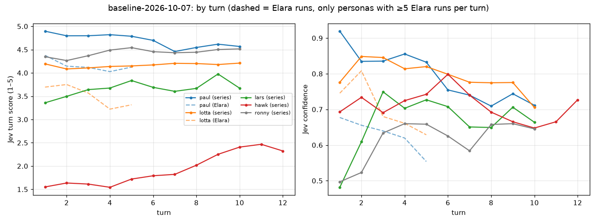

# Analysis: Jev baseline after the roll and Brenna rework (2026-10-07)

**Question:** The [plan](plan-jev-baseline-and-ab.md) called for a new Jev reference after the roll, Brenna and prose rework (ex-tales-forge #56–#66), in the same shape as the [first analysis](analysis-jev-scores-2026-10-07.md), compared with the 44 Elara runs. What do the scores show now, where are they still low and why, and how fast do characters grow?

**Short answer:** The series **completed: 65 of 65 runs, 13 per persona, no failed runs and no failed AI calls**, for **$6.03**. The rework fixed what the first analysis found. Checks drop from 80% of turns to 6%, failures from 57% to 3%, and NPC brush-offs from 45% to 3%. "Eyes narrow" now shows up in 17% of runs instead of 89%, and 98% of runs have a hook by turn 2 (39% before). For the two personas we can actually compare, Paul and Lotta, scores rose by about **+0.6** on the like-for-like turns 1–5 (persona-balanced +0.63, 95% CI +0.53…+0.73). Four new problems remain.

1. **Paul and Lotta are now at Jev's ceiling.** Lotta's most likely level is 4 ("Immersed") on 130 of 130 turns, and her session SD is 0.07. Paul's is level 5 on 124 of 130. Jev can no longer see an improvement for either of them, so they are useless as A/B signals in their current form.
2. **Hawk almost never meets danger.** His turn mean is 1.93. Only 4 of 13 runs reach a turn scoring ≥ 3, and never before turn 8. The session score splits cleanly: **2.54 without a fight roll (n=10) vs 4.61 with one (n=3)**. Brenna's "lend a hand" hooks have him hauling kegs and carrying trays: 62% of his runs contain chores, and his lowest turn (1.05) is one of them.
3. **Leaving the inn breaks.** In 62% of runs the player tries to leave. After 38 of 65 such attempts, the GM is still describing the inn or Brenna on the next turn. In Paul's two weakest runs, the GM walks him to the Market Square and then answers his speech to Osric *as Brenna, back at the bar*. Neither run registered a scene change.
4. **Prose and generosity overcorrected.** The GM opens 22% of turns by repeating the player's own line word for word (Lotta: 52%; Elara runs: 5%). Brenna hands something out "on the house" in 15% of turns and in 77% of runs (Elara: 3% of turns). That generosity is where Ronny's low confidence comes from.

**Growth is very slow.** 1.0 LP per run, 0.65 rolls per run, and only 34% of runs roll at all. Over 65 runs there were **0 improvement attempts and 0 improvements**. At this pace Paul needs about 43 runs to bring one skill to the first 5-LP threshold.

Chart: [score and confidence by turn per persona](images/jev-baseline-2026-10-07-by-turn.png) (below).

*Update 2026-10-08:* a confidence-aware reading of these scores (only the scores Jev is sure about count) is in [Update 2026-10-08: confidence-aware reading](#update-2026-10-08-confidence-aware-reading).

---

## Data and method

| | Runs | Turn scores | Personas (runs) | Window (CEST) |
|---|---|---|---|---|
| Series `baseline-2026-10-07` on Fly `tales-forge-playtest` | 65 | 676 | Paul, Lotta, Lars, Ronny 13 × 10 turns; Hawk 13 × 12 turns | 19:29–21:33 |
| Elara reference (same 44 runs as the first analysis: 18 playtest + 26 local) | 44 | 216 | Paul 29, Lotta 11, Hawk 2, Lars 1, Ronny 1 | 05:25–16:03 |

- **Driver:** `/workspace/baseline/drive.sh` ran round-robin (paul, hawk, lotta, lars, ronny) × 13 rounds through `TalesForge.Playtest.Series.start/2`, one run at a time. All 65 runs ended `finished/turn_limit`. There were no non-ok AI calls after 19:25 CEST. The only hiccup was a log-parsing stop at the very first start (19:29), which was restarted at once. No run was lost.
- **Run conditions** (all 65 identical; from `playtest_runs.git_sha` and `flags`, ex-tales-forge #55):
  - git SHA **`2a6589edcfcb2066731d951a7cd6c7fe45bdebd4`** (merge of #66; contains #55–#66);
  - Fly image `deployment-01M4BPBMT569YD7DHNWSN0TXNA`;
  - `variant=default`, `npc_reactions=on`, `world_agents=off`, `llm_provider=xai`, `gm_model` and `intent_model` = `grok-4.20-0309-non-reasoning`, Jev `jev-1.13.0`;
  - rubric hashes: Paul `dfec71a`, Lotta `4545d3b`, Lars `fc771be` (unchanged from the Elara runs), Hawk `129f728` and Ronny `e8f0786` (new in #57).
- **Characters:** persona-chosen (#60). Paul plays Corvin Ashdown (half-elf cleric), Lotta Hilde Stonebrook (dwarf druid), Lars Taren Swiftbrook (elf ranger), Hawk Brannoc Hale (human warrior) and Ronny Maxx Goldhand (human warrior). All runs are `tin_valley`.
- **Scoring:** as before, Jev makes one call per run. It sees the whole transcript and answers one session question plus one "turn N alone" question per turn, so **turn scores still have hindsight** and are not independent. The first scoring pass is used.
- **Scripts:** [`scripts/jev-compare/`](scripts/jev-compare/), with `export.exs` → `compare.py` → `baseline_extra.py`, plus `chart_by_turn.py`. Fixes made for this run are listed in the appendix. Features are regexes on the text (hook, brush-off, stock phrases, inn location, chores, "on the house"), so read the turns before quoting them; every example below was read.
- **Statistics:** session means with bootstrap 95% CIs over runs. Turns 1–5 are compared as **one mean per run** (not pooled turns). Spearman correlations: "within run" means turn score minus the run mean.
- Data on the box: `/workspace/baseline/final/` (`jev_export.json`, `runs.csv`, `turns.csv`, `report.md`, `extra.md`, `spend.txt`) and `/workspace/baseline/drive.log`. Nothing was written to any database.

---

## 1. Per persona

Session scores (one per run):

| Persona | Runs | Mean | 95% CI | SD | Min–max | Mean conf | Turn mean | Turn conf | Turns conf < 0.3 |
|---|---|---|---|---|---|---|---|---|---|
| Paul | 13 | **4.67** | 4.33…4.90 | 0.59 | 2.86–4.95 | 0.82 | 4.70 | 0.79 | 5 |
| Lotta | 13 | **4.40** | 4.36…4.44 | **0.07** | 4.27–4.52 | 0.64 | 4.16 | 0.79 | 0 |
| Lars | 13 | **4.04** | 3.84…4.24 | 0.39 | 3.15–4.59 | 0.72 | 3.66 | 0.66 | 3 |
| Hawk | 13 | **3.02** | 2.44…3.68 | **1.20** | 1.78–4.86 | 0.84 | 1.93 | 0.71 | 1 |
| Ronny* | 13 | 4.37 | 4.15…4.55 | 0.38 | 3.58–4.74 | 0.57 | 4.44 | 0.61 | **13** |

\* Ronny is the anti-persona (high = the game resisted his exploits). He is kept out of every delight average.

- **Ceiling.** Jev's most likely level for Lotta is level 4 on 130 of 130 turns (mean probabilities .00/.01/.03/.76/.21). For Paul it is level 5 on 124 of 130 turns, and his 11 "normal" runs sit at 4.72–4.95. Lotta never reaches "Transported" (5) and never drops below "Immersed" (4), whatever happens in the run. **A Lotta score now carries almost no information about the run.** Paul's spread comes entirely from two broken runs (§4).
- **Hawk is bimodal, not noisy.** 9 runs score 1.78–2.94 and 4 runs score 4.13–4.86. The high runs are the ones where a fight finally happens (§4).
- **The session score is not the mean of the turns any more:** Spearman 0.80 against the mean turn score, but +0.32 higher on average (Hawk 3.02 vs 1.93). For a 10–12-turn run, the session judgment weighs the climax more than the average turn. For Hawk that is the right reading: a late fight makes the session.
- **Runs per arm for a future A/B** (80% power, from these SDs): Lars and Ronny about 10 per arm for Δ0.5 (26 for Δ0.3); Paul 22 (61); Hawk 91 (251) because of the bimodality. For Lotta no number makes sense at SD 0.07.

## 2. By turn index



Mean turn score per persona (series):

| Turn | Paul | Lotta | Lars | Hawk | Ronny* | Within-run dev. (all) | Conf (all) |
|---|---|---|---|---|---|---|---|
| 1 | 4.89 | 4.19 | **3.36** | 1.55 | 4.35 | **−0.11** | 0.67 |
| 2 | 4.80 | 4.08 | 3.50 | 1.64 | 4.26 | −0.12 | 0.71 |
| 3 | 4.80 | 4.11 | 3.64 | 1.61 | 4.37 | −0.07 | 0.75 |
| 4 | 4.82 | 4.14 | 3.67 | 1.54 | 4.49 | −0.04 | 0.75 |
| 5 | 4.79 | 4.15 | 3.84 | 1.72 | 4.54 | +0.03 | 0.76 |
| 6 | 4.70 | 4.17 | 3.69 | 1.79 | 4.46 | −0.02 | 0.74 |
| 7 | **4.46** | 4.21 | 3.60 | 1.82 | 4.43 | −0.07 | 0.70 |
| 8 | 4.55 | 4.20 | 3.67 | 2.02 | 4.44 | −0.00 | 0.70 |
| 9 | 4.62 | 4.18 | 3.98 | 2.25 | 4.50 | +0.13 | 0.71 |
| 10 | 4.57 | 4.21 | 3.67 | 2.41 | 4.51 | +0.10 | 0.67 |
| 11 | | | | 2.47 | | | 0.67 |
| 12 | | | | 2.32 | | | 0.73 |

- **Turn 1 is now the weakest turn, not the strongest.** T1 minus the rest of the run is −0.12 (T1 lower in 36 of 65 runs), against +0.16 in the Elara runs. Lars starts at 3.36 and climbs to 3.84 by T5. His T1 is usually a polite order of ale and stew that the GM answers with a price and no lead (e.g. `6b007826` T1, 2.26, below). Hawk's T1–T4 sit at about 1.55 in every run.
- **Within-run trends** (Spearman of turn vs within-run score): Hawk +0.46, Lotta +0.34, Lars +0.29 and Ronny +0.24 rise; **Paul falls (−0.45)**. Paul's drop at T7 comes from the runs where he leaves the inn (§4). Even without his two snap-back runs, Paul drifts from 4.91 at T1 to 4.70 at T10.
- **Confidence no longer falls over turns 1–5** (0.67 → 0.76, against 0.68 → 0.56 for Elara). It does fall later for Paul (0.92 at T1 → 0.71 at T10) and Lotta (0.85 at T2 → 0.71) (within-run Spearman −0.35 and −0.44).

## 3. Correlations

Pooled turn-level correlations are now dominated by persona differences: Paul writes long and scores high, and Lotta and Hawk get the most echo. So the table shows **within-run** Spearman per persona (\* p < 0.05; turns are not independent, so the p-values are optimistic).

| Feature (within run) | Paul | Lotta | Lars | Hawk | Ronny* |
|---|---|---|---|---|---|
| Failed check | −0.12 | −0.12 | **−0.35\*** | +0.04 | 0.00 |
| GM still describing the inn/Brenna | +0.15 | +0.01 | **−0.18\*** | **−0.40\*** | −0.08 |
| Hook words (Osric, nest, job…) | −0.12 | **−0.25\*** | +0.12 | −0.05 | **−0.18\*** |
| GM repeats an 8-word run of the player's text | 0.00 | −0.09 | +0.16 | −0.02 | −0.10 |
| Stock phrases | −0.08 | −0.02 | −0.06 | −0.05 | −0.06 |
| GM length (words) | 0.00 | +0.14 | +0.03 | −0.02 | −0.14 |

- **Failures still hurt where they happen,** but they are now rare. Lars's −0.35 comes from failed tracking or combat narrated as a dead end (`5f05fd77` T7–T8). The roll value correlates −0.58 with the score (n=42 rolled turns). Mean score on a failure is 3.07 (n=23) vs 4.25 on a success (n=14), though failures are concentrated in Lars and Hawk.
- **Leaving the inn is what lifts Hawk and Lars.** Turns where the GM is still at the inn score lower within the run (Hawk −0.40, Lars −0.18).
- **The things that mattered for Elara no longer move the score:** GM length (Elara +0.24 within run), stock phrases, repetition and brush-off are all near zero now, because they mostly went away.
- **Echo** (the share of the player's words the GM reuses) is −0.33 pooled but ≈0 within runs: it is a persona confound. Lotta (0.71) and Hawk (0.54) get the most echo.
- **Score vs confidence:** +0.42 pooled (Elara +0.36). Within persona it is +1.00 for Paul and −0.76 for Lotta. At the ceiling, confidence just measures how peaked the vector is: Paul's peak is at level 5, Lotta's at level 4. GM latency shows no link (+0.06).

## 4. Low scores and low confidence: what actually happened

### The lowest 10 turns are all Hawk's (6 shown); the cause is "no danger", which is what his scale measures

| Run / turn | Score | Conf | What happened | Cause |
|---|---|---|---|---|
| 72d7292e T4 | **1.05** | 0.96 | "Brenna, point me toward those kegs now." She beams, leads him to the cellar. | Chore hook; no danger |
| 16bdb938 T12 | 1.10 | 0.92 | Takes the damp cloth Brenna offers and clears tables. | Chores in the last turn of a 12-turn run |
| 16bdb938 T11 | 1.11 | 0.92 | Asks quietly about "the work she mentioned". | Talk only |
| 496574e3 T12 | 1.25 | 0.77 | Back on the inn bench after the goblin fight, accepting a mug. | Post-fight wind-down (T10 was 4.73) |
| 889631fc T4 | 1.27 | 0.78 | Drains his ale, "speaks low across the bar". | Talk only |
| b110e474 T4 | 1.28 | 0.77 | "Mentioning the bread trays. Her eyes light up at once." | Chore hook |

- **Hawk's scale now measures "how much real danger", and the confidence is high (0.84 session).** The #57 rewrite worked: there are no more bimodal L1/L4 splits, and the re-scored Elara Hawk runs went from confidence 0/0.35 to 0.98/0.97. The low scores are an accurate reading of the game: **in 9 of 13 runs nothing threatens him in 12 turns.** The 4 runs with a turn ≥ 3 get there at T8, T9, T9 and T9.
- **Fight or no fight:** 3 runs with a combat roll average 4.61 (4.13–4.86). The 10 without one average 2.54. One of those 10 (`496574e3`, 4.78) did fight goblins at T9–T11, **without any dice roll**: the GM narrated a knife fight ("The blade bites deep into its forearm…") while the rules result says "No skill check required". A crude regex flags 29 of 50 fight-like turns across the series with no roll. That figure is unverified, but `496574e3` is a confirmed case of combat without mechanics.
- **The chore hook:** Brenna's "lend a hand with the rush" offers (#58) turn into kegs, trays and plates. Chores appear in 62% of Hawk runs and 46% of Lars runs. Chore turns score 1.58 vs 1.99 for Hawk (n=24) and 3.26 vs 3.71 for Lars (n=14).

### Lowest 10 non-Hawk turns

| Run / persona / turn | Score | Conf | What happened | Cause |
|---|---|---|---|---|
| 54c401ab Ronny T8 | 2.24 | 0.00 | "I'll take the job as is… for that ten silver each." Osric points him to the trail, clipped. | Not an exploit at all: a fair deal. Jev splits L1/L3–L4 (.50/.18/.18/.08) |
| 6b007826 Lars T1 | 2.26 | 0.72 | Polite ale-and-stew order. The GM **repeats his whole line verbatim**, then a price and stew. | **No hook on T1** + echo |
| 761713eb Paul T7 | 2.27 | 0.39 | Paul addresses Osric in the square. GM: "You step **back into the Valley Inn**… 'Back already, Corvin?'" and he "relays the message" to Brenna. | **Location snap-back** |
| 5f05fd77 Lars T7 | 2.35 | 0.60 | Heads for the goat track. Failed tracking: "the narrow switchback you seek blends into a tangle of scree". | Failure as a dead end (no fail-forward) |
| 5f05fd77 Lars T8 | 2.44 | 0.61 | Failed again: "no clear path reveals itself". On the ridge, "**Brenna's voice carries faintly from the inn door**". | Dead end + location continuity break |
| e588c587 Lars T7 | 2.46 | 0.47 | Melee failure against the wounded orc chieftain. | Failed check in the climax |
| d31b8373 Lars T3 | 2.48 | 0.61 | Weaving between tables with a stack of tankards. | Chore hook |
| d31b8373 Lars T2 | 2.55 | 0.54 | "Tell her you'll lend a hand with the plates tonight." | Chore hook |
| 6b007826 Lars T10 | 2.57 | 0.47 | Finishes bread and ale. Brenna: "The hills will still be there at dawn." | Run ends in the inn; adventure deferred |
| 54c401ab Ronny T2 | 2.58 | 0.00 | Demands free ale and bread. Brenna laughs **and slides the refilled mug over**. | Generosity read as a soft exploit (L1 .33) |

### All 22 turns with confidence < 0.3 (3.3% of 676; Elara 6 of 216)

- **Ronny, 13 turns in 5 runs** (`e367a9a0` ×6, `54c401ab` ×4, `e5127175`, `7c631b0c`, `677cc9d1`). These are the turns where Brenna laughs off his demands but **still refills the ale or gives the stew "on the house"**. Jev cannot decide whether that is "Unlocked" (L1) or "Held" (L4), and the vectors are bimodal (e.g. `e367a9a0` T2: .30/.11/.15/.28/.16). Ronny's turns that mention a freebie score 4.04 with confidence 0.39, against 4.48 and 0.64 for the rest (n=13).
- **The persona bot loops.** In `e367a9a0` Ronny raises the same demand every turn (100 → 200 → 500 → 1,000 → 5,000 → 10,000 silver "plus all the loot and another free round"). His turn-to-turn trigram repeat is 0.19 (other personas 0.01–0.03).
- **Paul, 5 turns in 2 runs** (`761713eb` T6, T9, T10 and `98018f52` T7, T8). Both are the **location snap-back**: the GM moves him to the Market Square, then answers his lines to Osric/Caldern as if he were still at Brenna's bar. Both runs logged only one scene call, so the move never became a scene change. These two are Paul's lowest sessions (2.86 / conf 0.34 and 4.09 / conf 0.25).
- **Lars, 3 turns** (`85f8d585` T1 and T8, `d31b8373` T1). These are low-key turns: ale on T1, going to bed on T8 ("First thing at dawn I'll go find Osric"). Jev splits L2/L4.
- **Hawk, 1 turn** (`b0ef6c0d` T12, the aftermath of a fight).

### Cause tally (top 10 Hawk + top 10 non-Hawk, read by hand; a turn can have several causes)

| Cause | Turns |
|---|---|
| No danger / no adventure yet (Hawk's scale; Lars's adventure deferred) | 10 |
| Chore hook (kegs, trays, plates, tables) | 5 |
| Location snap-back or continuity break after leaving the inn | 2 |
| Failed check narrated as a dead end | 3 |
| Ronny's rubric unsure whether a gift or a fair deal is an exploit | 2 |
| GM repeats the player's line verbatim | 1 (plus 22% of all turns, below) |
| No hook on turn 1 | 1 |
| NPC brush-off, Insight-on-small-talk, third-person POV | **0** (the first analysis's top causes are gone) |

### Recurring prose problems (all 676 turns)

- **Verbatim restating:** 22% of GM turns share an 8-word run with the player's input (Lotta 52%, Hawk 24%, Lars 17%, Ronny 14%, Paul 3%; Elara runs 5%). The new GM often opens by echoing the player's first-person line in second person, quoted dialogue included (`458a9fa3` T4 and T6). Paul is the exception: he writes in speech only, not "I do X". This does not show in Jev (within-run ≈0), but it is the first thing a human reader notices.
- **New stock phrases replaced the old ones:**
  - "in the market square" appears in 41 of 65 runs, "tilts her head toward" 36, "Osric Vane (over) in the…" 30–31, "orc nest off the cut" 31, "hands on her apron" 27, "leans on the counter" 26, "a fresh mug of ale" 25 and "stew's on the house" 24;
  - the old set is mostly gone: 0.18 stock phrases per turn vs 1.64.
- **Generosity:** something is "on the house" in 15% of turns and in 77% of runs (Paul 92% of runs). Brenna went from cold to giving things away.
- **Third-person POV:** 0.3% of turns, after excluding dialogue where an NPC says the character's name. Effectively fixed.

## 5. Rolls, outcomes, brush-off and hooks

| | Series (676 turns) | Elara (216 turns) |
|---|---|---|
| Turns with a check | **6.2%** | 80.1% |
| Insight share of turns | 0% | 71.8% |
| Failed checks (share of turns) | **3.4%** | 56.5% |
| NPC brush-off phrasing | **3.1%** | 44.9% |
| Hook by turn 2 (share of runs) | **98.5%** | 38.6% |
| Runs with "eyes narrow" | 16.9% | 88.6% |

Per persona:

| Persona | Check rate | Outcomes (fail / partial / success) | Fail rate | Brush-off | Hook by T2 |
|---|---|---|---|---|---|
| Paul | 1.5% | 1 / 0 / 1 | 0.8% | 0.8% | 100% |
| Lotta | 2.3% | 3 / 0 / 0 | 2.3% | 1.5% | 100% |
| Lars | 16.9% | 11 / 2 / 9 | 8.5% | 3.8% | 92% |
| Hawk | 5.8% | 7 / 2 / 0 | 4.5% | 1.9% | 100% |
| Ronny* | 4.6% | 1 / 1 / 4 | 0.8% | 7.7% | 100% |

- **Rolls now follow the persona's actions:** Lars (tracking, ranged and melee) rolls most, and Paul and Lotta almost never. Skills rolled: melee, tracking, ranged, climbing, stealth and persuasion. Insight was not rolled once.
- **Ronny's brush-off rate (7.7%) is the intended "in-story no"**, not a defect.
- The hook regex matches concrete leads: Osric, the nest, the drovers, Caldern, the shaft or the steward in turns 1–2. Lars's 92% is the exception: some T1s are just ale and stew (`6b007826`).

## 6. Skill growth (LP, from `playtest_runs.growth`, ex-tales-forge #66)

| Persona | LP per run | SD | Rolls per run | Runs with any roll | Top skill LP per run | Runs with a skill ≥ 5 LP | Improvement attempts | Improvements | Runs to 5 LP in the top skill at this pace |
|---|---|---|---|---|---|---|---|---|---|
| Lars | 2.19 | 2.44 | 1.69 | 10/13 | 2.00 | 2 | 0 | 0 | 2.5 |
| Ronny* | 1.23 | 3.75 | 0.46 | 2/13 | 1.23 | 1 (13.5 LP melee, one run) | 0 | 0 | 4.1 |
| Hawk | 1.08 | 1.71 | 0.69 | 5/13 | 0.85 | 0 | 0 | 0 | 5.9 |
| Lotta | 0.38 | 0.77 | 0.23 | 3/13 | 0.38 | 0 | 0 | 0 | 13 |
| Paul | 0.12 | 0.30 | 0.15 | 2/13 | 0.12 | 0 | 0 | 0 | 43 |
| **All** | **1.00** (CI 0.53…1.59) | | **0.65** | **34%** | | **3 of 65** | **0** | **0** | |

- **That is about 0.10 LP per turn, against about 0.8 LP per turn in the Elara runs** (old rules: Paul 4.0 LP in 5 turns). The rework's "fewer rolls" is the cause, as the plan's caveat predicted.
- **Why no improvements at all:** an attempt needs the tier's LP (5 at Novice), at least one failure in that skill since the last attempt, *and* a rest or wait of ≥ 1 hour, or training (`TurnProcessor.maybe_attempt_improvements/3`, `Mechanics.attempt_improvements/2`). Only 3 runs brought a skill to 5 LP, and none of them then rested long enough to trigger an attempt. At least one run went to bed (`85f8d585` T8), but it had no eligible skill.
- LP by skill over all 65 runs: melee combat 35, ranged combat 13.5, tracking 12, climbing 2, stealth 1.5 and persuasion 1.
- **What this means:** a social persona (Paul, Lotta) will essentially never see an improvement in a 10-turn session, and an action persona needs 3–6 sessions for one skill. Whether that is too slow is a design question, but with today's numbers it is invisible to players.

## 7. Cost

| Series, 65 runs (676 turns) | Game | Persona bot | Jev (scorer) | Total |
|---|---|---|---|---|
| **Total** | **$4.38** (GM $3.84, scene $0.51, npc_reaction $0.03) | **$1.64** | **$0.014** | **$6.03** |
| Per run (mean) | $0.067 | $0.025 | $0.0002 | **$0.093** |
| Per run, Hawk (12 turns) | $0.087 | $0.029 | $0.0003 | $0.117 |
| Per run, the others (10 turns) | $0.060–0.065 | $0.023–0.026 | $0.0002 | $0.085–0.089 |

- **The export totals match the database exactly.** Grouping `ai_calls` from 19:25 CEST by purpose gives game $4.3825 and persona $1.6360. The scorer shows $0.0149 there against $0.0143 for the series: 4 extra scorer calls in the window, about $0.0006, which are not series runs. Every series call has a game session, and none failed.
- The total sits at the low end of the plan's estimate ($6–8.5). Game cost is $0.0065 per turn. Jev is 0.2% of the total.
- **The playtest day so far** (Stockholm day, at 21:36 CEST, including the earlier Elara-era runs): game $5.33, persona $1.80, scorer $0.017, **$7.14 of the $25 cap**. Nothing was capped. The cap was left unchanged.
- The Elara cohort's cost per run is not comparable: the 26 local runs logged little or no cost.

## 8. Versus the Elara runs

Session scores and like-for-like turns 1–5 (one mean per run; CIs bootstrap runs):

| Persona | n series / Elara | Session series vs Elara | Δ session (95% CI) | Turns 1–5 series vs Elara | Δ T1–5 (95% CI) | Usable? |
|---|---|---|---|---|---|---|
| **Paul** | 13 / 29 | 4.67 vs 4.18 | **+0.49** (+0.11…+0.78) | 4.82 vs 4.16 | **+0.66** (+0.58…+0.74) | yes |
| **Lotta** | 13 / 11 | 4.40 vs 3.63 | **+0.78** (+0.55…+1.01) | 4.13 vs 3.54 | **+0.60** (+0.42…+0.77) | yes |
| Paul + Lotta, persona-balanced | 26 / 40 | | **+0.63** (+0.41…+0.82) | | **+0.63** (+0.53…+0.73) | yes |
| Lars | 13 / **1** | 4.04 vs 3.70 | +0.34 (no CI) | 3.60 vs 3.50 | +0.10 (no CI) | **no: n=1** |
| Hawk | 13 / **2** | 3.02 vs 2.28 (old rubric); vs 1.98/2.04 re-scored | +0.74; +1.0 vs re-scored | 1.61 vs 2.14 (old rubric) | −0.52 | **no: n=2, rubric changed** |
| Ronny* | 13 / **1** | 4.37 vs 4.14 (old rubric); vs 4.69 re-scored | +0.23; −0.32 vs re-scored | 4.40 vs 3.84 (old rubric) | +0.56 | **no: n=1, rubric changed** |
| All but Ronny, pooled | 52 / 43 | 4.04 vs 3.94 | +0.09 (−0.21…+0.39) | 3.54 vs 3.89 | −0.35 (−0.72…+0.01) | **no: confounded** |

- **Paul and Lotta are clearly better** on the same five-turn window, with intervals well clear of zero. Lotta's turn 1–5 profile no longer sags (Elara: 3.69 → 3.22 by T4; series: flat at 4.1). Her old low points ("there is no way to help", brush-offs) are gone.
- **The pooled row is misleading.** Hawk is 25% of the series but 5% of the Elara runs, and his scale is now a danger scale, so the pooled "all but Ronny" mean goes *down* while every comparable persona goes up. Use the persona-balanced row.
- **This is not the rework's effect alone.** The comparison also changes the character (persona-chosen vs Elara), the run length (10–12 vs about 5 turns), NPC_REACTIONS (always on now; mostly off before), the builds and the day. Only an A/B on one deploy (`variant: "baseline"`, see the plan) isolates the rework.
- **Too small to compare:** Lars (1 Elara run), Ronny (1), Hawk (2). Hawk and Ronny also changed rubric. Against the Elara transcripts re-scored with today's rubric, Hawk is up (3.02 vs about 2.0, but only because of the 4 runs with a late fight) and Ronny is slightly down (4.37 vs 4.69, n=1). That is consistent with Brenna's new generosity, but it rests on one run.

## 9. Limitations

- **Hindsight in turn scores.** Jev still scores every turn with the whole transcript in view, so the turn scores within a run are not independent, and late events (a T9 fight) can colour earlier turns. All turn-level p-values are optimistic.
- **Ceiling effects.** Paul and Lotta sit on one level (5 and 4 respectively), so their means hide real differences between runs. Their SDs understate the variance a player would feel. Their improvement over Elara is real in direction, but its size is capped by the scale.
- **The persona bot is the player.** Its habits shape the runs: Lotta's first-person "I do X" lines invite verbatim echo, Ronny loops on one demand, and Paul speaks in long speeches. The personas pick the same characters every run (one build per persona), so character and persona effects are confounded.
- **The Elara comparison is confounded and partly tiny.** See §8: character, run length, flags, builds, rubric (Hawk, Ronny), and n = 1–2 for three personas.
- **Regex features.** Hook, brush-off, stock phrases, inn location, chores, "on the house" and fight-without-roll are heuristics. The examples above were read by hand, but the rates are approximate. For example, "inn" also matches a GM line that merely mentions the inn.
- **One module, one deploy, one evening.** Everything is `tin_valley` on SHA `2a6589e`, between 19:29 and 21:33 CEST. Nothing here generalises to other modules or to later model versions.
- **No human calibration yet.** Jev's levels have not been checked against a human rater (recommendation 13 of the first analysis is still open).

## 10. Recommendations

1. **Make scene changes real.** When the player leaves the inn and the GM narrates arrival somewhere else, update the location and the present NPCs (a new scene). Today, 38 of 65 leave attempts are followed by an inn turn, and Paul's two worst runs answer Osric as Brenna. This is the biggest single fix for Paul, Lars and Hawk.
2. **Put danger inside Hawk's 12 turns, and roll for it.** Start Hawk closer to the cut, or let "lend a hand" lead to the nest rather than to kegs. When the GM narrates a fight, the rules engine must roll (`496574e3` fought goblins with no check). Hawk only scores above 4 when a fight happens.
3. **Drop chores as the default hook for action personas.** Offer the Osric/nest lead first; chores are fine for Lotta.
4. **Stop restating the player's line** (22% of turns; Lotta 52%). Answer the action instead of re-narrating it. Rotate the new stock phrases ("tilts her head toward", "hands on her apron", "on the house").
5. **Rein in Brenna's generosity.** "On the house" in 77% of runs is the new "eyes narrow". Give freebies for a reason, not by default. It is also what confuses Ronny's rubric.
6. **Lift the Jev ceiling for Paul and Lotta.** Either sharpen levels 4–5 (what separates "Immersed" from "Transported"?) or add a harder second question per persona. Otherwise no future A/B can move them.
7. **Growth:** decide whether 1 LP per run and zero improvements in 65 runs is intended. Options: more LP per roll, a lower first threshold, or an end-of-session rest that triggers attempts. At least log `attempts` with the reason none was made.
8. **Ronny:** add "a gift the NPC chooses to give is not an exploit unless he extracted it unfairly" to his question. Also stop the persona bot from repeating one demand (raise its temperature, or give it a "change tactic after a no" rule).
9. **Measurement:**
   - score turns without hindsight (state cut at turn N);
   - for an A/B, use Lars and Ronny (about 10 runs per arm for Δ0.5) and Hawk only with many runs (bimodal);
   - run the planned `variant: "baseline"` arm on this same deploy to separate the rework from the character and run-length changes.

## Update 2026-10-08: confidence-aware reading

**Summary.** Jev gives every score a confidence (0–1). From today we count only the scores Jev is sure about (confidence ≥ 0.7) in the headline, and report the share it is unsure about separately ([decision](decisions.md#2026-10-08-jev-scores-are-read-as-a-score-by-confidence-matrix-not-a-plain-average)). Read that way, this baseline tells the same story with one correction. Paul and Lotta are still at the top: Jev is sure on 83% and 92% of their turns, and every sure turn is high. Hawk is still low: almost half his turns are confidently low ("no danger"), and Jev is unsure on the other half. **Outside Hawk, problems show up as uncertainty, not as low scores:** only 1 of 520 non-Hawk turns is confidently low. Ronny's and Lars's plain averages were pulled down by turns Jev wasn't sure about (Ronny 4.44 → 4.80, Lars 3.66 → 3.92 on the sure turns). Jev is unsure on 58% of Ronny's turns (Brenna's freebies) and 55% of Lars's (quiet ale-and-stew, chore and bedtime turns). That share, not the average, is the signal to watch for them.

**Method.** Existing scores only: no new runs and no Jev calls. These are the stored first-pass scores this analysis used, so Paul and Lotta are on the rubric of that day (before #69's stricter top). Their stricter re-score is read in the [post-rework analysis](analysis-jev-post-rework-2026-10-08.md#update-2026-10-08-confidence-aware-reading).

- **High** = score ≥ 3.5 (nearest level 4 or 5: the persona's "works" levels). **Low** = score ≤ 2.5 (nearest level 1 or 2: "broken"). In between is level 3 ("Mixed"; Hawk's "Closing in"), reported as confident-middle. These are the midpoints between levels, since the score is Jev's expected level.
- **Confident** = confidence ≥ the cutoff: 0.7 for the headline, with 0.6 and 0.8 as a sensitivity check. **Unsure** = below the cutoff, which is the low-confidence share.
- **Headline** = mean of the confident turns, pooled over the persona's runs. ⚠ marks a cell with fewer than 20 confident turns or 3 runs with one (turns), or fewer than 3 confident sessions.
- Script: [`scripts/jev-confidence/`](scripts/jev-confidence/) (`confidence_matrix.py`; full output in `results-2026-10-08.md`).

**Turns** (cutoff 0.7 for the matrix columns; shares are of all turns):

| Persona | Turns | Plain mean | Headline ≥ 0.6 | **Headline ≥ 0.7** | Headline ≥ 0.8 | Confident-high | Confident-low | Confident-middle | Unsure (< 0.7) |
|---|---|---|---|---|---|---|---|---|---|
| Paul | 130 | 4.70 | 4.80 (n=118) | **4.82** (n=108) | 4.85 (n=86) | 108 (83%) | 0 | 0 | 22 (17%) |
| Lotta | 130 | 4.16 | 4.16 (n=129) | **4.15** (n=120) | 4.11 (n=70) | 120 (92%) | 0 | 0 | 10 (8%) |
| Lars | 130 | 3.66 | 3.80 (n=85) | **3.92** (n=59) | 3.97 (n=33) | 56 (43%) | 1 (1%) | 2 (2%) | 71 (55%) |
| Ronny\* | 130 | 4.44 | 4.75 (n=72) | **4.80** (n=54) | 4.85 (n=35) | 54 (42%) | 0 | 0 | 76 (58%) |
| Hawk | 156 | 1.93 | 1.85 (n=136) | **1.85** (n=78) | 1.91 (n=37) | 2 (1%) | 73 (47%) | 3 (2%) | 78 (50%) |

Low-confidence share of turns at each cutoff:

| Persona | < 0.6 | **< 0.7** | < 0.8 | Confidence exactly 0 |
|---|---|---|---|---|
| Paul | 9% | **17%** | 34% | 1 |
| Lotta | 1% | **8%** | 46% | 0 |
| Lars | 35% | **55%** | 75% | 0 |
| Ronny\* | 45% | **58%** | 73% | 6 |
| Hawk | 13% | **50%** | 76% | 0 |

**Sessions** (one per run):

| Persona | Sessions | Plain mean | Headline ≥ 0.6 | **Headline ≥ 0.7** | Headline ≥ 0.8 | Unsure (< 0.7) | Confident-high / low / middle |
|---|---|---|---|---|---|---|---|
| Paul | 13 | 4.67 | 4.89 (n=11) | **4.89** (n=11) | 4.91 (n=10) | 2 | 11 / 0 / 0 |
| Lotta | 13 | 4.40 | 4.40 (n=11) | 4.28 (n=2) ⚠ | — (n=0) ⚠ | **11** | 2 / 0 / 0 |
| Lars | 13 | 4.04 | 4.00 (n=12) | **3.95** (n=7) | 4.10 (n=3) | 6 | 6 / 0 / 1 |
| Ronny\* | 13 | 4.37 | 4.69 (n=5) | **4.71** (n=4) | — (n=0) ⚠ | **9** | 4 / 0 / 0 |
| Hawk | 13 | 3.02 | 3.02 (n=13) | **3.05** (n=12) | 3.04 (n=9) | 1 | 4 / 6 / 2 |

\* Ronny is the anti-persona: high = the game resisted his exploits (works), low = it let him (broken).

What the matrix shows:

- **Paul's broken runs are unsure, not low.** 13 of his 22 unsure turns are in the two snap-back runs (`761713eb` 7, `98018f52` 6, §4). Leaving them out lifts his headline from 4.70 to 4.82. A run that goes wrong for Paul makes Jev split between levels rather than score low.
- **Ronny's low turns are Jev being split.** His six turns at confidence 0 include the four where Jev leaned to level 1 ("Unlocked") but spread the rest over 3–5, so the score landed at 2.24–2.91 (`54c401ab` T2, T8, T9 and `e367a9a0` T2, §4). Those are not verdicts. 9 of his 13 sessions are unsure.
- **Hawk is the only persona with confident "broken" turns** (73 of 156). His unsure turns are a split between level 1 (no danger) and 2 (foreshadowed), so they are low too (mean 2.00): unsure about how low, not about whether it works.
- **Lotta's confidence sits just above 0.7.** It passes 0.7 on 92% of her turns but 0.8 on only 54%: Jev is sure she is at level 4, and only roughly so. At session level only 2 of 13 sessions reach 0.7, too few to give a headline at that cutoff.
- **The cutoff matters little for the turn headlines here:** they move by at most 0.17 between 0.6 and 0.8 (Lars 3.80–3.97), and the order of the personas never changes. At 0.8, Lotta's and Ronny's sessions have none left.
- The deltas against the post-rework series under this reading are in the [post-rework analysis](analysis-jev-post-rework-2026-10-08.md#update-2026-10-08-confidence-aware-reading). The Elara runs are not re-read here.

Reproduce: `python3 docs/scripts/jev-confidence/confidence_matrix.py /workspace/baseline/final /workspace/compare/final > results.md` (see the script's [README](scripts/jev-confidence/README.md)).

## Appendix: reproducing

```bash
# 1. export (read-only) on the playtest machine
./put.sh docs/scripts/jev-compare/export.exs /tmp/export.exs            # base64 copy via flyctl machine exec
flyctl machine exec 801e9ef6136178 -a tales-forge-playtest "/app/bin/ex_tales_forge rpc 'Code.eval_file(\"/tmp/export.exs\")'"
flyctl ssh sftp get /tmp/jev_export.json final/jev_export.json -a tales-forge-playtest
# 2. analysis (raw_local.json = the 26 local Elara runs from the first analysis)
python3 compare.py /workspace/jev-analysis/raw_local.json final/jev_export.json --out final/report.md --csv final
python3 baseline_extra.py final final/jev_export.json > final/extra.md
python3 chart_by_turn.py final images/jev-baseline-2026-10-07-by-turn.png
```

Script changes in this commit (`docs/scripts/jev-compare/`):
- `export.exs`: exports `playtest_runs.growth` (#66).
- `compare.py`:
  - Jev cost = the scorer only (`npc_reaction` stays in game cost);
  - LP, rolls and improvements per run and per turn;
  - per-persona by-turn table, dice outcomes and score by outcome;
  - growth-log section and re-scored reference runs;
  - **third-person detection ignores quoted dialogue** (an NPC saying the character's name is not a POV slip; this changes the Elara figure from 4.6% to 4.2% of turns);
  - **turns 1–5 compared as one mean per run** with a bootstrap CI and Mann-Whitney over runs (it used to pool turns as if independent), with a `ref_small` flag for fewer than 5 Elara runs;
  - lowest 10 non-Hawk turns per cohort.
- `baseline_extra.py` (new):
  - per-persona CIs;
  - Hawk and Ronny against the re-scored Elara runs;
  - inn location and leave attempts (column names fixed);
  - repetition, turn trends and runs per arm (with a ceiling guard);
  - recurring GM 4-grams, LP growth and Hawk fight vs no fight;
  - cost totals, run conditions and the persona-balanced Elara comparison.
- `chart_by_turn.py` (new): the chart above.
