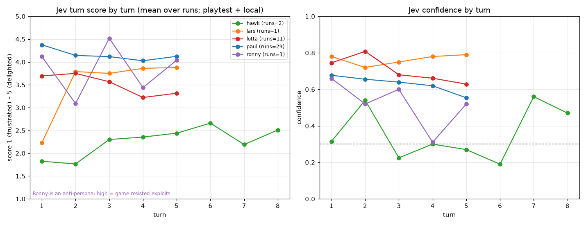
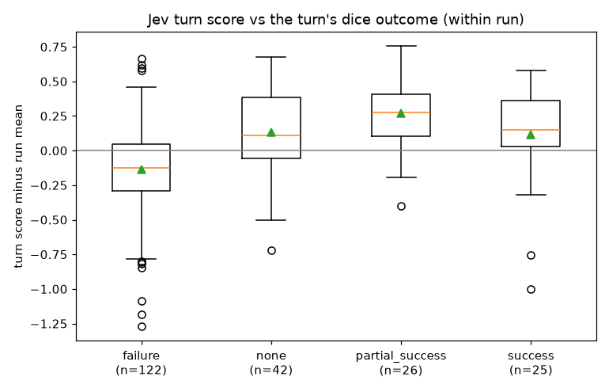

# Analysis: Jev persona-affect scores from the playtests (2026-10-07)

**Question (Fredrik):** What can we say about the Jev scores from the player tests? Are there correlations or trends? Can we find out why and where scores or confidence are low?

**Short answer:** We have little data: 44 scored runs, almost all Paul or Lotta, and all on the same opening in the inn. Even so, three things stand out.

1. **Failed dice rolls drive the low scores.** The rules engine rolls an **Insight** check on 72% of turns (155 of 216), even for ordering ale. At skill 3 that check fails 73% of the time. The GM then narrates the failure as the NPC getting colder ("your attempt to read her has only made her more watchful"). Within a run, a failed check costs about **−0.35** on the turn score. 9 of the 10 lowest non-Hawk turns are failed checks.
2. **The NPCs brush the player off.** Brenna (and Marta in the crossroads module) are "eyes narrow / voice flat / clearly done" in most low turns. Lotta suffers most: 8 of the 10 lowest non-Hawk turns are hers.
3. **Hawk's ~0 confidence is real ambiguity, made worse by how his levels are worded.** It is not a broken input. A quiet inn with ominous rumours but no actual danger fits his "bored and safe" level and his "engaged, foreshadowed" level about equally, so Jev splits the probability between level 1 and level 4.

Between runs on the **same build**, scores vary by roughly ±0.5. So today's build-to-build and flag-to-flag differences are **within noise**. None of them is shown yet, NPC_REACTIONS included.

Charts: [score and confidence by turn](images/jev-2026-10-07-score-by-turn.png) and [score by dice outcome](images/jev-2026-10-07-score-by-outcome.png) (below).

---

## Data and method

| Source | Scored runs | Turn scores | Personas (runs) | Window (CEST) |
|---|---|---|---|---|
| Fly `tales-forge-playtest` (DB `tales-forge-playtest-db`) | 18 | 93 (+8 duplicate rescoring rows) | Paul 12, Lotta 2, Hawk 2, Lars 1, Ronny 1 | 05:50–16:03 |
| Bobby's local runs on the box (`tf_npc_dev`, `tf_proto_dev`, `tf_paul_cmp`, `ex_tales_forge_dev`; read-only) | 26 | 123 | Paul 17, Lotta 9 | 05:25–15:31 |
| **Total** | **44** | **216** | Paul 29, Lotta 11, Hawk 2, Lars 1, Ronny 1 | |

- Two more playtest runs from 2026-10-06 have no Jev score (they predate Jev) and are excluded.
- All runs are `tin_valley` except one Hawk run on `crossroads_ledger` (8 turns). Every other run is 5 turns (a few are shorter, see below).
- Jev (`jev-1.13.0`) gets **one call per run**. The state is the opening plus every turn's player action and GM narration. The questions are one session-affect question and one "turn N alone" question per turn, each with five persona-specific levels (`TalesForge.Playtest.AffectLevels`). This means **the turn scores within a run are not independent**: each "turn N alone" judgment can see the later turns too.
- Features per turn: dice outcome and skill (from `turns.mechanical_resolution`), GM latency, tokens and cache (from `ai_calls` purpose `gm`), word counts, how much of the player's text the GM echoes back, how much the GM repeats earlier GM text in the same session (trigram overlap), and a small "cold NPC" phrase lexicon (eyes narrow, voice flat, guarded, wary, clearly done, dismissal, keep your questions…). Flags come from the run notes. Playtest runs with `npc_reaction` calls count as NPC_REACTIONS=on.
- Statistics: Spearman rank correlations. "Within run" means the turn score minus that run's mean, which removes differences between runs and personas. The headline effects are checked with an OLS model with run fixed effects, turn-index dummies and run-clustered errors (n=213 turns, turns 1–5).
- **Small samples:** Lars and Ronny have n=1 run each and Hawk n=2. Treat anything about them as anecdote.
- Data on the shared box: `/workspace/jev-analysis/` (`runs.csv`, `turns.csv` with full text, `turns_primary_features.csv`, `ai_calls.csv`, the scripts and the raw JSON exports). Nothing was written to any database.

### Scorer data-quality notes

- **The scorer gives the same answer twice.** The Hawk `crossroads_ledger` run (`0a18850a`, started from admin) was scored twice. Over 8 turns plus the session the two passes differ by a mean |Δscore| of 0.06 and a mean |Δconfidence| of 0.03. So the spread between runs comes from the games, not from Jev noise. (Scoring the same run twice is itself a small bug worth checking.)
- **Three local Lotta runs were scored before their last turn was saved** (`7e8cfbf6`, `58f3a6ab`, `c4e78d0b`, 11:26–11:29 CEST). They have 4, 4 and 3 turn scores. That matches the stale `turn_completed` race fixed in #41 (12:11). Two of the three are the "NPC_REACTIONS=on" Lotta runs (see the flags section).
- The session score is essentially the mean of the turn scores: Spearman 0.91 against the mean turn score, mean difference +0.05 (n=44). It adds little information beyond the turn scores.

---

## 1. Per persona

Session scores (one per run, first scoring pass):

| Persona | Source | n runs | Mean | SD | Min–max | Mean conf |
|---|---|---|---|---|---|---|
| Paul | playtest | 12 | 4.23 | 0.50 | 3.42–4.73 | 0.61 |
| Paul | local | 17 | 4.15 | 0.27 | 3.71–4.71 | 0.52 |
| Lotta | playtest | 2 | 3.04 | 0.09 | 2.97–3.10 | 0.60 |
| Lotta | local | 9 | 3.76 | 0.30 | 3.39–4.18 | 0.68 |
| Hawk | playtest | 2 | 2.28 | 0.12 | 2.20–2.37 | 0.18 |
| Lars | playtest | 1 | 3.70 | – | – | 0.68 |
| Ronny* | playtest | 1 | 4.14 | – | – | 0.64 |

Turn scores:

| Persona | n turns | Mean | SD | Mean conf | conf < 0.3 | Mean SD within a run |
|---|---|---|---|---|---|---|
| Paul (both) | 142 | 4.15 | 0.40 | 0.63 | 1 | 0.28 (playtest) / 0.40 (local) |
| Lotta (both) | 51 | 3.53 | 0.50 | 0.71 | 0 | 0.53 / 0.40 |
| Hawk | 13 | 2.21 | 0.42 | 0.35 | 5 | 0.44 |
| Lars | 5 | 3.50 | 0.71 | 0.76 | 0 | 0.71 |
| Ronny* | 5 | 3.84 | 0.57 | 0.52 | 0 | 0.57 |

\* **Ronny is an anti-persona.** His levels run from "Unlocked — the game let him" (1) to "Sealed — the world stayed fair" (5), so **high = the game resisted him**. His 4.52 on T3 is the turn where Brenna **refused** the loot bribe ("Gold buys ale and a warning, not my secrets"). His 3.09 on T2 is the turn where she took the gold coin and handed over the Willem lead. So "Ronny scored high when bribing for loot" really means the bribe failed. The question text still says "how frustrated (low) to delighted (high) would Ronny feel", which contradicts his inverted levels (see recommendations).

### Trend over the day / app version (Paul on playtest, n=12)

| Time (CEST) | Run | Release / change | NPC_REACTIONS | Session | Conf |
|---|---|---|---|---|---|
| 05:50 | 01037054 | v19, Jev smoke | off | 3.60 | 0.51 |
| 07:58 | 80f03e82 | v20, after #32–35 | off | 4.62 | 0.69 |
| 08:40 | 0785a4d6 | v21, after #36 cache fix | off | 3.67 | 0.44 |
| 09:14 | 232b0b2c | v22, after #37 cache fix | off | 4.66 | 0.73 |
| 09:47 | 34e8c5f4 | v22 | off | 3.80 | 0.54 |
| 09:48 | fc294b8a | v22 | off | 4.73 | 0.77 |
| 09:49 | 91ac8a3b | v22 | off | 4.68 | 0.75 |
| 11:11 | 504760e0 | v23, after #39 | off | 3.99 | 0.62 |
| 12:50 | f1a2102f | v27, after #41+#42 | on | 3.42 | 0.27 |
| 15:04 | 914c69f0 | v32, after #47 | on | 4.55 | 0.63 |
| 15:20 | 2fe1c1ef | v33, after #48 | on | 4.71 | 0.77 |
| 15:58 | 8f129b16 | v36, after #50/#51 | on | 4.28 | 0.63 |

- **There is no real trend over the day.** Spearman of time vs session score is +0.21 (p=0.51, n=12). For turn scores it is +0.18 (p=0.16, n=60).
- **The same build ranges from 3.80 to 4.73.** v22 had 4 runs: mean 4.47, SD 0.45. Any single before/after pair of runs today could show ±0.9 from chance alone.
- The `build` field holds the Fly image ID, not the git SHA. Releases were mapped by time, and the change notes come from the run's free-text `notes`.

## 2. By turn index

| Turn | n | Mean score | Within-run deviation | Mean conf |
|---|---|---|---|---|
| 1 | 44 | 4.04 | **+0.15** | 0.68 |
| 2 | 44 | 3.91 | +0.02 | 0.69 |
| 3 | 43 | 3.89 | +0.01 | 0.63 |
| 4 | 42 | 3.74 | **−0.15** | 0.61 |
| 5 | 40 | 3.87 | −0.03 | 0.56 |

- **Turn 1 does not score lower in general. It usually scores *higher*.** The paired comparison of T1 against the rest of the run gives +0.16 (median +0.29). T1 was lower in only 12 of 44 runs (Wilcoxon p=0.003). The opening/arrival lands well for Paul and Lotta.
- **Scores drift down slightly over turns 1–5.** Within runs, Spearman is −0.22 (p=0.001). In the fixed-effects model T4 and T5 are about −0.25 against T1. The dip is mainly Lotta's (3.69 → 3.22 by T4, n=11 runs) and comes when Brenna turns guarded.
- **The exceptions are anecdotes:** Lars T1 = 2.23 (no hook, n=1 run), then about 3.8 after the GM gave him something to chase. Hawk's T1–T2 are his lowest turns (n=2 runs).
- **Confidence falls over the turns:** 0.68 → 0.56, within-run Spearman −0.39 (p<0.001). The last turn of a run has 0.08 lower confidence than the rest (n=41 runs, p<0.001). This fits the "whole transcript as state" design: later turns are judged against a longer and more mixed story.

## 3. Correlations

Turn level, n≈214. "Within run" = turn score minus run mean.

| Factor | vs score | vs score within run | vs conf | Comment |
|---|---|---|---|---|
| **Failed dice check** (122/215 turns) | −0.25*** | **−0.45*** ** | −0.16* | FE model: **−0.35** per failed turn (p<0.001) |
| Dice roll value (d20, high = worse) | −0.30*** | −0.37*** | −0.17* | same signal |
| GM length (words) | +0.24*** | +0.24*** | 0.01 | FE: +0.37 per 100 words (p=0.004) |
| Cold-NPC phrases | −0.23*** | −0.28*** | −0.10 | FE: −0.05 per phrase (p=0.09); failure and coldness overlap (87% of failed turns have cold phrasing vs 56% of successes) |
| Warm-NPC phrases | +0.09 | +0.20** | +0.17* | FE: +0.12 (p=0.07) |
| GM repeating its own earlier text | −0.17* | −0.30*** | −0.26*** | goes away once turn index and failure are controlled (FE p=0.48); repetition grows with turn number |
| GM echoing the player's words | −0.30*** | +0.07 | −0.07 | between runs only; run level −0.53 (n=44), but Paul gets far less echo (0.23) than the other personas (~0.41), so this is mostly a persona confound |
| Player input length | +0.17* | −0.08 | −0.09 | between runs only (Paul writes longer) |
| GM latency | −0.03 | +0.06 | −0.01 | **none** |
| GM output tokens | −0.08 | +0.10 | +0.06 | none |
| GM cache hit ratio | −0.02 | −0.09 | −0.11 (within −0.15*) | none for score; the weak confidence link follows turn index (cache grows with turn) |
| Score vs confidence | +0.36*** | | | low scores are also less certain |

\* p<0.05, ** p<0.01, *** p<0.001. Turns within a run are not independent, so treat the p-values as optimistic, except for the clustered FE results.

**Dice outcome, mean turn score:** Paul 4.02 on failure (n=90) vs 4.44 on success (n=15) and 4.47 on partial success (n=15). Lotta 3.16 on failure (n=21) vs 3.80–3.86 on success or partial (n=16).

**Why so many failures:** `ActionHandler` maps `observe/interact/other/freeform` without an explicit skill to `skill: "insight"`, and `Mechanics.infer_skill_from_action/1` also falls back to `"insight"`. With the pregen's Insight 3 on a d20 roll-under (success ≤3, partial ≤6), ordinary roleplay ("A tankard of your finest ale…") fails about 70% of the time. In our data: 113 of 155 Insight checks failed, and 57% of all turns are failures (62% on playtest).

**Flags (session scores):**

| Persona | Condition | n runs | Mean | SD |
|---|---|---|---|---|
| Paul local | all off (schema) | 5 | 4.01 | 0.25 |
| Paul local | all off (prose GM) | 4 (+1 nostream 4.19) | 4.14 | 0.21 |
| Paul local | WORLD_AGENTS on | 5 | 4.24 | 0.26 |
| Paul local | NPC_REACTIONS on (inferred from `npc_reaction` calls; `tf_paul_cmp` before/after runs) | 2 | 4.28 | 0.60 |
| Paul playtest | NPC_REACTIONS off / on | 8 / 4 | 4.22 / 4.24 | 0.50 / 0.57 |
| Lotta local | all off | 2 | 3.52 | 0.07 |
| Lotta local | WORLD_AGENTS on | 5 | 3.71 | 0.29 |
| Lotta local | NPC_REACTIONS on | 2 | 4.12 | 0.08 |
| Lotta playtest | off / on | 1 / 1 | 2.97 / 3.10 | – |

- **Paul shows no difference between flags** (Mann-Whitney p=0.40 for NPC_REACTIONS, 0.49 for WORLD_AGENTS).
- **Lotta's local "NPC_REACTIONS raised her from ~3.5 to ~4.1" is not established.** It rests on 2 vs 2 runs, and both "on" runs were scored on truncated transcripts (4 and 3 turns), which drops her weak late turns. Comparing only turns 1–3, on = 3.79 and off = 3.64 (2 runs each, 6 turns each). The direction is plausible but the effect is not shown. On playtest it is 3.10 vs 2.97 (n=1 each).
- **Prose GM:** 4.14 vs 4.01 for schema (n=4 vs 5). Confidence was lower with prose (0.46 vs 0.57). No conclusion either way.
- **Adventure, scene and NPC present:** all `tin_valley` runs have the innkeeper Brenna present the whole time and never leave the inn in 5 turns. The single `crossroads_ledger` run (Hawk, Marta) cannot be separated from the persona. Intent type is not logged per turn beyond the dice skill (`turn.intent` in `ai_calls` is a timing row only). **Nothing can be said yet about adventure, scene or NPC.**
- **Confidence vs text length:** none. Confidence vs GM words 0.01, vs player words −0.09, session confidence vs Jev input tokens −0.16 (p=0.30, n=43). Confidence depends on **persona** (Hawk 0.35, Ronny 0.52, Paul 0.63, Lotta 0.71, Lars 0.76) and on **turn index** (above).

## 4. Low scores and low confidence: what actually happened

### Lowest 10 turns overall (8 of 10 are Hawk)

| Run / persona / turn | Score | Conf | Dice | What happened | Cause |
|---|---|---|---|---|---|
| 682fdd9e Hawk T2 | 1.43 | 0.64 | none | Pays 2 copper, asks for the fire. Brenna: "Restless is one word for it… weight of local troubles lingers unspoken." | No threat or challenge at all (Hawk wants danger) |
| 682fdd9e Hawk T1 | 1.60 | 0.50 | Insight 20 fail | "Quiet enough… She does not smile." | No threat; cold NPC |
| 0a18850a Hawk T5 | 1.97 | 0.52 | Insight 20 fail | Goes up to bed. "Don't go wandering the hall." GM narrates in 3rd person ("Elara sets the empty bowl…") | No threat; brush-off; POV slip |
| 0a18850a Hawk T1 | 2.05 | 0.13 | partial | "Rooms are two silver a night, meal another three." | No threat; low conf (see §5) |
| 0a18850a Hawk T4 | 2.08 | 0.60 | Insight 16 fail | GM repeats the player's line word for word: "Understood. Just making conversation after the road." | Echo; nothing happens |
| 0a18850a Hawk T2 | 2.10 | 0.44 | Insight 7 fail | "Stew's four copper, room another **eight silver**". T1 said two silver and three for the meal. | **Price contradiction**; brush-off |
| 682fdd9e Hawk T3 | 2.19 | 0.01 | Persuasion 16 fail | "Brenna slides the mug across the scarred oak…" (the mug was already served in T2). "That's all I'll say about it." | **Repetition** (re-serves the mug); brush-off; foreshadowing without threat |
| 0a18850a Hawk T7 | 2.19 | 0.56 | Insight 13 fail | Checks the loose floorboard: "reveals nothing… The moment stretches, empty of answers." | Failed check = dead end |
| f5c98df8 Lars T1 | 2.23 | 0.78 | Insight 16 fail | Asks what's got everyone jumpy. "Road's been restless, that's all… your attempt to read her has only made her more watchful." | **No hook**; failed default Insight turned into NPC suspicion |
| 0a18850a Hawk T3 | 2.41 | 0.44 | Insight 19 fail | Tips her, asks about the slate. "Don't go poking at what ain't yours." | Brush-off |

### Lowest 10 non-Hawk turns (8 Lotta, 1 Lars, 1 Paul; 9 of 10 failed checks)

| Run / persona / turn | Score | Dice | Snippet | Cause |
|---|---|---|---|---|
| f5c98df8 Lars T1 | 2.23 | Insight fail | "Best keep your questions light if you're new here." | No hook + failed check |
| 20c48675 Lotta T3 | 2.56 | Insight fail | "That's a fool's hope in these parts… offering no hidden path or quiet ally." | **NPC brush-off**; persona goal (help, be someone better) shut down |
| 20c48675 Lotta T4 | 2.60 | none | "The only quiet way to help these days is to keep your head down… No item changes hands. Brenna is not merchandise…" | Brush-off; **system text leaking into the prose** ("Brenna is not merchandise") |
| 3d2fe901 Lotta T5 | 2.63 | Insight fail | Eats in silence; "your very stillness has made the shadows heavier." | Nothing for her to do; cold room |
| 3202ed67 Lotta T4 (local) | 2.68 | Persuasion fail | "If you're fixing to be the fourth, keep your questions to yourself." | Brush-off |
| cbfaf19c Lotta T5 (local) | 2.73 | Insight fail | GM restates her whole line, then: "Words are cheap on the road." | **Echo** + brush-off |
| 7e8cfbf6 Lotta T4 (local) | 2.74 | Insight fail | "You'd bring trouble right back here, girl, and I won't have my inn marked for it." | Brush-off; her plan rejected |
| c4e78d0b Lotta T1 (local) | 2.74 | Insight fail | Polite request for ale and a corner → "No one offers you the corner you hoped for." | Failed Insight on a polite order → cold NPC |
| 51b6c76e Paul T4 (local) | 2.74 | Insight fail | "Elara's gaze drifts across the hearth… the blackened kettle just a kettle." Then a deflection. | Failed check narrated as a non-event; 3rd-person POV slip |
| 3d2fe901 Lotta T4 | 2.75 | Insight fail | GM restates "I'm not here for any Guild trouble…" word for word, then "Fresh starts are cheap words around here." | **Echo** + brush-off (NPC_REACTIONS=on run) |

### All turns with confidence < 0.3 (n=6 of 216)

| Run / persona / turn | Score | Conf | Probabilities L1…L5 | What happened |
|---|---|---|---|---|
| 682fdd9e Hawk T3 | 2.19 | 0.01 | .40 .25 .12 .23 .00 | First ominous lore ("Guild men poking at the old hill… strangers wearing more steel than sense") |
| 682fdd9e Hawk T4 | 2.63 | 0.00 | .29 .23 .09 .36 .03 | "Folk who go up that hill don't come back the same, or don't come back at all." |
| 682fdd9e Hawk T5 | 2.91 | 0.02 | .20 .21 .10 .45 .04 | "Muttering about 'the hollow king' under the stones." |
| 0a18850a Hawk T1 | 2.05 | 0.13 | .39 .30 .19 .12 .00 | Arrival; prices; Marta wary, "the reason her ledger has gone missing" |
| 0a18850a Hawk T6 | 2.66 | 0.19 | .16 .36 .15 .33 .00 | Upstairs room: "the ghost of a scent… something metallic and sharp" |
| d91611e5 Paul T5 (local) | 3.48 | 0.27 | .05 .13 .29 .35 .18 | Paul apologises; Brenna clipped but gives free stew. Mixed warmth/coldness on the last turn |

Five of the six are Hawk, and in every Hawk case the turn contains **foreshadowing without danger**. The probability mass splits between L1 ("Bored and safe — the threat never felt real") and L4 ("Engaged — hard but fair; foreshadowing gave him a real chance"). Session-level confidence 0.27 also occurred once for Paul on playtest (`f1a2102f`, 12:50, score 3.42).

### Cause tally (top 10 overall plus top 10 non-Hawk, 19 unique turns; a turn can have several causes)

| Cause | Turns |
|---|---|
| Failed dice check (mostly the default Insight) narrated as suspicion or a dead end | 16 |
| NPC brush-off ("eyes narrow / flat / clearly done") | 15 |
| Persona goal not served by the scene (Hawk: no danger; Lotta: no way to help) | 11+ (9 Hawk, 2–3 Lotta) |
| GM echoes the player's line back | 3 |
| GM repetition (re-serving the mug, "slides … across the scarred oak") | 1 directly; stock phrases are everywhere (below) |
| No hook | 1 (Lars T1) |
| Price/rules contradiction | 1 (Hawk crossroads T2) |
| 3rd-person "Elara …" narration instead of "you" | 2 |
| Text too short for Jev | 0. Low scores are not short texts (confidence is unrelated to length) |

**Stock phrases** (all 216 turns): "eyes narrow" appears in 77 turns (39 of 44 runs), "scarred oak/wood/bar/counter" in 74 (34 runs), "two copper(s)" in 65, "fire crackles/pops" in 55, "the hearth crackles/pops" in 44, "wind moans/rattles" in 27, "slides the mug/tankard" in 12. On their own these phrases do not lower Jev scores (turns with "scarred …" are +0.11 within run). They mainly hurt **variety and believability**, which Jev measures poorly. Third-person "Elara …" narration: n=8 turns in 7 runs, −0.50 within run. That is a weak signal given the small n.

## 5. Hawk's ~0 confidence: an input problem or real ambiguity?

**Mostly real ambiguity, made worse by how his levels are written. It is not an input or format problem.**

- **Same input format, same day.** Lars (06:32) and Lotta (06:31) used exactly the same state format and the same `tin_valley` opening, and got confidence 0.68–0.79. Hawk's input is the same shape and length: the 5-turn Hawk run sent about 2,400 Jev input tokens, against about 2,600 typical for the others.
- **Not random noise.** Rescoring the same Hawk transcript reproduced the same low-confidence turns (T1 0.13/0.21, T6 0.19/0.20).
- **The probabilities are bimodal, not flat.** For example, 682fdd9e T4 = .29 / .23 / .09 / .36 / .03. Jev is torn between two *non-adjacent* levels, and that collapses its confidence to ~0.
- **The cause is in the level text.** Hawk's five levels mix two questions: *is there danger at all?* (L1 "bored and safe") and *was the danger fair and foreshadowed?* (L2 "arrived late or unfairly", L4 "foreshadowing gave him a real chance"). A tavern scene with rumours of disappearances and "the hollow king" but no threat fits L1 (nothing to fight) and L4 (good foreshadowing) at the same time. Low confidence appears exactly on the foreshadowing turns.
- **There is also a scenario mismatch.** In 5 turns (and even in 8 on crossroads), Hawk never leaves the inn and never meets danger. His score of about 2.2 is a fair reading of "nothing asked him to fight". His low confidence is about how the rubric handles *promised* danger.

## 6. Recommendations

### Game / GM

1. **Stop rolling Insight on ordinary talk (biggest single lever).** In `ActionHandler`, `observe/interact/other/freeform` should get **no check** unless there is real uncertainty and stakes. Default social actions to `persuasion`/`etiquette` with a sensible difficulty, or skip the roll. Today about 57% of turns are failures, and each costs about −0.35. Also **fail forward**: a failed read should mean "you learn nothing extra", not "she becomes more watchful". The GM prompt currently turns failure into NPC coldness (87% of failed turns have cold phrasing).
2. **Give the innkeeper an arc and guarantee a hook by turn 2.** Brenna/Marta should warm up to polite, paying or helpful players, which NPC_REACTIONS is meant to feed. Each of the first two turns should offer one concrete lead (a job, a name, a place), especially for Lars and Lotta. Lotta's lowest turns are all "there is no way to help".
3. **Prose hygiene in the GM prompt.** Don't restate the player's dialogue word for word. Don't re-serve items already served. Rotate stock phrases ("eyes narrow", "scarred oak", "hearth crackles", "two coppers"). Keep second person ("you", not "Elara …"). Never leak system text ("Brenna is not merchandise"). Keep GM replies at full length: longer replies score slightly higher (+0.37 per 100 words within a run).
4. **Price consistency outside Tin Valley.** Crossroads T1 → T2 went from "two silver a night, meal another three" to "stew four copper, room eight silver". Make sure the code-side prices from #42 cover `crossroads_ledger`.
5. **Give Hawk danger within the run.** Either start Hawk runs closer to a threat or run him for 10–12 turns. Five turns in the inn tells us nothing about hard mode.

### Persona definitions / Jev levels

6. **Hawk:** rewrite the levels on one axis, for example "How much real, fair, foreshadowed danger did Hawk face?", with L1 = "no danger yet — only talk/rumours" and foreshadowing placed explicitly at L2–L3. Alternatively, add a separate yes/no question "Was there any actual threat?" and only ask the fairness scale when the answer is yes.
7. **Ronny:** change the question to match his inverted levels ("How firmly did the game resist Ronny's exploits?"). Today the question says "frustrated (low) → delighted (high) would Ronny feel" while L1 = he got his way. Keep Ronny out of any averaged "player delight" number.
8. **Lotta / Lars:** the levels look fine. Their lows are real game problems (brush-off, no hook).

### Scorer / measurement

9. **Run more games per arm.** The SD between runs on the same build is about 0.45–0.5. To detect a 0.5 difference at 80% power you need about **13 runs per arm**; for 0.3 you need about **36**. Run A/B tests in interleaved batches of at least 10 runs per persona and arm, and report mean ± 95% CI. Single before/after runs (as in today's PR checks) cannot show an effect.
10. **Score turns without hindsight.** Today each "turn N alone" question sees the whole transcript. Score turn N with the state cut off after turn N (one Jev call per turn, which is cheap: ~$0.0001 per call). Then check whether the drop in confidence over turns goes away.
11. **Record conditions as structured fields on `playtest_runs`:** git SHA (`build` is a Fly image ID), NPC_REACTIONS, WORLD_AGENTS, GM_REPLY_MODE, rubric hash. Per turn, also store the intent `action_type` and the NPC reaction (stance/emotion); today only the final `npc_moods` survives.
12. **Treat confidence < 0.3 as "unscored"** in dashboards and averages, and show the probability vector when it is bimodal.
13. **Calibrate:** have Fredrik (or two people) blind-rate about 20 turns, mixing low, high and low-confidence ones, against the same levels, and compare with Jev. Re-score a fixed set of 10 transcripts whenever `AffectLevels` changes (the rubric hash changes), so score shifts from rubric edits are not mistaken for game changes.
14. **Housekeeping:** find out why `0a18850a` was scored twice. Keep the #41 stale-turn fix covered by a test (3 of today's local runs were scored on truncated transcripts).
15. **Longer runs:** 8–12 turns per run. Five turns do not get past the inn in any run we have.

## Appendix: reproducing

- Playtest export: an Ecto query through `/app/bin/ex_tales_forge rpc` on machine `801e9ef6136178` (base64-encoded `Code.eval_string`, read-only), written to `/tmp` on the machine and pulled with `flyctl ssh sftp get`. Local export: read-only `psql` (`default_transaction_read_only=on`).
- Scripts: `/workspace/jev-analysis/{export.exs,export_local.py,build.py,analyze.py}`. Charts were made with matplotlib.
