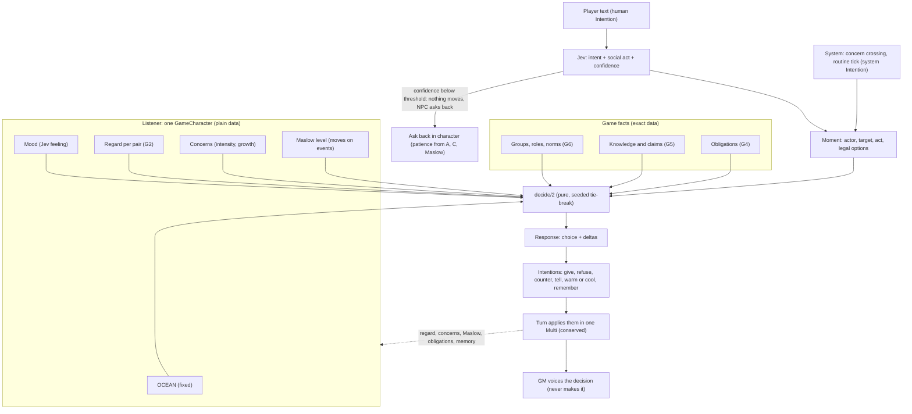

# Analysis: social situations vs OCEAN, Maslow and concerns

- Owner: Fredrik Pahlén. Written by Grok Bot, 2026-10-18.
- Read against `main` `8aa43fd` (after #478).
- Question: which social situations can NPC behaviour **not** handle well with the three levers: OCEAN, the Maslow level and concerns?
- Yardsticks: [goal: a living town](goal-living-town.md) (1,000 GameCharacters, a 100-hour session) and [principles](principles.md) (ETC, pure core, effects at the edges).
- This document has no player data, no metrics and no research results of its own. Every claim about the code points at a file.

## Summary

**Short answer.** The three levers describe the character **herself**: who she is (OCEAN), what she needs now (Maslow) and what she wants (concerns). Most social situations turn on **the other person**: what I think of you, what you owe me, what I know about you, and which group we both belong to. The levers can weigh those things, but they cannot hold them. Also, the code has no typed reading of **what a line does socially** (an insult, a gift, a threat, an apology). Today every line spoken to an NPC warms her by the same +0.05.

So the fix is mostly **not** new personality levers. It is one new input (the social act), one existing map made real (regard per pair), one pure decision function over the levers, and three stores of game facts (obligations, knowledge, groups). The groups store is already designed.

**Top 5 gaps, ranked by impact on play:**

1. **No typed social act.** Code cannot tell an insult from a compliment, a threat from a joke, or an apology from a request. `Actions.NPC.OnPlayerTalked` gives `{:warm, 0.05}` for every line, also for an insult. Every other fix below needs this input. Smallest fix: one Jev Choice question in the existing intent call.
2. **Regard is one number, toward the player only, and it only goes up.** `characters.relationships` is a map per other character, but only the player's entry is written, and only by `+0.05`. Trust, grudges, apology, forgiveness, betrayal and NPC-to-NPC relations all need a signed score per pair that decays. This extends existing data. It is not a new lever.
3. **No arbitration between concerns.** "Earn money" against "give the poor man a free mug" has no rule that decides. `Offer.accepts?/1` checks only stock and purse. The concern intensity and growth card is not built. Smallest fix: one pure `decide/2` that scores the options against the concerns, weighted by OCEAN, Maslow and regard, with a seeded tie-break.
4. **No obligations ledger.** Debts, favours, rewards, promises, gifts and bribes live only in the prose or in compressed memory gists that can be wrong. Example from the 2026-10-18 playtest: at T3 the player promised "a silver" for the lost mule, and at T1 Brenna offered "the plate's on me" for help; no data holds either one. [Principles](principles.md) say debts and deals are exact game facts. This is new data, of the same kind as coins.
5. **No knowledge per character.** Nobody can be lied to, and nothing spreads. Worse, the premise check tells present NPCs which claims are false (`NpcReactions.state/3`, "these claims are not true"), so every NPC sees through every lie. Lying, bluffing, gossip, secrets and reputation all need "who knows (or believes) what". This is the one genuinely new concept, and the costliest at town scale.

Next in line: **groups, roles and norms** (designed in [world agents](design-world-agents.md#character-levers-design-not-built), not built). They are needed for crowds, law, family, loyalty conflicts and foreigners.

**One precondition.** Two of the three levers barely move at runtime today. Maslow is set at seeding and never changes. Concerns are one `current_concern` whose priority rises by 1 every 4 waited ticks (`NPC.maybe_escalate_concern/2`). The planned concern card (intensity, growth, decay) and the designed Maslow events come first, or the gap designs have nothing to weigh.

## What exists today: built vs design only

| Thing | Built (on `main`) | Only in a design | Where |
|---|---|---|---|
| OCEAN | 5 × 0–10 on every character; read by the Jev reaction, `Combat.counter_chance/1`, memory interests, `Catalogue.refuses_trade?/1` | Faction `temperament` | `schemas/character/ocean.ex`, `game/npc_reactions.ex`, `game/combat.ex` |
| Maslow level | Stored (`maslow_level`, `maslow_since_tick`); read only by `counter_chance/1` | Typed events drop it at once; calm turns raise it; a "needs: safety" line for Jev and the GM | `game/combat.ex:211`, [world agents](design-world-agents.md#character-levers-design-not-built) |
| Concerns | Embedded list (0–3: text, focus, priority, status, `blocked_by`). The runtime uses one `current_concern`: priority +1 per 4 waited ticks, one speak-up | Intensity, growth rate, decay when addressed; a PC's crossing becomes a GM hint ([refactor plan](plan-tf-refactor-2026-10-17.md), noted item 7) | `schemas/character/concern.ex`, `npc.ex:216–626`, `npc_initiative.ex` |
| Mood | `runtime["reaction"]` from one Jev call per present NPC (at most 4): emotion, intensity, stance toward the player, confidence. A separate `mood` string ("troubled") | Mood fade | `game/npc_reactions.ex` |
| Regard | `relationships` map, one entry (the player). `+0.05` per line spoken to the NPC. Read by `refuses_trade?/1` | `relationships` keyed by any other slug ([character plan](plan-unify-character.md)) | `actions/npc/on_player_talked.ex`, `npc/person.ex` |
| Memory | `character_memories` tiers (working, short, long), interests from OCEAN, Jev compression with a feeling and a belief (`ally`, `threat`, `dishonest`, `owes_me`, `i_owe`, …), fade. `CHARACTER_MEMORY` is shadow on playtest, off on production | Rumour and news spread | `characters/memory.ex`, `characters/compression.ex` |
| Trades | `%Offer{}`, `Trade.execute/1` (both accept, conserved), Bargain (a persuasion roll, `JEV_CATALOGUE_V2`) | The NPC's money concern in `accepts?`; NPC coins that change | [trade offers](design-trade-offers.md), `game/trade.ex`, `game/bargain.ex` |
| Gift refusal | `Catalogue.refuses_gift?/1` exists | Nothing calls it | `game/catalogue.ex:89` |
| Factions | Fronts with clocks, resources, memories, a `mark_debt` move, public facts | Faction agents, memory of actors, disposition, members | `game/fronts/moves.ex`, [world agents](design-world-agents.md#living-world-design-to-try) |
| Groups (Tuckman) | Nothing | `groups`, `group_members`, phase on the group | [world agents](design-world-agents.md), [decisions 2026-10-07](decisions.md) |
| Unclear intent | Jev act/ask decision; a templated question in the UI (`IntentClarification`) | The NPC asks back in character, with patience from A, C and Maslow | `game/intent_clarification.ex` |
| Intentions | `{:feel, mood}`, `{:wait, _}`, `:speak_up`, `{:remember, _}`, `{:warm, _}` | Social responses (refuse, give, demand, warn, tell) | `intention.ex`, `game/turn/intentions.ex` |

Three facts from this table shape the whole analysis:

- **The NPC "decision" today is mostly a feeling.** The Jev reaction gives a mood and a stance. Deterministic code decides only trade acceptance, trade refusal and fighting back. Fredrik's rule (decisions in code, the GM only voices them) has very little decision code to stand on yet.
- **The reaction reads OCEAN and mood only.** It does not see the Maslow level, the concerns, the regard or any memory. Two of the three levers do not reach the moment of reaction.
- **Regard has the right shape but the wrong data.** The map can hold any pair. Only one pair is written, with one sign.

## Situations

Legend: **handled** = the levers plus what exists give believable, varied, deterministic behaviour. **Partial** = some of it works, or it works only in the prose. **Gap** = a missing concept.

### Trade and haggling

| # | Situation | State | Why | Lever fix |
|---|---|---|---|---|
| 1 | Buy at the list price | handled | `Offer` + `Trade.execute/1`: stock, purse, both accept, conserved | none |
| 2 | Haggle over a price | partial | A persuasion roll moves the price 10–20 %. The trader's personality, money concern and need do not set how far she gives | G3: the floor comes from the money concern's intensity, A, Maslow and regard |
| 3 | Trader refuses a customer she dislikes | partial | `refuses_trade?/1` reads regard, but regard only goes up | G2 |
| 4 | Trader who can't afford to buy | partial | NPC coins don't change yet (refactor plan, noted item 1) | Built by that card; then G3 |
| 5 | Repeat customer gets a better price | gap | No regard from honest deals; no memory link to price | G2 (a completed trade is a positive act), G3 |

### Gifts and charity

| # | Situation | State | Why | Lever fix |
|---|---|---|---|---|
| 6 | A poor man asks for a free mug | gap | Money concern vs kindness: no arbitration rule. A gift is not a trade (two things exchanged) | G3; G4 makes the gift a trade of mug for gratitude owed |
| 7 | The player gives the NPC a gift | gap | Prose only (playtest T24: Maude's pouch and poultices never reached the sheet). `refuses_gift?/1` has no caller | G1 (act: gift), G4 (gratitude owed), G2 |
| 8 | Bribe a guard | gap | Needs a duty (role), witnesses (knowledge) and a debt | G4, G5, G6 |

### Debt and favours

| # | Situation | State | Why | Lever fix |
|---|---|---|---|---|
| 9 | NPC lends coin; the player owes it | gap | No obligation data. A memory belief `i_owe` / `owes_me` can be wrong by design | G4 |
| 10 | A favour for a favour ("help tonight and the plate's on me", playtest T1) | gap | The offer lives only in the prose | G4: an open offer whose price is work |
| 11 | A promised reward (the silver for the mule, playtest T3) | gap | Nobody holds the promise; nobody can claim it | G4 |
| 12 | A promise kept or broken days later | partial | Extracted promises exist behind `WORLD_AGENTS` (off). No due tick, no keeper | G4 (status, due tick), G2 (kept +, broken −) |

### Lying and deception

| # | Situation | State | Why | Lever fix |
|---|---|---|---|---|
| 13 | The player lies to an NPC | gap | The premise check tells present NPCs which claims are false, so no NPC is ever fooled | G5: a claim is believed or not, from a contest and the NPC's knowledge |
| 14 | An NPC hides a flaw in her goods | gap | No NPC-held secret with a motive; the GM can invent one, which breaks "the server decides" | G5 (private facts), G3 (the money concern gives the motive) |
| 15 | A bluff in a haggle ("the smith sells it cheaper") | gap | Claims are not data | G5 |

### Trust and reputation

| # | Situation | State | Why | Lever fix |
|---|---|---|---|---|
| 16 | Trust grows over many honest deals | partial | +0.05 per line, whatever the line says | G1, G2 |
| 17 | Reputation arrives before the player | gap | Nothing spreads between characters | G5 (reputation = regard heard about) |

### Gossip and spreading information

| # | Situation | State | Why | Lever fix |
|---|---|---|---|---|
| 18 | An NPC passes on a rumour when motivated | gap | Designed (world agents: rumour), not built | G5, with concerns and regard as the motive |
| 19 | A secret told in confidence, then spread | gap | Memory has a `secret` flag but no "told to whom" | G5 |

### Group dynamics

| # | Situation | State | Why | Lever fix |
|---|---|---|---|---|
| 20 | The tavern crowd reacts to a brawl | partial | Each present NPC reacts alone, at most 4. No crowd mood, no "others are watching" | G6 (the place as a group), G5 (witnesses) |
| 21 | A faction member defends the faction | partial | Fronts have memory, but persons are not linked to them | G6 |
| 22 | Harm to a child angers the parent | gap | No kinship | G6 (family group), G2 |

### Authority and law

| # | Situation | State | Why | Lever fix |
|---|---|---|---|---|
| 23 | A guard arrests a thief | gap | A duty concern feeds only `counter_chance/1`. No role, no law, no witness | G6 (role and norms), G5 |
| 24 | A commoner defers to a noble | partial | `standing` is a derivation input only; behaviour never reads it | G6: standing as a role in the town group |

### Threats and intimidation

| # | Situation | State | Why | Lever fix |
|---|---|---|---|---|
| 25 | The player threatens a shopkeeper | partial | Fighting back is code (`counter_chance/1` reads OCEAN, Maslow, concerns, wounds). Giving in, fleeing or calling help is not. Maslow does not drop to safety (designed only) | G1 (act: threat), G7 (Maslow event), G3 (comply / refuse / flee / call help) |
| 26 | An NPC remembers who threatened her | partial | Memory may keep it (shadow); regard does not move | G2 |

### Flattery and persuasion

| # | Situation | State | Why | Lever fix |
|---|---|---|---|---|
| 27 | Flattery | partial | The Jev reaction may warm. Esteem need and E are not linked to it in code | G1, G3 (esteem need weighs flattery) |
| 28 | Persuade an NPC against her concern | partial | A roll; the difficulty does not come from the concern | G3: difficulty from concern intensity and regard |

### Romance

| # | Situation | State | Why | Lever fix |
|---|---|---|---|---|
| 29 | Courtship over days | gap | Needs regard per pair and memory; attraction itself can be a concern (the `love` focus label exists) | G2 + a concern that points at a person. No new lever |

### Grief

| # | Situation | State | Why | Lever fix |
|---|---|---|---|---|
| 30 | An NPC loses a friend | gap | Nobody knows who is whose friend | G2 (NPC-to-NPC regard), G7 (Maslow to belonging), mood |

### Humour and insults

| # | Situation | State | Why | Lever fix |
|---|---|---|---|---|
| 31 | An insult | gap | The reaction may go irritated, but regard goes **up** by 0.05 | G1, G2 |
| 32 | A joke or banter | partial | The reaction has `amused`. Code cannot tell banter from an insult | G1; E and A set how a borderline line lands |

### Social norms and etiquette

| # | Situation | State | Why | Lever fix |
|---|---|---|---|---|
| 33 | Breaking house rules (steel drawn in the inn, leaving without paying) | gap | No norms | G6 (norms on the place's group) |
| 34 | A foreigner or another race | gap | Race gives OCEAN offsets only; no in-group / out-group | G6 (membership), G2 (a start regard from group distance) |

### Misunderstanding

| # | Situation | State | Why | Lever fix |
|---|---|---|---|---|
| 35 | Unclear player intent | partial | Nothing moves and a templated question shows. The NPC does not ask back in character, and patience from A, C and Maslow is not built | Existing levers suffice (see G3, patience) |
| 36 | An NPC misremembers | partial | By design, beliefs can be wrong (compression). But the GM also invents facts (playtest T35–T37) | Keep exact facts in data (G4, G5); memory stays the interpretation |

### Apology and forgiveness

| # | Situation | State | Why | Lever fix |
|---|---|---|---|---|
| 37 | An apology after an insult | gap | Regard has no minus, so there is nothing to forgive | G1, G2 (decay toward the start, faster with high A) |

### Loyalty conflicts and betrayal

| # | Situation | State | Why | Lever fix |
|---|---|---|---|---|
| 38 | Asked to betray an employer or a friend | gap | No regard toward third parties; no group | G2, G6, G3 (the options score against both) |
| 39 | The player breaks a deal | gap | No obligation to break | G4 → a broken event → G2, G5 (others hear of it) |

### Long-term memory and NPC-to-NPC

| # | Situation | State | Why | Lever fix |
|---|---|---|---|---|
| 40 | An NPC remembers the player's act after 50 game hours | partial | Memory tiers and fade exist (shadow). Regard and debts do not carry the exact part | G2, G4 |
| 41 | Two NPCs feud or trade | gap | Only the player's regard is written; offers between NPCs are out of scope | G2 (any pair), later offers between any two GameCharacters |

### Children and dependants

| # | Situation | State | Why | Lever fix |
|---|---|---|---|---|
| 42 | A mother puts her child's hunger first | partial | Maslow is the character's own need only | A concern that points at the dependant ("feed my daughter", high intensity). No new lever |

**Count:** 1 handled, 17 partial, 24 gap. The one handled situation is the one with a pure decision function and exact data behind it.

## Gap designs

Each design follows the same pattern: typed data in, a pure function, typed data out as Intentions, applied by the turn, voiced by the GM. Nothing here adds an LLM call per off-screen character.

### G1. The social act (an input, not a lever)

**Missing concept:** what a line does to its listener.

**Built from existing data?** The input already exists: the player's words reach Jev in the intent call. Only the question is new.

**Smallest design:**
- Add one Choice question to the existing Jev intent call: `social_act`, with fixed labels: `none`, `request`, `offer`, `gift`, `thanks`, `compliment`, `flattery`, `joke`, `insult`, `threat`, `apology`, `promise`, `claim`, `refusal`. Each label has a one-line description, as Jev needs.
- Confidence gates it, like every other Jev read. Below the threshold, the act is `none`, and nothing social moves.
- An NPC's act comes from code, not Jev: it is already typed (her Intention).
- `OnPlayerTalked` stops giving a flat `+0.05`. It gives the act to G2.

**Pure core:** `%SocialAct{actor, target, label, confidence}` is data on the turn. No new process.

**Living-town cost:** zero extra calls. One more question in a call that runs anyway, only for the human's turn.

### G2. Regard per pair (extends `relationships`)

**Missing concept:** what this character thinks of that one, with a sign, and how it changes.

**Built from existing data?** Yes. `characters.relationships` is already `other_slug → score`. This makes it real.

**Smallest design:**
- One score per pair, −1.0 to +1.0, plus `since_tick`. Keyed by any GameCharacter slug, also NPC to NPC.
- `Regard.apply(score, act, listener) :: score` is a pure table: act label → base delta. OCEAN scales it. High A softens a minus; high N makes a minus larger; high E makes a joke land better.
- `Regard.decay(score, elapsed, ocean)`: the score drifts toward its start value. High A forgives faster. That is forgiveness with no new trait.
- The start value comes from G6 (same group: a little warmer) or 0.
- Trade outcomes and kept or broken obligations (G4) are acts too.
- Trust is not a second number. Trust reads regard plus the count of kept and broken obligations in G4.

**Pure core:** a function of `(score, act, ocean, elapsed)`. The turn writes the new map in the Multi.

**Living-town cost:** sparse. A pair exists only after an interaction. Cap the entries per character (for example the strongest 50 by absolute score; Dunbar's number, about 150, is a sensible upper reference). 1,000 × 50 = 50,000 small entries at most. Decay is computed lazily on read from `since_tick`, so no tick loops over pairs.

### G3. Concern arbitration: one pure `decide/2`

**Missing concept:** a rule that chooses between options when concerns pull apart. Example: the trader's "don't lose money" against a poor man's free mug.

**Built from existing data?** Yes. It reads only OCEAN, Maslow, concerns, regard and the offer. It needs the concern card (intensity, growth) first.

**Smallest design:**
- Code lists the legal options for the moment, from the situation: for a free mug, `give`, `sell_at_price`, `refuse`, `counter` (for example "sweep the floor for it").
- Each concern focus has a small effect table: `money` loses value on `give`, `standing_in_town` gains a little on `give`, and so on. The tables are pack data, next to the concern templates in `Characters.Defaults`.
- `score(option) = Σ intensity(c) × effect(option, c.focus)`, plus an A term for kind options, plus a regard term toward the asker, plus a Maslow term. A trader at `physiological` or `safety` weighs money more; a trader at `esteem` weighs being seen as generous more.
- The best score wins. A seeded jitter breaks near-ties (session id + slug + tick, the seed pattern that `Characters.Defaults` already uses). The same inputs always give the same choice. Different traders give different choices.
- The choice becomes an Intention (`{:give, …}`, `{:refuse, reason}`, `{:counter, offer}`). The turn applies it, and the GM gets one line to voice.
- The concern that won is advanced, and the one that lost is threatened. So a trader who gives too many mugs grows more worried about money. That is the long-term variety the living town wants.

**Patience for unclear intent** fits here with no new trait: `patience = f(A, C, Maslow level)` as a number of in-character asks before the NPC gives up or turns cool. Regard toward the asker can add one ask. The ask echoes the player's words, as Fredrik decided.

**Pure core:** `decide(%Moment{}, %GameCharacter{}) :: %Response{}`. Easy to test with tables of cases.

**Living-town cost:** runs only for characters in a moment with options (the scene, or a threshold crossing). Off-screen, concerns tick as pure functions; `decide/2` runs only when a crossing needs a choice.

### G4. Obligations: debts, favours, promises and gifts as game facts

**Missing concept:** who owes whom what, by when.

**Built from existing data?** Partly. Fronts have a `mark_debt` move and memory beliefs have `owes_me` / `i_owe`, but both are interpretations. An exact ledger is new data. It is game state of the same kind as coins, not a personality lever.

**Smallest design:**
- `obligations` rows: `debtor_id`, `creditor_id`, `kind` (`coin`, `item`, `service`, `favour`, `reward`), `amount` or `item_id` or a short service label, `due_tick` (nullable), `status` (`open`, `kept`, `broken`, `forgiven`), `source_event_id`.
- An obligation is created by an accepted offer whose second thing is a promise: a loan, "help tonight for the plate", "a silver for the mule". This keeps Fredrik's trade rule: one operation, two things, both accept. **A gift is a trade of the item for an open `favour` owed.** The creditor may later forgive it. That makes gifts conserved and keeps them out of the prose.
- When `due_tick` passes and the debtor has not paid, the status becomes `broken`. That is an act for G2 and a fact for G5.
- An open obligation can raise a concern on the creditor ("Mags owes me 5c"), with intensity from C and the amount against her purse.
- The GM gets open obligations as per-turn facts, like prices today.

**Pure core:** `Obligation.due?/2`, `Obligation.settle/2`, written in the turn Multi. A tick checks due dates by index, not by loop.

**Living-town cost:** one row per promise. Only `open` rows stay hot. Over 100 hours this grows with the number of deals, not with town size, and settled rows can move to the event log.

### G5. Knowledge and claims: who knows or believes what

**Missing concept:** a fact can be known by some characters and not by others, and a claim can be believed or not.

**Built from existing data?** Partly. `session_events` already record who could perceive an event (`player_aware`), and memory rows already hold a character's view of an event. What is missing is (a) knowledge for NPCs, not only the player, and (b) claims as data. This is the one genuinely new concept.

**Smallest design:**
- **Knowledge = a memory row that points at a fact.** No new table: a character knows a fact when she has a `character_memories` row for its event. She learns it by seeing it (presence at the place) or by being told.
- **Stop telling NPCs the truth.** The premise findings stay for the GM. An NPC gets them only if she knows the fact.
- **A claim** is a typed act (G1 `claim`) with the fact it asserts. `Belief.judge(claim, listener) :: :believe | :doubt | :disbelieve` is pure: does she know the fact? If not, a contest of the speaker's deception against her insight, with regard toward the speaker as a bonus and low A as a malus. She keeps the result as a memory belief (`dishonest` when she catches the lie).
- **Gossip** is a typed `tell` Intention from G3: a character tells a fact when a concern or regard gives a motive (high E tells more, high C keeps secrets). The listener gets a memory row marked `heard_from`, with a reliability.
- **Reputation** is not stored. It is the regard a character starts with toward someone she has only heard about, read from her `heard_from` rows.

**Pure core:** `Belief.judge/2` and `Gossip.tells?/3` are pure. The rows are written in the turn Multi.

**Living-town cost:** this is the expensive one. A naive "every fact × every character" is 1,000 × the number of facts. Keep it bounded:
- spread only facts that crossed a salience threshold (a theft, a fight, a broken debt), not every line;
- spread only between characters in the same place at the same tick, so the work grows with co-presence, not with town size;
- let rows fade with the existing memory tiers and the cap per character.
The "first experiment" in the [living-town goal](goal-living-town.md) should count these rows per game hour.

### G6. Groups, roles and norms (already designed)

**Missing concept:** membership (family, guild, guard, the inn's regulars), a role inside the group, and the group's norms.

**Built from existing data?** It is designed (Tuckman phase on the group, faction agents) but not built. It is new data. It is not a new personality lever.

**Smallest design:**
- `groups` (kind, phase, norms) and `group_members` (character, group, role). As decided on 2026-10-07, the phase lives on the group.
- **Norms** are a short list per group: `act label → sanction` (for example the inn: `threat` or a drawn weapon → `throw_out`; the guard: `theft seen` → `arrest`). A role picks which norms the member enforces. The guard's duty becomes a role, not a hard-coded concern.
- **Loyalty** is regard toward the group (G2 with a group id as the key). A loyalty conflict is G3 with options that score against two groups.
- **In-group and out-group:** a shared group gives a small start bonus to regard; no shared group gives 0. The foreigner case falls out of this.
- **A crowd** is the present members of the place's group. One crowd mood per place, not per person, so a brawl reaction costs one computation, not one per drinker.

**Pure core:** `Norms.sanction(act, group, role) :: nil | sanction`. Read by `decide/2`.

**Living-town cost:** small. Groups are few, memberships are about one to five per character.

### G7. Make Maslow and concerns move (the precondition)

**Missing concept:** none. These are the designed lever dynamics, not yet built.

- **Maslow events:** a threat (G1), a broken debt that empties the purse (G4), hunger from the routine tick. Each drops the level at once. Calm ticks raise it one level. This is the [world agents](design-world-agents.md#character-levers-design-not-built) design.
- **Concerns:** the planned card (intensity, growth rate, decay when addressed). G3 needs intensity to weigh.
- **Feed the reaction:** give the Jev reaction the Maslow line and the top concern, as the design says. Today it reads only OCEAN and mood.

**Living-town cost:** both are pure ticks per character, coarse off-screen and lazy on catch-up, as the living-town goal already plans.

## How the levers combine into a decision

The feeling and the decision stay apart. The Jev reaction says how she **feels**. `decide/2` says what she **does**. The GM says it in words.

## Riskiest assumption and the experiment

**The riskiest assumption:** Jev can read the social act of free player text (insult, banter, flattery, threat, apology, claim) with high enough confidence, and a misread does little harm.

Why this one: every gap design feeds on G1. If a joke reads as an insult, regard drops, the trader refuses, and the grudge spreads by gossip. Over 100 hours, errors can pile up. The safeguards (the confidence gate, decay toward the start) are assumptions too.

**The smallest experiment** (offline first, no game change; the same pattern as founder survey 4 for intent):

1. Take the player lines in the two 2026-10-18 playtest transcripts (`docs/playtests/2026-10-18-10e-before/transcript.md` and `-after`, the same 38-input script, run twice) and add lines from earlier persona runs where the records exist.
2. Founders label each line with one social act from the G1 list, blind to each other.
3. Run the one new Jev question on the same lines.
4. Measure: founder-to-founder agreement (the ceiling), Jev-to-founder agreement per label, and how often a confident Jev read is wrong. Pay most attention to the harmful pairs: `joke` read as `insult`, `flattery` as `compliment`, `claim` as `none`.
5. Set the pass bar **before** the run. Fredrik picks it.

If it passes, run one scripted playtest on Brenna behind a flag: insult → apology → gift → ask for a free ale, with G1 + G2 + G3 on against off. Check two things: the code's decision changes as the tables say, and the GM voices that decision and not another.

If it fails, the fallback is cheap: keep only the acts with high agreement (likely `gift`, `threat`, `apology`), and let the rest stay `none`.

## Suggested cards

1. **Concern intensity and growth** (existing card, now first): give concerns intensity, growth and decay as a pure tick, so `decide/2` has something to weigh.
2. **Maslow events**: drop the level on typed threats and an empty purse, raise it on calm ticks, and send the "needs:" line to the Jev reaction.
3. **Social act in the Jev intent call (offline eval first)**: one Choice question with 14 labels, scored against a founder-labelled set before it touches play.
4. **Signed regard per pair**: replace the flat `+0.05` with an act table scaled by OCEAN, decay toward the start, any pair of GameCharacters.
5. **`decide/2` for the free mug**: one pure decision function with concern effect tables, a seeded tie-break and Intentions out; first use is the trader and the free mug.
6. **In-character ask-back with patience**: on unclear intent the NPC echoes the player's words; patience comes from A, C and Maslow.
7. **Obligations ledger**: loans, favours, rewards and gifts as conserved trades against an owed obligation, with due ticks and kept or broken events.
8. **NPCs stop seeing premise findings**: give the findings to an NPC only if she knows the fact, so a lie can work.
9. **Claims and belief**: a pure `Belief.judge/2` (knowledge, deception against insight, regard), stored as memory beliefs.
10. **Gossip by co-presence**: salient facts spread between characters at the same place and tick, with a motive from concerns and regard.
11. **Groups, roles and norms**: the designed `groups` / `group_members`, plus norms as act → sanction per group and role.
12. **Living-town social count**: add regard entries, open obligations and knowledge rows per game hour to the 1,000-character rules-only experiment.

## What this analysis does not propose

- **No new personality trait.** Patience, forgiveness, greed, kindness, gossipiness and loyalty all come from OCEAN, Maslow, concerns and regard.
- **No LLM call per off-screen character.** Every new function is pure and runs on events or crossings.
- **No production code.** Each card above needs its own design and Fredrik's OK.

## References (brief)

- Big Five / OCEAN personality traits: McCrae and Costa's five-factor model.
- Maslow, "A Theory of Human Motivation" (1943). Researchers dispute the strict order of the levels; the game uses it as a lens, not as a law.
- Dunbar's number (about 150 stable relationships), Dunbar 1992/1993. Used only as an upper reference for the regard cap.
- Tuckman, "Developmental sequence in small groups" (1965), already the basis of the group phase.
