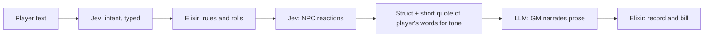

# Call types: Elixir function, Jev, or LLM

**Status:** draft, 2026-10-07. Agreed rule for the Tales Forge app ([whyse-ab/ex-tales-forge](https://github.com/whyse-ab/ex-tales-forge), Elixir/Phoenix/Jido).

Every piece of work in a turn is one of three call types. Pick by the shape of the input and the output.

## The rule

| Input | Output | Call type | Cost |
| --- | --- | --- | --- |
| Structured (known) | Structured | **Elixir function** | Exact, free, instant |
| Unstructured (unknown) | Structured | **Jev call** (TypeSafe System One API) | Fast, cheap |
| Any | Unstructured (prose) | **LLM call** (xAI Grok, non-thinking model) | Slowest, most expensive |

- **Elixir function:** when we already know the shape of the data, plain code does it.
- **Jev:** when the input is free text or a messy situation but we want a typed answer. Jev returns typed JSON that Elixir pattern-matches across multiple function heads, so the result drives code directly.
- **LLM:** only when the output itself is prose a person reads. Use it last, with the smallest input possible.

## Corollary: structured output from the LLM is a smell

Whenever we are about to ask the LLM for structured output, move that work to Jev or Elixir. Today the GM also returns bookkeeping fields (gm_notes, context summary, NPC memories, state updates, mood adjustments). Only about 46% of GM output is player-facing story, and output length dominates GM latency (p50 about 5.9 s against a 3 s target). Taking the bookkeeping out of the LLM call makes the game faster and cheaper.

## Tales Forge examples

| Elixir function | Jev | LLM |
| --- | --- | --- |
| Dice rolls and skill checks | Player intent extraction into a typed struct: system exploit, a skill they don't have, which skills apply, out-of-character talk | GM scene narration |
| Damage and wounds | Persona affect scoring, 1-5 frustrated to delighted, with confidence (exists today, jev-1.13.0; see [Jev scoring](jev-scoring.md)) | NPC dialogue |
| Inventory | NPC gut reaction (System 1) from situation + OCEAN scores + mood | Opening scene |
| Coin and prices | Memory formation filtered through personality | Deliberate (System 2) NPC thinking, when it matters |
| Time advance | Playtest finding classification | Persona bot player text in playtests |
| Maslow need levels | | |
| Caps and billing of GM seconds | | |
| Prompt assembly | | |

## Target turn pipeline

1. Player text comes in.
2. Jev extracts intent as a typed struct.
3. Elixir applies rules and rolls dice.
4. Jev produces NPC reactions.
5. Elixir builds one struct of outcomes, plus a short quote of the player's own words so the GM keeps their tone.
6. The LLM GM narrates prose only.
7. Elixir records the turn and bills GM seconds.

## Character model

Player characters and NPCs are the same `Character` type: OCEAN personality scores, personality-filtered memory, and a Maslow need level. Only the controller differs: a player or the GM. That also lets the GM play an absent player's character using the same data and the same calls.

## Recording call types and metrics

Every unit of work in a turn is a row in the app's `ai_calls` table ([ex-tales-forge#39](https://github.com/whyse-ab/ex-tales-forge/pull/39)), so the rule above can be checked with numbers.

| Column | Meaning |
| --- | --- |
| `call_type` | `llm`, `jev` or `function`, as in the table above |
| `purpose` | What the call is for: `gm`, `scene`, `intent`, `persona`, `scorer`, `jev_npc`, `gm_notes`, or a turn step `turn.*` |
| `adventure_id` | The world/module played, e.g. `tin_valley` |
| `game_system` | The rules system. Today every pack uses `skill_d20` (1d20 roll-under skills) |
| `conv_id` | The `x-grok-conv-id` an LLM call was sent with |
| `started_at` | When the call or step began (microseconds) |

- **LLM rows:** one per xAI request, with tokens, cached tokens, cost and latency.
- **Jev rows:** one per TypeSafe call (the persona-affect scorer, the NPC reactions when `NPC_REACTIONS` is on, and, once ex-tales-forge PR #76 deploys, the input safety read before each GM call, purpose `input_safety`, whose label, confidence and quote decision go in `meta`), with input tokens, cost and latency.
- **Function rows:** the timed Elixir steps of a turn, at zero cost. They show whether "exact, free, instant" holds:
  - `turn.intent`: intent extraction and validation, before the turn job (includes a tier-1 LLM call when one is needed; that call also has its own row)
  - `turn.rules`: handler resolution, mechanics, rolls, inventory, clock, world sim
  - `turn.prompt`: GM context and prompt assembly
  - `turn.gm`: the GM call as Elixir sees it, including retries and decoding
  - `turn.persist`: the turn transaction, NPC updates and signals

Function rows are not counted as calls in spend figures.

### Derived metrics

- **Cost and latency:** count, total and average cost, cost per session and per turn, and p50/p90 latency, per `call_type` and `purpose`.
- **Cache hit rate:** cached / input tokens, and the share of calls with more than 128 cached tokens. xAI reports 128 cached tokens even when it reused nothing, so 128 counts as a miss. Shown for GM turns 2+, all GM calls and all game LLM calls.
- **Idle gap:** for each GM call, the time since the previous xAI call on the same `x-grok-conv-id` ended. This helps tell cache misses caused by long pauses from those caused by routing.
- **Persona is separate:** the persona and scorer bots have their own sections and are never added to game cost.

### Where to see them

- `/admin/costs`, card "Calls by type · this month (this app)": cache and idle-gap figures, the breakdown table and the most recent sessions. Each environment shows its own; the peer card still shows only spend buckets.
- Playtest run page (`/admin/playtest/<run>`): the breakdown, a cache and latency strip, and a per-turn table with GM latency, idle gap, tokens, hit/miss, game vs persona cost and step timings.
- `TalesForge.Playtest.Runner.status/1` over rpc: a compact `metrics` map with the same per-turn figures.
