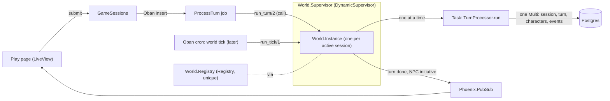

# Design: GameCharacter 10f, one process per world

**Status:** design for Case's review, 2026-10-18. No code until Case approves. This follows [refactor plan step 10f](plan-tf-refactor-2026-10-17.md#step-10-one-gamecharacter-pc-and-npc-differ-only-at-intention-input) and the [2026-10-08 decision](decisions.md#2026-10-08-stateful-world-four-design-answers) ([design-stateful-world.md §4](design-stateful-world.md#4-processes-and-plain-data)): one process per world, with characters as plain data. It is read against `main` `fa7d6b5`, and it assumes 10e has landed, so NPC reactions, initiative and `Actions.NPC.*` already produce Intentions.

## Today: the processes and what they own

| Process | Owns | Notes |
|---|---|---|
| `NPCAgent` (Jido, one per present NPC per session) | A copy of mood, relationship, concern wait and initiative flags | Handles 3 signals through `Actions.NPC.*`, which write `npc_instances` and memories **outside** the turn transaction |
| `PlayerSessionAgent` (Jido, one per session) | `turn_count` and `entries` | Started by `GameSessions.ensure_agent/1`; nothing reads it. *Retired in PR 3* |
| `NPCRegistry.sync/1` | Starts and stops agents to match `present_npcs` | Runs at create, at submit and after every turn |
| `NPCRecovery` (GenServer) | Syncs **every** active session at boot | Its cost grows with the number of sessions, not with the number of players |
| `NPCSignals` | Calls each present agent with `AgentServer.call/2` after the commit | A missing agent drops the signal (logged at debug) |
| `World.Registry`, `World.Supervisor` | Host the `World.Agent` prototype | `WORLD_AGENTS` is off on both apps |
| Oban `ProcessTurn` (queue `llm`, 5 at a time) | Runs `TurnProcessor.run/3` | No per-session serialization. Two quick submits can run at once, and only the unique index on `(game_session_id, turn_number)` catches the second |

## Target

- **`TalesForge.World.Instance`** is a GenServer per active session, registered under the session id with `{:via, Registry, {World.Registry, id}}`. The session id is the world id until persistent worlds exist.
  - It is started lazily with `DynamicSupervisor.start_child` (`restart: :transient`), with no recovery at boot.
  - It stops after 15 minutes idle.
- **Its state is a cache, never the truth:** `session_id`, `world_tick`, the session's `%GameCharacter{}`s (the player character and the NPCs, loaded from the `characters` rows), a FIFO queue of waiting work, the running Task's ref and the idle timer. `init/1` rebuilds all of it from Postgres in milliseconds.
- **Supervision and registry:** standard OTP only, using the `World.Supervisor` and `World.Registry` that already exist, plus a `Task.Supervisor` for turn Tasks.
  - There is no Horde and no Jido. Each app runs on one machine.
  - If an app ever runs on more machines, the cross-node guard is a Postgres `pg_advisory_xact_lock` on the session in the turn Multi. It goes in from PR 1 as a backstop, so it needs no distributed registry.
- **PubSub and Oban carry everything between processes.**
  - The job asks the instance to run the turn.
  - The instance broadcasts on the session topic `SessionPubSub` uses today, so the LiveView doesn't change.
  - Between-turn work (the world clock, initiative while away) arrives later as Oban cron jobs that go through the same queue.

## How turns are serialized

`ProcessTurn.perform/1` calls `World.Instance.run_turn(session_id, request)`, a `GenServer.call` whose timeout covers the GM call (180 s).

1. The instance queues the request.
2. It runs the request in a Task under the `Task.Supervisor`, so its mailbox stays free during the GM call.
3. It replies when the Task ends, then starts the next queued request.

There is one writer per session. Cron ticks and, later, several players use the same queue. The advisory lock and the unique turn index stay as the backstops.

## Failure and restart

| Failure | What happens |
|---|---|
| The Task crashes or the GM fails | The turn Multi never commits, so no half turn. The job gets `{:error, _}` and Oban retries it (`max_attempts: 3`), as today |
| The instance crashes | The supervisor doesn't restart it eagerly. The waiting `call` exits, Oban retries the job, and the next call starts a fresh instance from the database |
| Deploy or SIGTERM | Oban's 20 s grace period finishes running jobs. Nothing needs `terminate/2`, and nothing is recovered at boot |
| An idle session | No process at all, unlike today's agents, which stay up for every active session |

## Migration: small PRs, each with the replay proof

1. **Serialize.** Add `World.Instance`, `run_turn/2` and the advisory lock. `ProcessTurn` goes through the instance, and nothing else changes. The new test: two concurrent submits give turns 1 and 2 in order.
2. **Retire the NPC agents.** With 10e, the agents' work already comes in as Intentions applied in the turn. Delete `NPCAgent`, `NPCRegistry` and `NPCRecovery`, and send `NpcInitiative`'s broadcast from the instance after the commit. `NPCSignals` and `Actions.NPC.*` stay: since 10e they only make the Intentions and deliver nothing to an agent. *(Done in PR 2: the payload carries `:npc_initiatives`, and `World.Instance` broadcasts them after the turn's `{:turn_completed, _}`.)*
3. **Retire `PlayerSessionAgent`.** Delete it and `ensure_agent/1`. Remove the `jido` dependency (a `mix.lock` change, so it goes through the security lane and needs Fredrik's OK). *(Done in PR 3: nothing read its `turn_count` or `entries`, so nothing moved to `World.Instance`. `TalesForge.Jido`, its supervision child and config, `ensure_agent_started/1` and `agent_id/1` are gone, and `mix deps.unlock --unused` took `jido` and the 8 packages only it used out of `mix.lock`. `rg Jido lib` finds nothing.)*
4. **Drop `world_state["npc_state"]` and `"npc_moods"`** (Fredrik, 2026-10-18 08:16: with 10e/10f).
   - The 21 files that read them switch to the NPC GameCharacters from the rows.
   - `Schemas.WorldState.dump/1` leaves both keys out, the same pattern 10b-2 used for `"character"`. A session stored before this is read as stored until its next turn.
   - Minor foes, which today live only in `npc_state`, need a home first. **Case decided (2026-10-18):** each minor foe gets a `characters` row with `controller: "gm"`, plus one new column with a default, written by an additive migration.
     - The column is named for what it governs, its lifetime (for example `lifetime`, default `"session"`), not for what the character is. A minor foe's row says it is removed when its scene or fight ends.
     - Nothing may branch on that column except the cleanup that removes the row. Prompts, mechanics and the play page treat a minor foe like any other GM character.
5. **Drop `npc_instances`** with the row-check pattern from #47.
   - First a read-only check on playtest and prod that every instance equals its row (mood, location, stock, memories): 0 differences.
   - Then the readers move to the rows, and the NPC stock moves to `characters.inventory`.
   - Last, the migration that drops the table. Any backfill or drop on playtest or prod needs Fredrik's OK.

## Proof of no behaviour change

- **Golden replay on main and the branch for each PR**, the same method as 10b-2 and 10d.
  - The script covers speak, overheard talk, time passing (sleep), a buy, a fight and a move.
  - Each turn dumps the prompts, the loaded session, the character rows, the memories and the events.
  - From PR 2 on, the replay compares the state **after the turn**: the agents' after-commit writes on main against the in-turn writes on the branch. It does not compare when the writes happen.
- **Tests:** the concurrency test (PR 1), an instance crash in the middle of a turn followed by an Oban retry, and an idle stop.
- **Playtest:** 10f is user-visible, so Gentry runs one before-and-after comparison. In the logs, `npc agent start failed` and `npc signal undelivered` reach 0 because those code paths are gone, with no new `[error]`.

## Health targets (from `main` `fa7d6b5`: cycles 0, complex 116, 4+ params 24, web refs 0)

| | Target |
|---|---|
| Cycles, web refs | stay 0 |
| Complex functions | ≤ 114: the Kaizen point on `game_sessions.ex`, which has 3 complex functions, and on `npc.ex` (`format_gm_sections`, ABC 52) |
| 4+ params | ≤ 24; `run_turn/2` takes a request struct |
| Code | about 580 lines deleted (the agents, registry, recovery, signals and `Actions.NPC.*`); `rg Jido lib` finds nothing; the only long-lived process per session is `World.Instance` |

## Open questions for Case

1. ~~Where minor foes live once `npc_state` is gone.~~ Decided: `characters` rows with `controller: "gm"` and a defaulted lifetime column (step 4).
2. Whether PR 1 should ship on its own before 10e. It changes no game behaviour; it only makes double submits safe.
