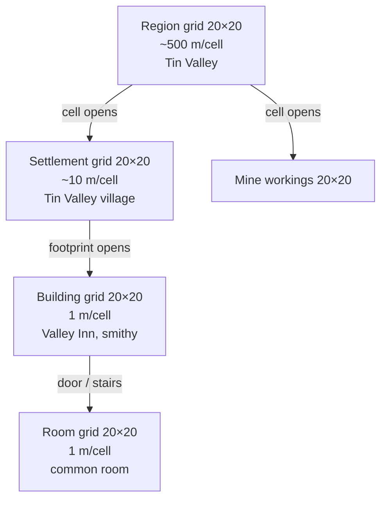

# Design: locations in game state

Status: design, no code. Decisions by Fredrik, 2026-10-21. Follows up
[social layer §11](design-social-layer.md#11-next-design-topic-location-in-game-state).
Context: [Tin Valley world](design-tin-valley-world.md),
[Tin Valley adventure](worlds/tin-valley/adventure.md), [principles](principles.md).

## 1. Problem

Movement bugs (walk to the inn and end up at the smithy; flee and nothing moves)
come from the story and the system disagreeing on where a character is. The fix:
the game tracks location, and the GM narrates from it. The GM never decides
where someone is.

## 2. One fixed grid at every scale

From the original game: every map is a fixed **20×20 grid**, at every scale.

- Each cell holds one **item** from that scale's legend.
- A cell may open into its own 20×20 **child grid**.
- Shapes are made from items. A circular tower is wall items placed in a circle.
- Fixed size makes maps and room drawings easy to render and to reason about.

Example legends (world-pack data, not code):

| Scale | Items |
|---|---|
| region | forest, river, mountain, road, hills |
| settlement | street, square, building |
| building / room | wall, door, bar desk, table, chair |



## 3. Structs (sketch)

Pure core, plain structs, match on `%Struct{}`, no function with 4+ params.

```elixir
%Grid{id: :valley_inn, scale: :building, cell_m: 1,
      cells: %{{x, y, z} => %Cell{item: :table, child: nil}}}

%Cell{item: atom(), child: grid_id | nil}

# Path from the top grid down to one cell.
%Position{path: [{:tin_valley_region, {3, 7, 0}},
                 {:tin_valley_village, {2, 3, 0}},
                 {:valley_inn, {10, 4, 0}}]}
```

Legends (which items exist at which scale, what blocks movement, what is a link)
live in the world pack.

### Levels (z)

Cells are keyed `{x, y, z}`. `z = 0` is ground, `1` a second floor, `-1` a
cellar or underground caverns. Stairs, ladders and shafts are link items between
`z` and `z ± 1`.

### Tiles, not borders

20×20 is the viewing window and the storage tile, not a world boundary. Tiles
join at their edges: scrolling past an edge loads the neighbouring tile (the
child grid of the neighbouring parent square), and the parent square stays
visible around the view. The world scrolls without end.

Neighbour lookup (idea): stepping east off the tile under parent cell
`{px, py, z}` lands in the child grid of parent cell `{px + 1, py, z}`, at
`{0, y}`. Same for the other three edges.

### Large features

- A great river is a chain of river cells across tile edges; a river trip
  follows the chain.
- Large underground structures are many joined tiles at `z = -1`.
- Long trips travel at parent scale (~500 m/cell) and drop to detailed tiles
  only where something happens.

## 4. Multi-cell buildings

A building may cover several cells of its parent grid. One rule: a **footprint**
is the set of cells that share one `child`. All of them open into the same grid.

## 5. Movement and distance

- Movement = neighbour steps inside a grid, plus crossing **links**.
- Doors and stairs are items that link two grids (cell to cell).
- Distance is derived from two positions (cells × `cell_m`, plus link hops).
  This feeds [Hearing](design-social-layer.md) distances later.

## 6. Scales (proposed)

| Level | Cell size |
|---|---|
| region | ~500 m |
| settlement | ~10 m |
| building / room | 1 m |

All cell sizes are **proposed** and tuned in playtest.

## 7. Build order

Bottom-up from Tin Valley: region > village > Valley Inn and smithy > common
room, plus the mine workings. Upgrade the existing files in
`priv/adventures/tin_valley/world/*.md` (they already carry `scale`, `parent`,
`at: [x, y]`, `fixtures`, `aliases`) with grids, rather than inventing a new
format. `fixtures` become cell items; `at` becomes the cell in the parent grid.

## 8. Later: generated continents

Thobias's continent generator (`fpahlen/tales-forge-new-31993d9d`,
`world-generator/`, TypeScript, seed-deterministic, 384×256 cells, JSON export
with biomes, kingdoms, settlements) can feed the top levels by sampling biomes
into region cells. Not now.

## 9. Open questions

- Cell sizes per scale (see §6).
- How the GM gets the position (and nearby items) into its prompt.
- How Jev resolves "go to the inn" into a target path.

## Review notes

- The mapping in §7 (`fixtures` become cell items, `at` becomes the cell in the
  parent grid) is a proposal, pending Fredrik's check.

## 10. Step 1: grid files (built)

- Each grid is an ASCII block, one character per cell, 20 rows of 20:
  `priv/adventures/<pack>/world/grids/<scale>/<location>_z<z>.txt`. Row 0 is north.
- The grid directory names its scale; one legend per scale: `world/legends/<scale>.json` with `scale`, `cell_m`
  and `items` (`char => {item, blocks, opaque, link}`). `blocks` stops
  walking, `opaque` stops sight (a window blocks walking, not sight); both
  default false. `link: {dz: ±1}` marks stairs.
- `TalesForge.Locations.Pack.grids/1` loads them by location id.
- `TalesForge.Locations.Legend`, `Grid` and `Cell` parse them (pure).
- `LOCATION_GRID=on` (playtest only, `fly.playtest.toml`): when the place
  (`location_id`) has a grid, the GM prompt gets "Around the character (from
  the map)" from `TalesForge.Locations.Prompt`. Step 1 keeps no position in
  the game state: the character stands on the main door facing in, until a
  later step maps the player's words to `Move.approach/3` and stores it.
