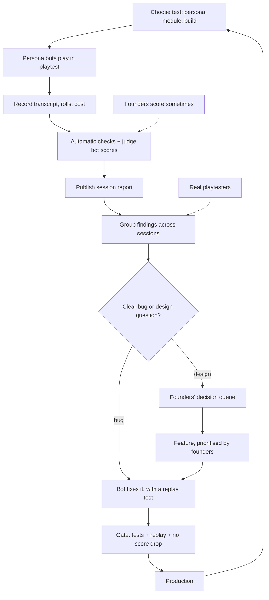

# Design: playtest loop

**Status:** draft, 2026-10-06. Agreed in outline with Fredrik the same day; the details below are proposals.

## Purpose

This is the inner loop from the [roadmap](roadmap-2027.md) (§2) in practice: how persona bots play Tales Forge in the playtest environment, how we score their sessions, and how the findings turn into fixes, founder decisions and new features.

The founders stay product owners. Bots play, record, score, group and fix clear bugs. Anything that needs judgement goes to the [decision queue](design-decision-queue-and-docs.md), and the founders pick the order of features.

It also gives us **cost per session** from self-play, measured on the playtest key from November, which [pricing](roadmap-2027.md) depends on.

**Biggest risk: judge calibration.** If the judge bot's scores don't match what the founders (and later real players) feel, every step after scoring optimises the wrong thing. See step 5 and the open decisions.

## The loop at a glance



## Where we start from (code, 2026-10-06)

Checked in `ex-tales-forge` on `main` (commit `bd5af30`):

- **No self-play, persona bots, judge or scorecard code exists yet.** The hits for "persona" in the code are NPC personalities, not player personas.
- **`mix e2e.smoke`** (`lib/mix/tasks/e2e.smoke.ex`) is the closest thing. It plays a fixed three-turn tavern scenario against a running dev server with the real AI, checks each turn's latency against the 3 s limit and whether the expected NPCs show up and remember things, and writes `priv/playtest/reports/e2e-smoke.json` and `.md`. It runs by hand; it is not part of CI. The last saved report is from 2026-07-03.
- **What's already recorded per session:** each turn stores the player's action, the narration and a `mechanical_resolution` map (roll and outcome). `session_events` carry a `player_aware` flag, so events the player never sees are already kept apart.
- **Not recorded yet:** the GM's hidden reasoning as its own record (in review, see *Build progress*). AI token use and cost per call are recorded since ex-tales-forge #19, see *Build progress*.
- **Playtest environment:** `fly.playtest.toml` and the playtest deploy workflow exist; see [environments](environments.md).

## Build progress

| Build step | What | Status |
|---|---|---|
| 1 | AI cost per LLM call: `ai_calls` table with tokens (in, out, cached, reasoning), model, cost, latency and status, linked to session and turn number | Done: [ex-tales-forge #19](https://github.com/whyse-ab/ex-tales-forge/pull/19), plus the fix [#21](https://github.com/whyse-ab/ex-tales-forge/pull/21) so rows are actually written in production; verified live 2026-10-06 |
| 2 | Per-session and per-day spending caps with a hard stop, set by `AI_CAP_SESSION_USD` and `AI_CAP_DAY_USD` (unset = off; day = since midnight Stockholm time). A capped call sends nothing, is logged and stored as a `capped` row, and the player sees a calm "the Game Master is resting" message | Done: [ex-tales-forge #20](https://github.com/whyse-ab/ex-tales-forge/pull/20). Live on playtest ($1.00 per session, $10.00 per day); off in production |
| 3 | GM hidden reasoning per turn: a short hidden `gm_notes` field in the GM reply, stored with the raw GM reply as a `gm_reasoning` session event (`player_aware: false`) in the turn's transaction; never shown to the player or fed back into prompts | Done: [ex-tales-forge #22](https://github.com/whyse-ab/ex-tales-forge/pull/22) |
| 5 | Persona bot runner: `TalesForge.Playtest.Runner.start(persona, module, opts)` plays a new playtest session as a persona from [personas](personas.md), through the same paths a player uses. It sees only what the play page shows, and its moves come from an LLM call recorded in `ai_calls` as `persona` and counted by the caps. It stops at module end, death, a spending cap, a timeout or the turn limit (default 15). Each run is stored in `playtest_runs`. Off unless `PLAYTEST_RUNNER_ENABLED=true`; started over `rpc` on playtest, never in production | In review: [ex-tales-forge #23](https://github.com/whyse-ab/ex-tales-forge/pull/23) |

## The steps

Each step lists what goes in, what comes out, and what gets stored.

### 1. Choose the test

A test is a persona, a module, a build and a goal. Example: Paul, Merovingia, the current `main` commit, "can Paul bluff past the guards at the Runekeeper's Tower?".

The scenes in [Examples of play](examples-of-play.md) are the first test targets: each one already names a persona, a place and what a good outcome looks like.

- **In:** the persona (from [personas](personas.md)), a module, a build, a goal, optionally a starting scene.
- **Out:** a test definition the bots can run again later.
- **Stored:** the test definition (see *Data shapes*).

### 2. Persona bots play in playtest

One bot per persona plays the session against `tales-forge-playtest`, through the same paths a real player uses. Ronny plays as the red team: exploits, sweet-talking the GM, prompt injection, economy gaming, death negotiation.

Bots play in their persona's style. Paul types in character with dice hidden; Hawk, Lars and Ronny play with dice shown.

- **In:** a test definition and the playtest build.
- **Out:** a played session in the playtest database.
- **Stored:** the game session itself, as for any player.

### 3. Record everything

For every session we keep enough to replay and judge it without rerunning it.

- **In:** the played session.
- **Out:** a session record.
- **Stored:** the transcript (player turns and GM replies), every dice roll, the GM's hidden reasoning and player-unaware events, AI cost (tokens and money, per call and in total) and time (per turn and in total), plus the build, model names and test id.

Cost is counted on the playtest environment's own xAI key, so bot spending never mixes with player spending.

### 4. Score in two layers

**Layer 1: automatic checks.** Cheap and deterministic. Crashes and errors, timeouts, the 3 s latency limit, rule violations (impossible rolls, skills the character doesn't have, items from nowhere), mechanics leaking into narration when dice are hidden, and the GM contradicting world canon.

**Layer 2: the judge bot.** A separate bot reads the session record and scores it against the persona's scorecard in [personas](personas.md). For Paul: was the intent read from in-character speech, did mechanics stay hidden, did NPCs stay in character, did bluff quality matter.

The judge uses a different model or at least a different prompt from the GM, so the GM doesn't grade its own homework. It must quote the turns behind every score, so a human can check it quickly.

- **In:** the session record and the persona's scorecard.
- **Out:** a scorecard per session: check results, a score and reason per criterion, and findings.
- **Stored:** the scorecard and the findings.

### 5. Calibrate the judge

Now and then a founder hand-scores a session the judge already scored, without seeing the judge's scores first. We compare the two.

If they disagree a lot, we fix the judge's prompt, rubric or model before trusting its numbers again. Hand-scored sessions are kept as a reference set, so a new judge version can be checked against them before it goes live.

- **In:** a judged session and a founder's scores.
- **Out:** agreement per criterion and per persona.
- **Stored:** the hand scores, linked to the session and the judge version.

### 6. Publish a session report

One readable page per session: the test, the build, cost and time, check results, scores with quoted evidence, and the findings.

- **In:** the session record and scorecard.
- **Out:** a session report.
- **Stored:** the report (see *Where reports and findings live*).

### 7. Group findings across sessions

Patterns beat single sessions. A grouping bot merges findings that describe the same problem across sessions, personas and builds, and counts how often each one shows up.

- **In:** findings from many sessions.
- **Out:** consolidated findings with a count and links to the sessions behind them.
- **Stored:** the consolidated findings.

### 8. Sort: bug or design question

- **Clear bugs** (a crash, a broken rule, a canon contradiction) go straight to a fixer bot.
- **Design questions** (a persona trade-off, a taste call, "should Paul's bluff need a roll at all?") go to the founders' decision queue.

When in doubt, it's a design question.

- **In:** a consolidated finding.
- **Out:** a fix task for a bot, or a decision-queue entry.
- **Stored:** the finding's status and where it went.

### 9. A feature carries its own test

Every fix and feature ships with the scenario that exposed it, so the persona can replay it. Example: the Runekeeper's Tower scene becomes Paul's replay test for "bluff quality affects the outcome".

Replay tests pile up into a regression suite that grows with every finding.

- **In:** the finding and the sessions behind it.
- **Out:** a replay scenario linked to the fix or feature.
- **Stored:** the replay scenario, next to the test definitions.

### 10. Founders prioritise, a bot builds

The founders order the features. A bot picks the top one and builds it, with its replay scenario. Nobody assigns work to people; founders self-assign whatever they want to take on.

- **In:** the ordered feature list.
- **Out:** a pull request.
- **Stored:** the PR, linked to the feature and its findings.

### 11. Gate before production

A change reaches production only when:

1. the CI tests pass;
2. its replay scenario passes in playtest (or a preview app, once previews are built);
3. no other persona's score drops.

What counts as a score drop is an open decision. Merging to `main` still needs Fredrik's OK, as in [environments](environments.md).

- **In:** the PR, its replay scenario, scores for the current build.
- **Out:** pass or fail with reasons.
- **Stored:** the gate result on the PR.

### 12. Track trends

Persona scores and cost per session over time, per build. This shows whether we are getting better for the people we design for, and what a session costs as we go, which pricing needs.

- **In:** scorecards and session records.
- **Out:** trend lines per persona, per criterion, per build.
- **Stored:** nothing new; computed from what's already stored.

### 13. Bring in real people

Invited playtesters, and later real players, feed findings into the same queue. They also tell us whether the personas are realistic: if real Pauls behave differently from the Paul bot, the bot is wrong, not the players.

The monthly real playtests in the roadmap are where this happens first.

- **In:** playtester sessions and feedback.
- **Out:** findings, plus corrections to persona bots and scorecards.
- **Stored:** the same session records and findings as for bots, marked as human.

## Data shapes (suggestions)

Kept light on purpose. The fields are suggestions; the real schema comes with the first implementation.

### Test definition

```yaml
id: t-paul-runekeeper-bluff
persona: paul
module: merovingia
start: runekeeper-tower-night   # optional starting scene
goal: "Can Paul bluff past the guards?"
source: examples-of-play.md#2-paul-new-regulations
dice_visible: false
max_turns: 20
```

### Session record

```yaml
id: s-2026-11-03-0042
test: t-paul-runekeeper-bluff
build: bd5af30
environment: tales-forge-playtest
player: bot          # bot | human
gm_model: grok-…     # whatever the GM ran on
started_at: 2026-11-03T14:02:00+01:00
turns: 14
time:
  total_s: 61
  p95_turn_s: 2.8
cost:
  tokens_in: 48200
  tokens_out: 6100
  usd: 0.21
# Transcript, rolls and hidden GM reasoning are stored per turn,
# not in this summary.
```

### Scorecard

```yaml
session: s-2026-11-03-0042
judge: judge-v1      # model + prompt version
checks:
  crashed: false
  latency_ok: true
  rule_violations: 0
  canon_contradictions: 1
criteria:
  - id: paul.intent-from-speech
    score: pass       # or 1–5; open decision
    evidence: [turn 1, turn 4]
  - id: paul.no-mechanics-leak
    score: fail
    evidence: [turn 7]
    note: "Narration says 'you rolled well'."
```

### Finding

```yaml
id: f-0017
title: "GM mentions dice when rolls are hidden"
kind: bug            # bug | design
personas: [paul, lotta]
seen_in: [s-2026-11-03-0042, s-2026-11-04-0003]
count: 2
status: open         # open | fixing | queued | done
goes_to: fixer-bot   # fixer-bot | decision-queue
```

### Feature with replay scenario

```yaml
id: feat-bluff-quality
title: "Bluff quality affects the outcome"
from_findings: [f-0021]
decision: d-0xx      # if it went through the queue
replay:
  test: t-paul-runekeeper-bluff
  expect:
    - "A pretext that clashes with canon fails more often"
    - "A pretext that uses the world can succeed"
```

## Where reports and findings live

**Suggestion (open):**

- **Session records, scorecards and reports** live in the playtest database and are shown in the playtest admin, next to the sessions themselves.
- **Consolidated findings** leave the playtest app: design questions become decision-queue entries in this repo (`decisions/`), and clear bugs become GitHub issues on `ex-tales-forge` for the fixer bot.

Things this depends on:

- Nobody can sign in to the playtest admin yet: there is no mail key and no GitHub sign-in there ([environments](environments.md)).
- Playtest has no `GITHUB_DOCS_TOKEN`, so it can't write decision-queue entries itself. Bots could do that through Git instead.
- The decision-queue design lists "bot result feeds" and "persona scorecard dashboards" as out of scope for now. This doc proposes bringing them in.

## Cost controls

AI spend on playtest must never surprise anyone. Three layers, cheapest first:

1. **A budget cap per session.** The harness stops a session when it passes its token or money cap, and marks it as stopped on budget (that's a finding too).
2. **A daily cap on the playtest key.** Set at the provider if possible, so it holds even if our own code is broken.
3. **A runaway stop.** If spending per hour jumps well above normal (a loop, a bot stuck retrying), all bots stop and nothing restarts on its own.

Raising a spending cap or adding an AI key needs Fredrik's OK ([environments](environments.md)). The actual numbers belong to the AI spend ceiling decision (`d-004`).

## Open decisions

Most important first.

1. **Judge model and calibration method.** Which model and prompt the judge runs on (different from the GM's), how often founders hand-score, how many hand-scored sessions make a reference set, and how much agreement is enough to trust the judge. This is the biggest risk in the loop.
2. **What counts as a regression.** Pass/fail per criterion or a weighted score, how big a drop blocks a release, and how to tell a real drop from noise between runs. Part of `d-002` (persona scorecards).
3. **The session budget cap and the daily cap on the playtest key.** Numbers, and hard stop or throttling. Part of `d-004` (AI spend ceiling).
4. **How many sessions per persona per build.** Enough to see patterns and beat AI randomness, few enough to stay within budget. Maybe a small set on every build and a bigger one nightly.
5. **Where findings go.** GitHub issues, decision-queue items, or both (bugs to issues, design questions to the queue), and whether reports live only in the playtest admin.
6. **When real testers join, and how they sign in to playtest.** Ties to the open sign-in question in [environments](environments.md) and to the monthly real playtests in the roadmap.
