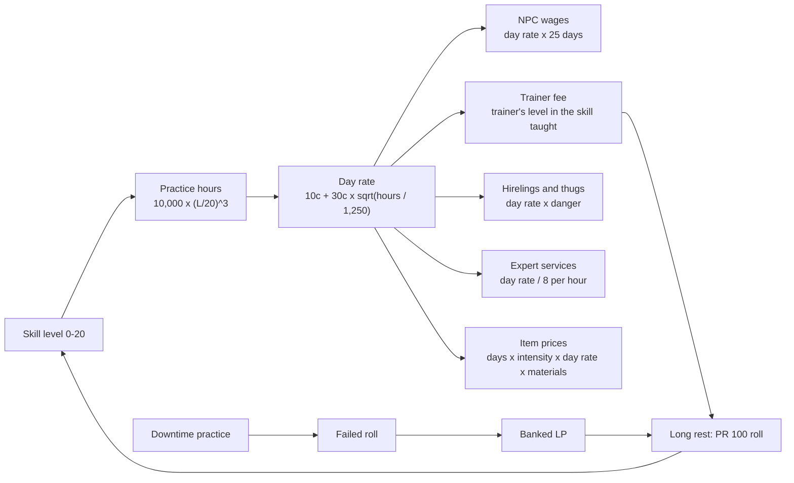

# Design: one rule for skills and the economy

**Status:** design note, 2026-10-09, approved by Fredrik as a docs-only note ([decision](decisions.md#2026-10-09-write-one-design-note-for-skills-and-the-economy-docs-only)). No code changes. Every follow-up code PR needs Fredrik's OK.

**Read against:** ex-tales-forge `main` at `702cf6f` and [PR #100](https://github.com/whyse-ab/ex-tales-forge/pull/100) (open, head `f99b3e0`, the new growth rules); the two earlier designs in `fpahlen/tales-forge-new-31993d9d` (`main` at `20b791c1`):

- **Skill Progression and Convergence:** [`docs/game-rules/skill_domains.md`](https://github.com/fpahlen/tales-forge-new-31993d9d/blob/main/docs/game-rules/skill_domains.md), first planned in `.lovable/plan.md` at [`b9952c11`](https://github.com/fpahlen/tales-forge-new-31993d9d/blob/b9952c115dda4b60746018021e595106491ddf2a/.lovable/plan.md).
- **Labor-Anchored Economy:** [`docs/game-rules/economy_system.md`](https://github.com/fpahlen/tales-forge-new-31993d9d/blob/main/docs/game-rules/economy_system.md), first planned in `.lovable/plan.md` at [`2da5f015`](https://github.com/fpahlen/tales-forge-new-31993d9d/blob/2da5f015025ecb9fa45036a85aa9f91ac904b8e3/.lovable/plan.md).

Both were copied into the game as `priv/rules/skills.md` and `priv/rules/economy.md` (plus the copies in each pack). The game then went its own way, and the numbers no longer agree with each other or with the docs.

## 1. Summary

- **One rule:** a person's day rate depends on their skill level, through the practice hours that level stands for. Wages, hireling and thug prices, trainer fees, expert services and the labour part of item prices all come from that one curve.
- **Hours:** keep the formula, `hours = 10,000 × (level / 20)³`, and drop the rounded table (§2).
- **Day rate:** `day_rate = 10c + 30c × (level / 10)^1.5`, that is 10c plus a part that grows with the square root of practice hours. Unskilled (level 0) earns 10c a day, a skilled worker (level 10) 40c, so a month of skilled work (25 days) is 1,000c = 2g = 1 oz of gold, the old anchor (§3).
- **Growth stays PR #100's LP model.** Practice hours are not tracked for player characters; they are the scale that prices labour, sets NPC levels and gives the GM words for how good someone is. Deliberate practice in downtime can feed the LP model as rolls that can fail (§4).
- **Drift to fix:** the smith's short sword (60c) is 8× under the doc's sword (1g = 500c); starting coins come from the old table, not the budget; trainer fees are typed in by hand (three level-9 trainers charge 20c, 50c and 80c); the economy doc gives three different unskilled wages; `priv/rules/skills.md` mixes two growth models and rules the code never applies (§6).
- **Call types:** all price and wage math is Elixir. Jev turns the player's words into a typed deal (who, what job, how risky, how many days). The LLM only narrates, with the price given to it (§7).

## 2. The hours scale: formula, not table

`skill_domains.md` gives both a formula and a table, and they disagree:

| Level | Table (`~`) | Formula `10,000 × (L/20)³` | Gap |
| --- | --- | --- | --- |
| 5 | 100 | 156 | table 36% low |
| 10 | 1,000 | 1,250 | table 20% low |
| 15 | 3,000 | 4,219 | table 29% low |
| 20 | 10,000 | 10,000 | same |

**Pick the formula.** Why:

1. The table isn't one curve at all. Its points at 5 and 10 fit a power of about 3.3, its point at 15 needs about 4.2. Any code would have to interpolate between hand-picked points.
2. The formula is one Elixir function with a doctest, defined for every level, and it matches the table at both ends (0 and 10,000).
3. The table is marked "~" and reads as rounded milestones; the formula is what the doc calls the rule.

The cost is that the milestones stop being round: 156, 1,250 and 4,219 hours. The tier table in `priv/rules/skills.md` should show the formula's numbers.

**Practice hours means deliberate practice**, not years on the job. A journeyman who has worked six years may have far fewer hours of real, at-the-edge practice, which is why the default NPC levels below sit where they do.

## 3. The one rule: day rate by level

`day_rate(level) = 10c + 30c × (level / 10)^1.5` (rounded to whole copper). The `(level / 10)^1.5` part is `sqrt(hours / 1,250)`: pay grows with the square root of practice hours. A master has 8× the hours of a level-10 worker but earns about 2.4× as much, which is close to how wages spread in real crafts.

Three fixed points set the curve:

- **Level 0, unskilled: 10c a day.** The top of the doc's "unskilled labour 5-10c" row. It buys two common meals (5c each) and not much more: hand-to-mouth.
- **Level 10, skilled: 40c a day.** A month of 25 working days is 1,000c = 2g = 1 oz of gold, the doc's anchor ("1 oz of gold is about one month of skilled craftsman labour"; in our coins 1 oz = 2g, and 1g = 50s = 500c, so 1s = 10c).
- **Level 15-20, expert: 65-95c a day**, the doc's "expert service 5-10s a day".

| Level | Practice hours | Who, in today's game | Day rate | Per hour (day / 8) | Month (25 days) |
| --- | --- | --- | --- | --- | --- |
| 0 | 0 | unskilled labour | 10c (1s) | 1.2c | 250c (25s) |
| 1 | 1 | | 11c | 1.4c | 275c |
| 2 | 10 | | 13c | 1.6c | 325c |
| 3 | 34 | class package top skill at creation | 15c | 1.9c | 375c |
| 4 | 80 | NPC apprentice (`seniority.apprentice`) | 18c | 2.2c | 450c |
| 5 | 156 | normal cap at creation | 21c (2s 1c) | 2.6c | 525c (1g 2s 5c) |
| 6 | 270 | | 24c | 3.0c | 600c |
| 7 | 429 | signature skill at creation | 28c | 3.5c | 700c |
| 8 | 640 | NPC journeyman (`seniority.journeyman`) | 31c | 3.9c | 775c |
| 9 | 911 | today's best trainers | 36c | 4.5c | 900c |
| 10 | 1,250 | **skilled worker: the anchor** | **40c (4s)** | 5.0c | **1,000c (2g)** |
| 11 | 1,664 | | 45c | 5.6c | 1,125c |
| 12 | 2,160 | NPC master (`seniority.master`) | 49c | 6.1c | 1,225c |
| 13 | 2,746 | | 54c | 6.8c | 1,350c |
| 14 | 3,430 | | 60c (6s) | 7.5c | 1,500c (3g) |
| 15 | 4,219 | expert, instructor | 65c | 8.1c | 1,625c |
| 16 | 5,120 | | 71c | 8.9c | 1,775c |
| 17 | 6,141 | | 76c | 9.5c | 1,900c |
| 18 | 7,290 | Summit Sight in the old doc | 82c | 10.2c | 2,050c |
| 19 | 8,574 | | 89c | 11.1c | 2,225c |
| 20 | 10,000 | world-class | 95c (9s 5c) | 11.9c | 2,375c (4g 37s 5c) |

Everything below uses this column. The only other inputs are a few fixed factors in data (danger, intensity, materials), never a hand-typed price.

### 3.1 NPC wages

`monthly wage = day_rate(level in their trade) × 25`. A labourer (level 0-2) earns 250-325c a month, a journeyman miner (8) 775c, a master (12) about 1,225c. The Miners Guild board in the square ("wages in tin and coin") can quote these.

### 3.2 Hirelings and thugs

`hire per day = day_rate(level in the skill hired for) × danger`. Danger is one of three labels: **safe** ×1, **risky** ×1.5 (guard duty, escort, a dangerous road), **fight** ×2 (paid to fight: clearing the orc nest, a brawl).

| Hired for | Level 10 | Level 15 |
| --- | --- | --- |
| Safe work (carry, guide, keep watch in town) | 40c (4s) | 65c |
| Risky (guard, escort) | 60c (6s) | 98c |
| Fight (thug, sellsword) | 80c (8s) | 130c (13s) |

Check against the doc: its "hired guard 3-5s a day" is a level-7 guard on risky work (28c × 1.5 = 42c). The Tinjacks fit too: Cobb (unarmed 8) would ask about 62c a day to break heads for you, Rusk (melee 8) the same.

### 3.3 Trainer fees

`trainer fee per day = day_rate(trainer's level in the skill taught)`. One session is one day and one free +5 attempt (`TalesForge.Game.Train`). Today `fee_copper` is one number per NPC whatever they teach; under the rule the fee follows the skill.

| Trainer (Tin Valley) | Teaches (level) | Fee today | Fee by the rule |
| --- | --- | --- | --- |
| Herb wife | history 9 | 20c | 36c |
| Prospector | climbing 9 | 50c | 36c |
| Guild steward (Osric) | persuasion 9 | 80c | 36c |
| Innkeep (Brenna) | persuasion 8 (derived) | 50c | 31c |
| Smith (Hilde) | melee combat 6 | 40c | 24c |
| Drover | persuasion 7 | 30c | 28c |
| Stable lad | stealth 8 | 10c | 31c |

### 3.4 Expert services

Short work is billed by the hour, `day_rate / 8`, rounded up, at least 1c. Stitching a wound for an hour by a level-12 healer is 7c; a day of legal advice or tutoring from a level-15 expert is 65c. A night on the herb wife's sickbed (1s today) fits: about two hours of a level-9 carer's time (4.5c an hour).

### 3.5 Item prices

The doc's own formula, made concrete: `price = labour days × intensity × day_rate(maker's level) × (1 + materials)`.

- **Intensity:** 1 for constant attention (forging, tailoring), down to about 0.1 for things that mostly make themselves (ale, cheese).
- **Materials:** raw materials are also labour (mining, smelting, charcoal, spinning) further up the chain. A first version gives each item category one materials factor in data, for example 1 for iron goods (the iron and charcoal cost about as much as the forging). Open question 4.

At the smith, with Hilde at smithing 10:

| Item | Labour | Labour only | With materials (×2) | Today | Doc |
| --- | --- | --- | --- | --- | --- |
| Hunting knife | 5 hours | 25c | 50c | 15c | dagger 10s = 100c |
| Spearhead | 3 hours | 15c | 30c | 20c | (none) |
| Short sword | 3 days | 120c | 240c (24s) | 60c (6s) | common sword 1g = 500c |

## 4. Today's levels on the 0-20 scale, and how hours feed growth

### 4.1 Where today's characters sit

| Today's game | Level | Hours | Tier |
| --- | --- | --- | --- |
| Player character at creation (`creation.json`: cap 5, one or two signature skills at 7, free levels from class, race and past occupation) | about 0-7 | 0-429 | Novice to early Adept |
| NPC apprentice / journeyman / master (`priv/characters/defaults.json` `seniority`: 4, 8, 12) | 4, 8, 12 | 80, 640, 2,160 | Novice, Adept, Expert |
| Tin Valley trainers (herb wife, prospector, steward) | 9 | 911 | Adept |
| Reflection needed (PR #100 `reflection_level`) | 10+ | 1,250+ | Adept and up |

This fits the scale as it is: apprentices are Novices, journeymen Adepts, masters Experts, and 16-20 is left for legends. No numbers in the game need to move to adopt the scale. The skill check stays 1d20 roll-under (success if the roll is at most level plus the stat bonus).

### 4.2 Growth: PR #100's LP model stays the engine

PR #100: you learn only from failure; a failed or partial roll banks 1 LP for that skill; banked LP are resolved on a long rest; one improvement roll costs `ceil(level / 3)` LP and needs a d20 of at least 11 and at least the level; at most +1 per skill per night, then that skill's LP are cleared; from level 10 the character must have reflected on the skill, or its LP stay banked.

**Proposal: practice hours are a derived label, not a counter.** `hours(level)` gives wages, prices, NPC levels and the GM's words ("about a thousand hours with a blade"). Player characters do not carry an hours total, and hours never cap a level.

Why not track hours and cap levels by them: player characters grow much faster than the hours scale. In PR #100's simulation, with 10 rolls a day a skill goes from 3 to 10 in a median of 9 nights, against 1,250 practice hours on the scale. Adventure is dense practice at the edge of failure, and a cap would stop the growth Fredrik just tuned. It would also be a second growth engine to keep in step with the first.

**Where hours do feed growth: downtime practice.** A character who spends hours deliberately practising (a new `practise` action, or `wait` with a skill named) gets Elixir-simulated rolls at a fixed rate, for example one roll per 2 hours of practice. Their failures bank LP like any other failure, and the practice counts as reflection for skills at 10+ (as `TalesForge.Game.Reflection` already does for the words "practise", "drill", "spar"). This keeps "growth only from failure", needs no new engine, and gets slower at high levels by itself, because a skilled character fails less often and each roll costs more LP. The rate is open question 7.

**Trainers** stay as in #100: a day with a trainer is one free attempt at +5, paid at the trainer's day rate (§3.3), and it counts as reflection.

## 5. What stays from the old skills design

| Old idea | In the game today | Proposal |
| --- | --- | --- |
| Tiers Novice 1-5, Adept 6-10, Expert 11-15, Master 16-20 | names only, in GM text; `core_mechanics.md` still mentions stat minima per tier, which no code applies | keep as names for bands of the hours scale |
| Scaled LP thresholds (5/7/10/15 LP, harder rolls, trainer required at 16+) | only in the `baseline` variant (`Progression.Tiered`) | replaced by #100 (`ceil(level / 3)` LP per roll, roll at least 11 and the level) |
| Five domains and their skill lists | GM text only; the lists name skills the game doesn't have (smithing, medicine, cooking…) and miss two it has (survival, tracking) | redo the lists against the game's 17 skills (`Mechanics.skill_stat_map/0`) |
| Domain floors (2 at 10, 4 at 15, 6 at 18) | GM text only, no code | open question 8 |
| Summit Sight (18+) and Attribute Echo (+1 to +3 to stats) | GM text only, no code; the GM is told a level-15 fighter has +2 STR, DEX and CON that Elixir never applies | open question 8 |
| Trainer at least 5 levels above the student, +5 to the roll | in code (`Train.qualify/6`, `Progression.train/3`) | keep |

## 6. The drift to fix

| # | Drift | Numbers | Fix (later PR) |
| --- | --- | --- | --- |
| 1 | **The smith's short sword is about 8× under the doc.** | Hilde's stock has the short sword at `price_copper: 60` (6s; her hook text says the same). The doc's common sword is 1g = 500c: 8.3× more. But the doc is itself 4-6× over its own anchor (see 4), so matching it is not the fix. | By the rule: 120c of labour, about 240c with materials (§3.5). Also give the smith a real level in a smithing or crafting skill: today she is derived as a `laborer` with melee 6 and history 5, and the game has no craft skill at all. |
| 2 | **Starting coins use the old table, not the budget model.** | `CharacterCreation.finalize/1` takes coins from `Defaults.derive/3`, which returns `standings.<standing>.coins`, the legacy `STARTING_WEALTH` table (commoner 0g 20s 300c = 500c). The kit (travel cloak, hunting knife) comes free on top. `priv/rules/economy.md` tells the GM the opposite: gear is paid out of the budget. The legacy totals equal the budgets for every class (26,000c, 5,700c, 4,000c, 500c, 50c), so the fix is small in coins but real: subtract the kit. | Starting coins = budget − kit value, in Elixir. Price the kit (the cloak has no price anywhere; the knife is 15c today, 50c by the rule). The legacy table was kept in the rules text on purpose until now ([decision 2026-10-08](decisions.md#2026-10-08-clarification-the-code-and-its-docs-stand-alone-where-the-code-came-from-is-recorded-here)); it can go with this fix. |
| 3 | **Trainer fees are hand-set.** | Seven non-zero `fee_copper` values in Tin Valley, from 10c to 80c, with no link to level. The three level-9 trainers charge 20c, 50c and 80c, a 4× spread for the same level. The stable lad (stealth 8) charges 10c, the smith (melee 6) 40c. One fee per NPC whatever skill they teach. | Fee = `day_rate` of the trainer's level in the skill taught (§3.3), computed in Elixir; drop `fee_copper` from the pack files, or keep it only as an explicit override with a reason. |
| 4 | **The economy doc contradicts itself on pay.** | Unskilled: the services table says 5-10c a day; "1c = about 20 minutes of unskilled work" makes it 24c for an 8-hour day; "1s = half a day unskilled" makes it 20c. That is 2-5× apart. Skilled: the anchor (2g a month) gives 40c a day, "1s = 3 hours" gives about 27c, the services table 20-30c. Items: the sword is "1g, 2-3 days of skilled work", but the same doc says 1g is 2 weeks; the dagger is "10s, 4-6 hours", but 4-6 hours at "1s = 3 hours" is 13-20c; boots are "15s, a full day". The item prices are 4-6× the doc's own labour anchor. | One wage curve (§3): unskilled 10c a day, so 1c is about an hour of unskilled work and 1s is a quarter of a skilled day (about 2 hours). Rewrite the coin-equivalent lines and the item tables from it. |
| 5 | **`priv/rules/skills.md` mixes the models.** | On `main` it has the hours table and the formula that disagree (§2), the 2026-10-07 "one LP, one attempt, spent every turn" section, domains, floors, Summit Sight and Attribute Echo that no code applies, and the old "+1 LP per roll" for Summit Sight. PR #100 rewrites the LP section and drops the "+1 LP" line but leaves the rest. `core_mechanics.md` still has tier stat minima and "20-30 skill points" next to the real 25-point budget. The same text is copied into `priv/adventures/tin_valley/rules/` and `priv/adventures/crossroads_ledger/rules/`. | After #100 merges: one rules text that says only what Elixir applies (hours formula, #100 growth, trainers, wage rule), with unimplemented ideas moved to [Future ideas](future-ideas.md) or implemented. Golden prompt fixtures change with it, so it is its own PR. |

## 7. Who does what: Elixir, Jev or the LLM

By the [call-type rule](call-types.md) (and the walkthrough on `/team`): known structure in and out is Elixir; free text in, typed answer out is Jev; prose out is the LLM.

| Work | Call type | Where |
| --- | --- | --- |
| `hours(level)`, `day_rate(level)`, monthly wage, hourly rate | **Elixir** | a new pure module, for example `TalesForge.Game.Economy`, with doctests for the table in §3 |
| Trainer fee from the trainer's level in the skill taught | **Elixir** | `Train.qualify/6` calls it instead of reading `fee_copper` |
| Hire price: day rate × danger × days | **Elixir** | |
| Item price from labour days, intensity, maker's level and materials | **Elixir** | at pack load, or as a test that fails when a pack price drifts more than, say, 25% from the rule |
| Starting coins = budget − kit value | **Elixir** | `CharacterCreation.finalize/1` / `Defaults.derive/3` |
| Coin maths, affordability, paying | **Elixir** | already `TalesForge.Game.Inventory` |
| Growth: LP, rest rolls, downtime practice rolls | **Elixir** | `TalesForge.Game.Progression` (#100) |
| Reading a hire or a job offer from the player's words: which NPC, what job, safe/risky/fight, how many days | **Jev** | a field on the typed intent (`TalesForge.Game.JevIntent`) |
| Classifying an item the player asks for that has no price: category and size labels from a fixed list, never a number | **Jev** | Elixir then prices it |
| Which skill the player practises or reflects on | **Jev** later; the `Reflection` regex today | |
| Narrating the deal, the haggling, the trainer's lesson | **LLM** | gets the price in its per-turn facts, as it already does for stock ([world agents round 2](design-world-agents.md#round-2-results-2026-10-07)); it never invents a price |
| Authoring labour days, intensity and materials for new pack items | author (human or a writing bot), checked by the Elixir drift test | not a turn call |

## 8. Open questions for Fredrik

1. **Hours:** use the formula `10,000 × (L/20)³` (156 / 1,250 / 4,219 hours at 5 / 10 / 15) and drop the rounded table?
2. **Wage curve:** `10c + 30c × (L/10)^1.5` (pay grows with the square root of practice hours): unskilled 10c, skilled 40c, master 95c a day. Right shape and right fixed points?
3. **Which level is the anchor's "skilled craftsman":** 10 (as proposed), or the NPC master at 12?
4. **Materials:** one materials factor per item category (×2 for iron goods), which puts the short sword at about 240c (24s), not the doc's 1g. Or should the old doc's item prices win and the wage curve move up to match them?
5. **Trainer fees:** just the trainer's day rate, or a teaching premium on top? Should standing or scarcity add anything (the guild steward charges 80c today)?
6. **Danger factors:** safe ×1, risky ×1.5, fight ×2?
7. **Downtime practice:** feed growth through simulated rolls (one per 2 hours of practice?) that bank LP on failure, or keep hours purely a label?
8. **Domains, floors, Summit Sight, Attribute Echo:** build them in Elixir, or take them out of the GM's rules text until they are built?
9. **Trainers for player characters:** the 5-level gap means today's level-9 trainers can only teach skills at 4 or lower, so nobody in Tin Valley can train a new character's 5-7 skills. Add trainers at 12-14?
10. **A craft skill:** the game's 17 skills have no smithing or crafting, so makers have no level to price their work by. Add one (crafting), or price makers by a derived occupation level?
11. **Starting kit:** subtract the kit from the starting budget (commoner 500c minus the cloak and knife)?
12. **Order of work:** after #100 merges, (a) the Elixir economy module and the drift test, (b) starting coins, (c) pack prices and trainer fees, (d) one clean rules text. Each its own PR with your OK?
