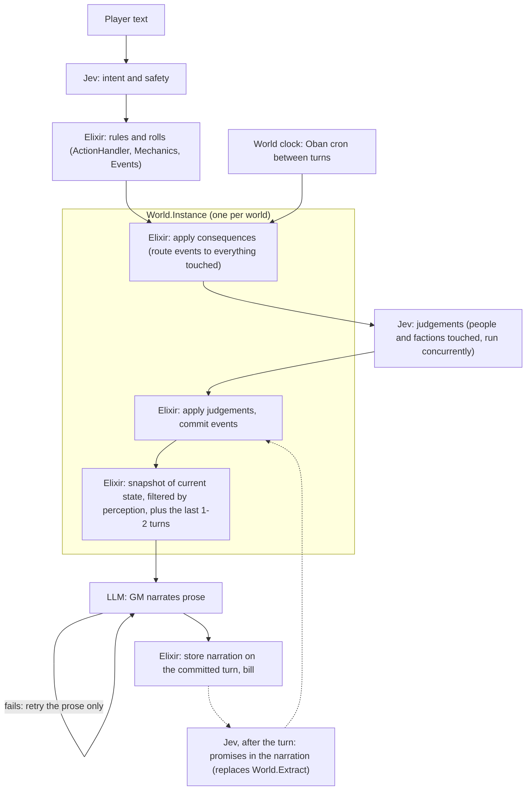

# Design: persistent world state at the core of the turn loop

**Status:** design note, 2026-10-08, asked for by Fredrik (via Case) ([decision](decisions.md#2026-10-08-design-note-persistent-world-state-at-the-core-of-the-turn-loop)). No code. Read against ex-tales-forge `main` `410b132`.

**Update 2026-10-08:** Fredrik answered questions 1–4 of §11 ([decision](decisions.md#2026-10-08-stateful-world-four-design-answers)), and the body below now follows those answers. Questions 5–8 wait for measurements. The first code PR (`WORLD_STATE=shadow`) comes after Jev intent PR 2, and each code PR needs Fredrik's OK.

**In one paragraph:** add an **apply consequences** step between the rules and the prose. The turn's result becomes typed events, routed to everything it touched: people, the player character, places and factions. Each of these updates its own state in plain Elixir: memories, feelings toward others, and traces on places (footprints, felled trees, a burned wagon) that fade with world time. Jev is called only for judgements, such as how Brenna feels about what just happened. Only the rules and Jev write events. What happened is **committed before the GM call**, and the GM gets a **snapshot of the current state plus the last 1–2 turns**, not the whole history. The world keeps moving on world time between turns, which is the [living world](design-world-agents.md#living-world-design-to-try).

- **Decided 2026-10-08:** one process per world instance, with entities as plain data.
- **Recommended:** an **event log plus snapshots** for persistence, and a **shadow mode first**.

## 1. Today, from the code

The loop is input → intent → Elixir rules → LLM prose, as Fredrik describes. But more than the transcript persists. The problem is that the state is spread over several copies, and nothing ties a change to its cause.

1. **Input and intent** (`GameSessions.submit_message/3` → `resolve_and_enqueue/3`): `Game.Intent.resolve_bundle/2` runs the regex heuristic, and below 0.85 confidence the Tier 1 LLM call. The Jev intent reader (`Game.JevIntent`) exists, but only `mix intent.eval` uses it so far ([intent design](design-jev-intent.md)). The turn is queued as an Oban job (`Workers.ProcessTurn`).
2. **Rules** (`Game.TurnProcessor.run/3`, `resolve_rules/2` and `apply_board/6`): `ActionHandler`, `Mechanics` (rolls, wounds), `Inventory`, movement, `WorldClock`, `Train`, then `Events.from_turn/7` (typed events from front and NPC triggers) and `WorldSim.tick/1`, a pure tick of fronts and people. `Perception` hides what the character can't see.
3. **Flagged extras, before the GM:** `World.collect/2` and `World.Prices` (`WORLD_AGENTS`, off on both apps), and `NpcReactions.react/5`: one Jev call per present NPC, at most 4 (`NPC_REACTIONS`, on in playtest only).
4. **Prose:** `Prompts.gm_messages/5` and `LLM.complete_turn/5`. The GM sees the per-turn section (`Context.per_turn_section/1`): perceived facts, the last 2 player actions (120 characters each), the GM's own `situation_lines` summary, NPC sections with their last 5 memories, world facts, reactions and "Scene now".
5. **Persist:** one `Ecto.Multi` rewrites the whole `game_sessions.world_state` map, inserts the `turns` row (player text, narrative, resolution), `session_events` and GM reasoning, and updates `front_instances` and `npc_instances`. After that, outside the transaction: `NPC.apply_gm_updates/3` (the GM's `npc_memory_updates`), `Characters.mirror/1` (the double-write to `characters`, which nothing reads yet), `NPCRegistry.sync/1`, and `NPCSignals.emit_turn_signals/5` to the Jido `NPCAgent`s.

**What that means:**

- **Several copies of the same state.** The mood lives in `npc_instances.runtime_state`, the `NPCAgent`, `world_state["npc_moods"]` and `world_state["npc_state"]`. The `NPCAgent` actions (`OnPlayerTalked`, `UpdateMemory`) write to the database outside the turn's transaction.
- **Agents run only while an NPC is present** (`NPCRegistry` matches them to `present_npcs`; `NPCRecovery` restarts them for every active session at boot), and nothing moves between turns.
- **Places hold no state**, and feelings point only at "the player" (one `relationship_score`).
- **The GM holds the continuity itself,** through its own summary and recent turns. That is where the drift comes from ([world agents](design-world-agents.md#problem)).

## 2. The new turn loop

1. `Consequences.derive/2` turns the rules' result into typed events (id, world tick, kind, actor, targets, place, visibility) and routes each to what it touched: the actor, the target, witnesses, the place, and the factions involved or whose trigger matches.
2. A pure module per kind updates its own state: `Npc.apply/2`, `PlayerCharacter.apply/2`, `Place.apply/2`, `Faction.apply/2`. Where a change needs a judgement, `apply` returns a request instead of guessing.
3. The requests become concurrent Jev calls; the answers come back as `judged` events and are applied the same way.
4. The events and the turn are **committed**. From here on, the world has changed, whatever happens to the GM call (§6).
5. The instance renders the snapshot. The GM narrates from it and from the last 1–2 turns (§9). The GM writes prose only, never state.

**New on the hot path:** one Elixir step. The Jev judgements take the slot of today's NPC reactions.

## 3. What each kind keeps

| Kind | State | Changes from |
|---|---|---|
| **Person (NPC)**, the [one Character type](plan-unify-character.md) | location, mood (in **one** place), **feelings toward others** (a map from character to stance and score, plus the event behind it), memories (references to events, with how she felt about each and how much it matters), concerns, Maslow level, promises, stock and coins | events she witnessed or that touched her; Jev judgements; the world tick (concerns advance, mood calms) |
| **Player character** | the sheet as today (stats, skills, wounds, coins, inventory, LP, location) and what this character has perceived (per character, which multiplayer needs) | rules; events it perceives |
| **Place** | pack facts and learned facts, prices (`World.Prices`), keeper, **traces** (footprints, blood, a burned wagon: what, who, made at which tick, fades at which tick, who can notice it) and **lasting changes** (felled trees, a broken door, with an optional regrow or repair tick) | events that happened there; the world tick |
| **Faction**, the living world's agent | goals, plan steps, clocks and resources (today's `front_instances`), memory of who helped or hindered, disposition, members, temperament, Tuckman phase (the group's own lever) | events that touch it; the world tick (clocks, portents, moves, as `WorldSim` does now); Jev faction reactions |

Fading and regrowth are **stamped ticks**, not timers. A footprint carries `fades_at_tick`. The snapshot shows it as "fresh" or "old" depending on the current world tick, and the next snapshot drops it once it has faded. The result is the same after a restart or a replay, and a long sleep (which jumps hours of world time) needs no special case.

## 4. Processes and plain data

**The rule:** a process for things with their own clock or real concurrency, plain data for everything else.

**Applied (decided 2026-10-08):** only the **world instance** passes that test. Everything inside it is data.

- **One `World.Instance` GenServer per active world.** It runs under the existing `World.Supervisor` (a `DynamicSupervisor`) and is registered in `World.Registry` by world id. It owns the world clock and keeps the state hot in memory. It also serializes writes from turns, cron ticks and, later, several players.
- **Short-lived Tasks for concurrency.** The Jev judgements run as Tasks with a short timeout, as `NpcReactions` does today. They hold no state.
- **A short-lived Task when an NPC needs to think something through.** For example: Rusk weighing whether to offer the player a cut, or Brenna deciding whether to tell what Tam saw.
  - The instance starts a Task under a `Task.Supervisor`, with a copy of that NPC's state.
  - The Task makes its Jev calls (one or a few, no LLM) and returns the answer to the instance as a `judged` event, which the instance applies like any other.
  - The Task holds no state of its own and has a timeout. On the player's clock it shares the judgement time budget; otherwise it runs between turns.
  - It exists only while it matters, so the NPC never becomes a process.
- **Plain data for everything else.** People, the player character, places, items and factions are structs, updated by pure `apply/2` and `advance/2` functions.

**Why not one process per entity** (the brief's starting point). This also **replaces the per-character agent of Character plan phase 3** (decided 2026-10-08):

- **A turn must commit atomically.** It touches several entities, and their changes must land together with the turn. With one process per entity that takes coordination across processes, or a crash leaves half a turn applied. With one instance it is one pure fold and one transaction.
- **Replay needs pure functions.** Pure functions over an ordered log replay identically. Messages between entity processes can arrive in different orders.
- **The entities have no clocks of their own.** Brenna's mood, a footprint and the Guild's dig clock all run on world time, which belongs to the world, not to Brenna. Timers in many processes would die on every deploy and would have to be rebuilt.
- **Processes cost even when idle.** `NPCRecovery` already restarts agents for every active session at boot. Data costs nothing when nobody plays.
- **Pure modules are easy to test.** They need no processes or sandbox.

**Scaling later: split by region.** Long thinking never blocks a world, because it runs in a Task. If a world gets busy enough that its one process becomes the bottleneck (a shared world with many players), it splits into one process per region, never one per entity. The entity modules keep the same `apply/advance` API wherever they are hosted, so the split doesn't change them.

## 5. How it fits what exists

| Today | In this design |
|---|---|
| `World.Agent` (one GenServer per person, place or item, `WORLD_AGENTS`), `World.Registry`, `World.Supervisor` | The supervisor and registry host `World.Instance`. Facts become part of entity state. `World.Prices` stays as it is. `World.Extract` (an LLM call) becomes a Jev call or is dropped (§6). |
| Jido `NPCAgent`, `NPCSignals`, `Actions.NPC.*` | Their logic (`AdjustConcern`, `EmitInitiative`, `UpdateMemory`, the relationship bump) becomes pure `Npc.apply/2` handlers for the `time_passed`, `spoken_to` and `overheard` events. The agents and signals retire, and so do the writes from outside the turn. |
| `NPCRegistry`, `NPCRecovery`, `PlayerSessionAgent` | Not needed. An instance starts lazily from its snapshot and log. Only worlds that run while nobody plays are started by the cron. `PlayerSessionAgent` holds only a turn count and an entries list today. |
| `NpcReactions` (`NPC_REACTIONS`, Jev) | Becomes the people's judgement. It reads the mood and feelings from the state and writes them back as a `judged` event. Same input rules (player-visible only), the same cap of 4, the same cost. |
| `Events.from_turn/7`, `WorldSim.tick/1`, `Perception` | The seed of the consequence events, `Faction.advance/2` plus the people tick, and the filter on the snapshot. All three are already pure. |
| Character phase 1 (`characters`, `character_memories`, `Characters.mirror/1`) | Person and player-character state is the Character shape. The `characters` rows become a projection written when the instance snapshots, which replaces the after-turn mirror. Memory rows point at events, as decision 6 already says. Phase 3's per-character agent is replaced by the per-world process (decided 2026-10-08). |
| GM `npc_memory_updates`, `context_summary` | Only the rules and Jev write events (decided 2026-10-08), so memories come from events and the Jev judgements. `context_summary` (today's `situation_lines`) is replaced by the snapshot plus the last 1–2 turns. Both are read until the GM reads the snapshot, then removed from the reply schema (§6, §10). |

## 6. Persistence: an event log plus snapshots

**Recommended:** the event log is the source of truth, with snapshots so a restart replays only a short tail.

- **Events:** extend `session_events`, which decision 6 already names as the shared events table, with `world_id`, `seq` (per world, unique) and `schema_version`. A turn's events are written in the turn's transaction, so nothing is acknowledged before it is durable. Each event carries the turn id, so an Oban retry can't apply a turn twice.
- **Snapshots:** a new `world_snapshots` table (world id, seq, world tick, schema version, state as a map). One is written every **25 events**, at the end of each cron tick that changed something, and when an instance stops after being idle. Keep the last three.
- **Restart:** load the latest snapshot and replay the at most 25 events after it. These are pure functions, so this takes milliseconds. A deploy never depends on `terminate/2` running.
- **Changing a handler:** bump `schema_version`. A snapshot from an older version is rebuilt by replaying from the pack and the log (or an old event is upcast).
- **Why not snapshots only:** that is today's `world_state` blob. It can't answer "why does Brenna dislike me?", a bug can't be replayed, and memory rows need events to point at anyway.
- **Why not the log only:** replay grows with world time. The cron alone could add 96 ticks per world per day, so a tick records an event only when something changed.

### Commit before the GM (decided 2026-10-08)

The rules and Jev decide what happened, and that is saved first. The GM only tells it.

- **Order:**
  1. Intent, rules, consequences and judgements run.
  2. **Commit:** the events, plus the `turns` row with the player's exact text, the mechanical resolution and status `narrating`, with no narration yet.
  3. The snapshot is rendered.
  4. The GM call runs.
  5. The narration is stored on the same row, and the status becomes `done`.
- **Two jobs instead of one.**
  - `Workers.ProcessTurn` runs up to the commit. Its events carry the turn id, so a retry after the commit adds nothing.
  - A new narration job, keyed by the turn id, runs the GM call. When it fails, Oban retries **only the prose**, rendered from the snapshot at that turn's `seq`. A retry never re-rolls dice, never re-asks Jev and never changes the world.
- **The spend cap** (`AICalls.check_spend_caps`) is checked **before** the commit, so a turn stopped by the cap leaves the world unchanged, as today.
- **What the player sees (proposed):**
  - **Right after the commit:** the play page shows the turn's result in plain words from the mechanical resolution and the judgements, for example "Persuasion failed. Brenna cools toward you." Under it: "The GM is writing…". The narration replaces it when it arrives.
  - **If the GM still fails after its retries** (3 attempts, as today): the plain-words result stays, with a "Retry the narration" button. The player can also just play on. The next GM call gets the snapshot and the last turns, where the missing narration shows as the plain result.
  - **Compared with today:** a failed turn now shows "Turn failed: …", and the player's action is lost. With this change, the action and its consequences stand.
  - **The playtest runner** treats `narrating` as still in progress, and a turn without narration as a narration failure, not a lost turn.

### Who writes events (decided 2026-10-08)

**Only the rules (Elixir) and Jev write events. The GM writes prose only.**

- **The GM's `npc_memory_updates`.**
  - **What replaces them:** memories derived from events. A person who witnessed or took part in an event gets a memory row pointing at it. How she felt about it and how much it matters (felt, salience) come from her Jev judgement (emotion, intensity).
  - **How it moves:** in shadow (§10, PR 1), the derived memories are compared with what the GM writes today, to see what is lost. The field stops being read when the GM reads the snapshot, and it leaves the reply schema in the cleanup PR. That is a deliberate GM prompt change, so the golden fixtures are updated.
- **`World.Extract`.** Today this is one LLM call after the turn (`WORLD_AGENTS`, off on both apps), reading the narration for facts and promises.
  - **Facts:** prices and lore come from the pack and the rules. Free-text facts the GM invents in its prose are no longer recorded, because Jev can't write text.
  - **Promises** become a Jev call after the narration, off the player's clock. It asks a yes/no question: did a present NPC promise the player character something? Then it picks from fixed promise kinds (meal, room, discount, information, help, meeting, other) and from candidate people.
  - **What happens to a confident answer:** it becomes a `promise` event with the same turn id, committed before the next turn.
  - **When it is dropped instead:** if, on a replay of the round 2 runs, this call misses most of the 8 promises that the LLM extraction found.

## 7. Per session now, a shared world later

- **Now:** add `world_id` from the first PR, one world per session (the same id). All new code is scoped to the world, and `game_session_id` stays. This is option A from the [Character plan](plan-unify-character.md#6-decisions-confirmed-by-fredrik-2026-10-07) with B's key already in place.
- **Later (option B):** several sessions join one world, and the instance applies their turns in order. Each player's GM gets a snapshot filtered by what their character perceives, with the GM conversation id still per session.
  - **Conflicts:** a turn's rules run against the seq it read. If another turn landed first, the rules and consequences re-run, which is cheap Elixir.
  - **Order of commit and GM:** consequences are committed **before** the GM call (decided, §6), so a 7-second GM call never holds the world.

## 8. Cost and latency

| Step | Call type | On the player's clock | Cost per turn | Time |
|---|---|---|---|---|
| Intent and safety (planned) | jev | yes | ~$0.0001 | ~0.3 s |
| Rules and rolls (today) | function | yes | 0 | a few ms |
| **Apply consequences** (route, apply) | function | yes | 0 | < 5 ms (estimate; today's world-agent function steps measure 1–3 ms) |
| **Jev judgements:** present people (≤ 4, today's reaction) plus 0–1 faction | jev | yes, concurrent | ≤ ~$0.0005 at $0.0001 per call (measured today: $0.00004) | ~0.3 s wall clock, the slot NPC reactions already use on playtest |
| Commit (events, snapshot every 25) and render the snapshot | function | yes | 0 | ~5–20 ms (estimate) |
| GM narration | llm | yes | ~$0.007 | 3.6–7 s |
| World tick between sessions | function | no | ~0 | — |
| Promise reader (replaces the `World.Extract` LLM call, ~$0.001) | jev | no | ~$0.0001 | ~0.3 s, after the turn |
| Narration retry (only when the GM fails) | llm | yes, on failure | another GM call | 3.6–7 s |

**No new LLM call on the hot path.**

- **Compared with playtest today** (`NPC_REACTIONS` on): about +0–1 Jev call and < 30 ms of Elixir.
- **Compared with production:** +~0.3 s and ≤ ~$0.0005 per turn, the same as turning reactions on.
- **The snapshot replaces** the NPC sections, `situation_lines` and the world facts in the per-turn section, with a hard budget (at most ~1,200 characters, as `World` uses). If it still grows by ~300 uncached tokens, that adds ~$0.0004 per turn ([world agents round 1](design-world-agents.md#first-prototype-results-2026-10-07-10-local-5-turn-runs)).
- **The last turn's narration** (capped at ~800 characters) adds roughly 200 more uncached tokens, about $0.0002 per turn. The short summary it replaces (`situation_lines`, at most 300 characters) offsets part of that.
- **A turn's total** comes to ~0.3 + 0.3 + 3.6–7 s. The [speculative intent idea](future-ideas.md#speculative-intent-while-typing) could take 1–2 s off that later.

## 9. Prompt layout and caching

- **The message order stays** (`Prompts`: narrator, rules, task, session-stable, per-turn). Nothing from the world state or the recent turns enters messages 1–4, and `prompt_prefix_test.exs` keeps guarding that.
- **The per-turn message, in order** (decided 2026-10-08: the snapshot plus the last 1–2 turns):
  1. **The state snapshot.** Committed state, filtered by perception, within its budget.
  2. **The last 1–2 turns.** Each turn's player action and outcome, in today's form: at most 120 characters, and gated on the stored safety decision once Jev intent PR 4 lands. Also the last turn's narration, capped at ~800 characters, so the prose carries on. A turn whose narration failed shows its plain-words result instead. We start with 2 and compare 1 against 2 in the playtest comparison of PR 6.
  3. **What happens now:** "Scene now", the mechanical resolution, the validated player action and the handler result, as today.
- **What this replaces:** the snapshot and the last turns replace `situation_lines` (the GM's own `context_summary`) and the NPC memory lists. The GM is told to treat the snapshot as true and to use the recent turns for voice and continuity only.
- **The render is deterministic.** It has a fixed section order (here, people present, nearby places, known factions) and sorted keys, and uses world time, never wall-clock time. Numbers become words ("fresh tracks", "Brenna: cool toward you since the brawl"), so small changes don't churn the text and the GM never sees raw scores. The same state always gives the same bytes.
- **GM prompts change only on purpose.** `gm_system.txt` gets one deliberate change (treat the snapshot as true, and use the recent turns for continuity). Dropping `npc_memory_updates` and `context_summary` from the reply schema is a second deliberate change, in the cleanup PR. Each change to the snapshot format is its own PR, with the golden fixtures updated and the playtest cache-hit rate checked (20 of 24 hits in [world agents round 2](design-world-agents.md#round-2-results-2026-10-07)).
- **A narration retry sends the same bytes.** It renders from the snapshot at the turn's `seq`, so the retry reuses the cache.
- **Jev inputs** keep the intent design's order: static questions and labels first, the deterministic state after.

## 10. Migration: small PRs, each behind a flag

The flag is `WORLD_STATE=off|shadow|on`. Like `INN_WORLD`, it is read when a session is created and stored in `world_state["features"]`. Each code PR needs Fredrik's OK.

0. **First: Jev intent PR 2** (the Jev intent call wired in behind `INTENT_JEV`, [intent design §9](design-jev-intent.md#9-pr-sequence-each-needs-fredriks-ok)). The world-state work starts after it lands.
1. **Pure state and consequences, in shadow (the first `WORLD_STATE` PR).**
   - **What it adds:** `World.State` structs, `from_session/1` (built from `world_state`, `npc_instances`, `front_instances` and `characters`), `Consequences.derive/2` and pure `apply/2` for each kind. Events come only from the rules and from the Jev reactions that already run.
   - **What shadow does:** after each turn, the events are appended with `world_id` and `seq`, and the shadow state is diffed against today's state (mood, memories, location, clocks), logged and shown as an admin badge. The diff also shows what the derived memories miss compared with the GM's `npc_memory_updates`.
   - **What it doesn't touch:** the commit order, the GM prompt and the calls stay as they are. It ships to playtest in shadow.
2. **`World.Instance` and snapshots.** The GenServer, `world_snapshots`, lazy start and idle stop. Still shadow. Test: kill the instance mid-session and check the state rebuilds identically.
3. **Places and feelings.** Traces and lasting changes, including the Tinjacks' burned wagon from [their escalation stage](design-tin-valley-world.md#the-antagonist-rusk-and-the-tinjacks-pr-c-73), and feelings between characters. Still shadow, plus an admin view of the world state.
4. **Judgements through the instance.**
   - `NpcReactions` reads and writes through the state.
   - Faction reactions come in for events that touch a faction.
   - The short-lived Task for an NPC that needs to think something through.
   - The new promise reader (Jev) runs in shadow next to `World.Extract` on `WORLD_AGENTS` sessions, and on a replay of the round 2 runs.
5. **Commit before the GM** (`on`).
   - `ProcessTurn` splits into the commit job and the narration job, with prose-only retry.
   - The plain-words result, "The GM is writing…" and "Retry the narration" on the play page.
   - The spend-cap check moves before the commit, and the playtest runner learns the `narrating` status.
   - Tests force a GM failure and check that the world keeps the turn and the retry doesn't re-roll.
6. **The GM reads the snapshot plus the last 1–2 turns** (`on`).
   - The new per-turn section, the `gm_system.txt` change and new golden fixtures.
   - `npc_memory_updates` and `context_summary` are no longer read.
   - Then a playtest persona comparison of `on` against `off`: Jev headline, cache hits, cost and latency, and 1 against 2 recent turns.
   - This is the read switch, and it lines up with Character phase 2 (mood in one place).
7. **World time between turns** (`WORLD_TICK=on`). An Oban cron ticks active worlds: the Tinjacks' `trouble` clock, the Guild's `dig`, regrowth. This is the living world's first prototype.
8. **Cleanup** after the comparison:
   - Retire `NPCAgent`, `NPCSignals`, `NPCRecovery`, `PlayerSessionAgent`, the per-entity `World.Agent`, and `npc_moods` and `npc_state` in `world_state`.
   - Remove `npc_memory_updates` and `context_summary` from the GM reply schema (a deliberate prompt change).
   - Replace `World.Extract` with the promise reader, or drop it if the replay showed it misses most promises.
   - Adjust Character phases 3–4 to match: no per-character agent.
9. **Later:** the per-region split when a world needs it, and shared worlds (§7).

## 11. Questions

**Resolved by Fredrik, 2026-10-08** ([decision](decisions.md#2026-10-08-stateful-world-four-design-answers)):

1. **One process per world, or one per entity?** One per world, and entities are plain data. An NPC that needs to think something through gets a short-lived Task when it matters. If a world outgrows one process later, it splits by region. This replaces Character plan phase 3's per-character agent. (§4)
2. **Snapshot only, or keep a short window?** The GM gets the state snapshot plus the last 1–2 turns. (§9)
3. **Commit before or after the GM?** Before. The rules and Jev decide what happened, and it is saved first. If the GM call fails, the world has still changed, and only the prose is retried. (§6)
4. **Which sources may write events?** Only the rules (Elixir) and Jev. The GM's `npc_memory_updates` and `World.Extract` become Jev calls or are dropped. (§6, §10)

**Waiting for measurements:**

5. **Traces:** how fast they fade, and who notices them (anyone, or only on a tracking check). To be decided from the shadow runs of PR 3.
6. **World pace and "runs while away"**, from the [living world](design-world-agents.md#dependencies-and-open-points). To be decided from the PR 7 prototype.
7. **Snapshot cadence:** 25 events is a starting value. To be tuned from PR 2's timings.
8. **Shared worlds:** the conflict policy, perception per player, and resets and moderation. These wait until shared worlds are on the table.

## Related

- [Design sketch: world agents and the living world](design-world-agents.md#living-world-design-to-try)
- [Design: the Tin Valley world and the Tinjacks](design-tin-valley-world.md)
- [Design: player intent as one Jev call](design-jev-intent.md)
- [Plan: one Character entity](plan-unify-character.md)
- [Call types](call-types.md)
- [Future ideas](future-ideas.md), including [memory consolidation and attitude drift](future-ideas.md#memory-consolidation-and-attitude-drift), a later layer on top of this design
