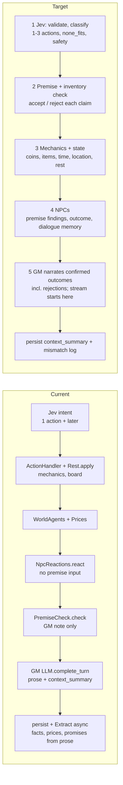

# Design: the turn pipeline (Jev first, GM last)

**Status: Draft.** 2026-10-12, revised after Case's review of `28c0404`. Fredrik approved the stage order at 15:54 and 16:05, and answered the open questions at 16:10 (§11). This document changes no code. Code: [whyse-ab/ex-tales-forge](https://github.com/whyse-ab/ex-tales-forge), main `575c2f0` (#198). Input: Case's analysis `llm-study/jev-threshold.md` and `jev_thr.py`.

## 1. Goal

Every turn runs in one fixed order:

1. **Intent.** Jev validates and classifies the input.
2. **Premise.** The premise and inventory check compares the claims with the state.
3. **Mechanics and state.** The server books coins, items, time, location and rest.
4. **NPCs.** The NPCs react. They get the premise findings and the mechanics outcome.
5. **Narration.** The GM narrates only confirmed outcomes. This includes rejections.

Rule: the narration never invents a sale or a coin change that the mechanics did not record.

## 2. Decisions from the threshold analysis

- Keep the Jev act threshold (`INTENT_ACT_MIN_CONFIDENCE`) at **0.70**. Do not send low-confidence turns to the heuristic or to Grok. Jev is right on 93 % of the gold set. The heuristic is right on 64 %. Jev confidence is well calibrated (ECE 0.037).
- Six of Gentry's seven failures come from the pipeline order. A threshold change fixes none of them.
- Add NPC dialogue memory and a repetition guard.
- Extend the catalogue with `rest`/`sleep` (with an optional lodging payment), `work` and `equip`.
- Jev returns **1 to 3 ordered actions** for this turn. The #198 rule for "pay for a room and sleep" becomes one case of this output.
- Add a real **`none_fits`** class with its own probability. A `none_fits` turn goes to the GM with the raw text and a "no mechanics" note.
- Bug **h-fa06**: strip injected text from the history that the next turn reads. Keep no marked copy. Add a multi-turn test.
- **Skill growth:** a skill improves only after a failure in that exact skill. Rest and work give no growth. Work gives coins only. Today a long rest only resolves the rolls that earlier failures earned (`Progression`, `put_rest_growth`), and `Rest.apply` only shortens a sleep with no bed to 1 hour. The rest itself adds no growth. The target keeps this rule.

## 3. Current flow and target flow

Current flow (from `GameSessions.resolve_and_enqueue_jev`, `Workers.ProcessTurn` and `TurnProcessor.run_steps/5`). The premise check runs **after** the mechanics and the NPC reactions. The GM gets the findings, but the NPCs and the books do not.

Changes in the target flow:

- The premise check moves from after the NPCs to stage 2. A rejected claim never reaches the mechanics as fact.
- The mechanics write an **outcome record** (accepted actions, rejected actions with a reason, coin and item deltas, clock, location). Stages 4 and 5 read only this record.
- `Rest.apply` becomes the `rest` handler in stage 3. It is no longer a special case of `wait`.
- State writes today: the GM writes only `context_summary` (`apply_allowlisted_patches`, `turn_processor.ex` about line 637). `Extract` writes facts, prices and promises from the prose. It writes no coins, items or location. The target keeps the GM to `context_summary` only.
- **Extract prices is the one remaining prose-to-state path.** Rule: a price in the prose never books a sale. Only stage 3 books a sale, at the price that stage 3 resolves.
- Stage 4 or the server writes NPC memory. The GM never writes it.
- **Streaming:** the GM stream starts only after stage 3 has booked everything and stage 4 has returned. There is no retry while the stream runs.

## 4. Findings mapped to stages

| Finding | Root cause | Stage that fixes it |
|---|---|---|
| "Pay for a room and sleep" dropped (Jev `wait` @0.96) | Catalogue has no rest; one action per turn | **1** (`rest` + ordered actions), **3** (pay, then sleep) |
| Broken clarification: "buy Marta Kellen?", own items offered as buy targets, 27 s turns | The question uses raw readings, not the state | **1** (clarification policy, §6), **2** (filter targets against the inventory and the people present) |
| NPC repeats the same speech; items re-given that never reach inventory | No dialogue memory; the GM gives items without a booking | **4** (dialogue memory, repetition guard), **3** (a gift is a booked transfer) |
| Past-event enchanted armor accepted (h-fp13) | Premise check runs too late and only adds a note | **2** (reject the claim), **5** (narrate the rejection) |
| Coins and items out of sync with the prose (stew, bread, h-fp14) | GM narrates sales that the mechanics did not record | **3** (book the sale), **5** (output contract, §5) |
| Location does not follow the prose; prose contradicts the clock | Move and time come from the prose, or the GM ignores them | **3** (the server owns location and clock), **5** (GM gets both as fixed facts) |
| #180: premise phrasing | GM prompt wording for the false-premise note | **5** (one fixed rejection phrasing in the prompt) |
| #180: NPCs react before the premise check | Order in `run_steps/5` | **2 before 4** |
| #180: rejected sale not passed to the GM | Mechanics outcome does not reach the prompt | **3** (outcome record), **5** (prompt reads it) |
| h-fa06: injected text bleeds into the next NPC line | The history keeps the raw injected text | **1** (label the turn), history builder in `Context` (strip the text) |

## 5. GM output contract

The GM gets the outcome record and returns `GMStructuredResponse`. The contract:

1. The GM narrates each accepted action and each rejected action. A rejection uses in-world words and gives the reason in one sentence.
2. The GM states no coin amount, item gain or item loss that the record does not contain.
3. The GM uses the location and the clock from the record. It does not move the character.
4. The GM speaks for an NPC only in line with the stage 4 reaction. It does not repeat a line from the NPC dialogue memory.
5. For `none_fits`, the GM narrates the attempt with no mechanical effect. No other LLM call runs.
6. The only state the GM writes is `context_summary` (max 300 characters). `gm_notes` is for logs only. The GM writes no NPC memory, coins, items, location or clock.
7. The GM states no skill growth that stage 3 did not record.

A post-check compares the prose with the record: coin numbers, item names, location names and clock words. Each mismatch is logged and counted as a bug. A mismatch fails the replay fixtures (§9). There is no GM re-run.

## 6. Clarification policy

`none_fits` is one class in Jev's distribution. It uses the same bands as the other classes:

| Band | Condition (calibrated confidence of the top class) | Action |
|---|---|---|
| act | ≥ 0.70 | Play the top class. If it is `none_fits`, send the raw text to the GM with a "no mechanics" note. |
| best_guess | 0.45 to 0.70, or the top two have the same consequence | Play the top class. Route to `none_fits` only when `none_fits` is the top class. |
| ask | < 0.45 (or raw < 0.45), and the top two have different consequences | Ask one question. `none_fits` can be one option ("something else"). |

- Default: play the best guess. Do not route to `none_fits` when another class wins.
- Ask at most 1 question per turn. Offer at most 3 options.
- Build the options from the state. Offer only items the character can buy, people who are present, and items the character owns for sell, drop or equip. Never offer a person as an item.
- If no valid option remains, play the top class.
- The question is a template with no LLM call. It appears ≤ 0.5 s after submit (stages 1 and 2 only). Target: the ask band is ≤ 6 % of live turns (today 13 of 616 = 2.1 %).

## 7. Latency budget

Measured in playtest `ai_calls` (2026-10-06 to 10-12, read-only query in Case's latency study, `llm-study/report.md`): Jev intent p95 291 ms (n=574), Jev `npc_reaction` p95 311 ms (n=2710), `turn.rules` 7 ms, `turn.persist` 69 ms, GM call p95 9.2 s (not streamed). The playtest app had no started VM on 2026-10-12 16:10, so this revision did not run a new query. Production has too few rows (6) for statistics.

Today `NPC_REACTIONS_TIMEOUT_MS` defaults to 2500 ms, and `Task.async_stream` kills a task at timeout + 500 ms = 3.0 s (`npc_reactions.ex` lines 130 to 139). That is far above the measured p95. **Confirmed (Fredrik, 2026-10-12):** set `NPC_REACTIONS_TIMEOUT_MS` to 600 ms. The kill then comes at 1.1 s. A reaction that times out is dropped, and the NPC keeps the mood from the last turn.

| Stage | Budget (p95) | Basis |
|---|---|---|
| 1 Jev intent | 0.3 s | measured 0.29 s; fallback timeout 1.5 s |
| 2 Premise check | 0.1 s | deterministic, no LLM |
| 3 Mechanics and state | 0.1 s | measured `turn.rules` 7 ms |
| 4 NPC reactions (concurrent, max 4) | 0.4 s | measured 0.31 s; timeout 0.6 s |
| **Stages 1 to 4** | **0.9 s** | |
| 5a GM first text | ≤ 1.0 s after stage 4 ends | #191 streaming; ≤ 1.9 s after submit |
| 5b GM rest of stream | 3.9 s | |
| Persist | 0.2 s | measured 69 ms |
| **Full turn** | **6.0 s** | 0.9 + 1.0 + 3.9 + 0.2 |

The GM budget (4.9 s) is below today's GM p95 of 9.2 s. Bobby applies these levers in this order, and Case measures the GM p95 after each one:

1. #191 streaming.
2. The lean production reply, with no `gm_notes` and no `location_name`.
3. A lower max-token cap on the GM reply.

A model change is not a lever in this plan. It waits for its own decision. No new LLM call goes on the critical path. Grok is not a fallback for intent.

## 8. Migration

Small PRs. Each one has a flag and a default of off until its eval passes.

1. **Outcome record** in stage 3 and in the GM prompt (fixes the rejected sale). No order change.
2. **Premise first** (`TURN_PREMISE_FIRST`): move `PremiseCheck` before mechanics and NPCs. Rejections block the action.
3. **State from mechanics**: coins, items, location and clock come only from stage 3. Add the prose post-check (log only).
4. **NPC memory** (`NPC_DIALOGUE_MEMORY`): the last 3 lines per NPC, written by stage 4, plus a repetition guard. NPCs get the premise findings. Set `NPC_REACTIONS_TIMEOUT_MS` to 600.
5. **Catalogue** (`JEV_CATALOGUE_V2`): `rest`, `work`, `equip`, `give`, 1 to 3 ordered actions, `none_fits`. `work` gives coins only. Retrain and re-run the eval. Remove the #198 rule after.
6. **Clarification v2**: state-filtered options.
7. **h-fa06**: strip injected text from the history. Add the multi-turn test.

Owners: Bobby builds the PRs. Case owns the eval plan and the fixtures. Gentry runs the adversarial and multi-turn sessions against the fixtures. Fredrik approves each flag flip to on.

## 9. Test and eval plan

- **Regression fixtures:** Gentry's session 0caf (11 turns) and the #180 cases (h-fp12, h-fp13, h-fp14, h-fa06) become replay fixtures (owner: Case). Each fixture asserts the outcome record and the books, not the prose words.
- **Intent eval:** `mix intent.eval` on the tune split. Target: Jev accuracy at or above 93 %, ECE at or below 0.05, and a `none_fits` recall target that the team sets after labelling.
- **Adversarial and multi-turn sessions:** Gentry runs them against the fixtures before each flag flip.
- **Multi-turn tests:** an injection on turn N does not appear in any line on turn N+1 or N+2. A sale on turn N matches the coins on turn N+1.
- **Skill-growth fixture:** (a) a failed lockpick improves only lockpicking; (b) a long rest and a work turn with no failure give no growth; (c) a work turn adds coins and no skill or item.
- **Mismatch metric:** each prose/record mismatch counts as 1 bug. A replay fixture fails on 1 or more mismatches. Live target: 0 mismatches per 100 turns.
- **Live metrics** (owner: Case, weekly; Bobby adds the metrics in the PRs): mismatch count, `none_fits` rate, repetition-guard hits, latency per stage (`Steps`).

## 10. Risks

- Stricter premise checks can reject true claims. Mitigation: reject only claims that the state contradicts. Case reviews the rejection log weekly. Gentry runs adversarial sessions with true and false claims.
- More Jev classes can lower accuracy on the old classes. Mitigation: Case gates the merge on the eval.
- Ordered actions can fail part way (pay succeeds, sleep fails). Mitigation: the record holds each action result, and the GM narrates each one.
- A 600 ms NPC timeout can drop reactions. Mitigation: track the drop rate. Raise the timeout if drops are above 2 % of calls.
- The GM budget of 4.9 s is about half of today's GM p95. Mitigation: the three levers in §7, in order.
- The gold set is small below 0.8 confidence (2 to 14 items per bucket). Mitigation: label more live turns.

## 11. Decided (Fredrik, 2026-10-12 16:10)

1. A rejected action costs no game time. The clock does not advance for it.
2. Catalogue v2 adds `give` now. `eat` and `drink` come later.
3. `none_fits` uses no extra Grok call. The GM handles it alone.
4. On a prose/record mismatch, the server logs it and counts it as a bug that fails the fixtures. There is no GM re-run.
5. The server strips injected text from the history. It keeps no marked copy.

See the [decision log](decisions.md#2026-10-12-turn-pipeline-order-and-rules).
