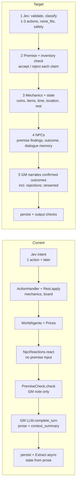

# Design: the turn pipeline (Jev first, GM last)

**Status: Draft.** 2026-10-12. Fredrik approved the stage order at 15:54 and 16:05. This document changes no code. Code: [whyse-ab/ex-tales-forge](https://github.com/whyse-ab/ex-tales-forge), main `575c2f0` (#198). Input: Case's analysis `llm-study/jev-threshold.md` and `jev_thr.py`.

## 1. Goal

Every turn runs in one fixed order:

1. **Intent.** Jev validates and classifies the input.
2. **Premise.** The premise and inventory check compares the claims with the state.
3. **Mechanics and state.** The server books coins, items, time, location and rest.
4. **NPCs.** The NPCs react. They get the premise findings and the mechanics outcome.
5. **Narration.** The GM narrates only confirmed outcomes. This includes rejections.

Rule: the narration never invents a sale or a coin change that the mechanics did not record.

## 2. Decisions from the threshold analysis

- Keep the Jev act threshold (`INTENT_ACT_MIN_CONFIDENCE`) at **0.70**. Do not send low-confidence turns to the heuristic or to Grok. Jev is right on 93 % of the gold set. The heuristic is right on 64 %. Jev confidence is well calibrated (ECE 0.037).
- Six of Gentry's seven failures come from the pipeline order. A threshold change fixes none of them.
- Add NPC dialogue memory and a repetition guard.
- Extend the catalogue with `rest`/`sleep` (with an optional lodging payment), `work` and `equip`.
- Jev returns **1 to 3 ordered actions** for this turn. The #198 rule for "pay for a room and sleep" becomes one case of this output.
- Add a real **`none_fits`** class with its own probability. A `none_fits` turn goes to the GM with the raw text and a "no mechanics" note.
- Bug **h-fa06**: strip or mark injected text in the history that the next turn reads. Add a multi-turn test.

## 3. Current flow and target flow

Current flow (from `GameSessions.resolve_and_enqueue_jev`, `Workers.ProcessTurn` and `TurnProcessor.run_steps/5`). The premise check runs **after** the mechanics and the NPC reactions. The GM gets the findings, but the NPCs and the books do not.

Changes in the target flow:

- The premise check moves from after the NPCs to stage 2. A rejected claim never reaches the mechanics as fact.
- The mechanics write an **outcome record** (accepted actions, rejected actions with a reason, coin and item deltas, clock, location). Stages 4 and 5 read only this record.
- `Rest.apply` becomes the `rest` handler in stage 3. It is no longer a special case of `wait`.
- State comes from the mechanics. Extraction from the prose is no longer a source of coins, items or location.

## 4. Findings mapped to stages

| Finding | Root cause | Stage that fixes it |
|---|---|---|
| "Pay for a room and sleep" dropped (Jev `wait` @0.96) | Catalogue has no rest; one action per turn | **1** (`rest` + ordered actions), **3** (pay, then sleep) |
| Broken clarification: "buy Marta Kellen?", own items offered as buy targets, 27 s turns | The question uses raw readings, not the state | **1** (clarification policy, §6), **2** (filter targets against the inventory and the people present) |
| NPC repeats the same speech; items re-given that never reach inventory | No dialogue memory; the GM gives items without a booking | **4** (dialogue memory, repetition guard), **3** (a gift is a booked transfer) |
| Past-event enchanted armor accepted (h-fp13) | Premise check runs too late and only adds a note | **2** (reject the claim), **5** (narrate the rejection) |
| Coins and items out of sync with the prose (stew, bread, h-fp14) | GM narrates sales that the mechanics did not record | **3** (book the sale), **5** (output contract, §5) |
| Location does not follow the prose; prose contradicts the clock | Move and time come from the prose, or the GM ignores them | **3** (the server owns location and clock), **5** (GM gets both as fixed facts) |
| #180: premise phrasing | GM prompt wording for the false-premise note | **5** (one fixed rejection phrasing in the prompt) |
| #180: NPCs react before the premise check | Order in `run_steps/5` | **2 before 4** |
| #180: rejected sale not passed to the GM | Mechanics outcome does not reach the prompt | **3** (outcome record), **5** (prompt reads it) |
| h-fa06: injected text bleeds into the next NPC line | The history keeps the raw injected text | **1** (mark the turn), history builder in `Context` (strip or mark it) |

## 5. GM output contract

The GM gets the outcome record and returns `GMStructuredResponse`. The contract:

1. The GM narrates each accepted action and each rejected action. A rejection uses in-world words and gives the reason in one sentence.
2. The GM states no coin amount, item gain or item loss that the record does not contain.
3. The GM uses the location and the clock from the record. It does not move the character.
4. The GM speaks for an NPC only in line with the stage 4 reaction. It does not repeat a line from the NPC dialogue memory.
5. For `none_fits`, the GM narrates the attempt with no mechanical effect.
6. The only state the GM writes is `context_summary`, `gm_notes` and NPC memory, inside the current caps.

A post-check compares the prose with the record (coin numbers, item names, location names). In the first PR it logs mismatches. Later it can trigger one retry.

## 6. Clarification policy

- Ask only in the `ask` band, and only when the top two readings have different consequences.
- Ask at most one question per turn. Offer at most three options.
- Build the options from the state. Offer only items the character can buy, people who are present, and items the character owns for sell, drop or equip. Never offer a person as an item.
- If no valid option remains, play the best guess or send the turn as `none_fits`.
- The question is a template. It uses no LLM call. It must appear in under 1 s.

## 7. Latency budget

| Stage | Budget (p95) |
|---|---|
| 1 Jev intent | 0.3 s (live p95 0.29 s; timeout 1.5 s) |
| 2 Premise check | 0.1 s (deterministic) |
| 3 Mechanics | 0.1 s |
| 4 NPC reactions (concurrent, max 4) | 0.8 s |
| 5 GM, first text (#191 streaming) | about 1 s from submit |
| Full turn | under 6 s |

No new LLM call goes on the critical path. Grok is not a fallback for intent.

## 8. Migration

Small PRs. Each one has a flag and a default of off until its eval passes.

1. **Outcome record** in stage 3 and in the GM prompt (fixes the rejected sale). No order change.
2. **Premise first** (`TURN_PREMISE_FIRST`): move `PremiseCheck` before mechanics and NPCs. Rejections block the action.
3. **State from mechanics**: coins, items, location and clock come only from stage 3. Add the prose post-check (log only).
4. **NPC memory** (`NPC_DIALOGUE_MEMORY`): last lines per NPC plus a repetition guard. NPCs get the premise findings.
5. **Catalogue** (`JEV_CATALOGUE_V2`): `rest`, `work`, `equip`, 1 to 3 ordered actions, `none_fits`. Retrain and re-run the eval. Remove the #198 rule after.
6. **Clarification v2**: state-filtered options.
7. **h-fa06**: mark or strip injected text in the history. Add the multi-turn test.

## 9. Test and eval plan

- **Regression fixtures:** Gentry's session 0caf (11 turns) and the #180 cases (h-fp12, h-fp13, h-fp14, h-fa06) become replay fixtures. Each fixture asserts the outcome record and the books, not the prose words.
- **Intent eval:** `mix intent.eval` on the tune split. Target: Jev accuracy at or above 93 %, ECE at or below 0.05, and a `none_fits` recall target that the team sets after labelling.
- **Multi-turn tests:** an injection on turn N does not appear in an NPC line on turn N+1. A sale on turn N matches the coins on turn N+1.
- **Live metrics:** the prose/record mismatch rate, the `none_fits` rate, the repetition-guard hits, and the latency per stage (`Steps`).

## 10. Risks

- Stricter premise checks can reject true claims. Mitigation: reject only claims that the state contradicts, and log each rejection for review.
- More Jev classes can lower accuracy on the old classes. Mitigation: gate the merge on the eval.
- Ordered actions can fail part way (pay succeeds, sleep fails). Mitigation: the record holds each action result, and the GM narrates each one.
- NPC reactions with premise input can add latency. Mitigation: keep the concurrent timeout.
- The gold set is small below 0.8 confidence (2 to 14 items per bucket). Mitigation: label more live turns.

## 11. Open questions for Fredrik

1. Must a rejected action cost the turn (clock advances), or is it free?
2. Do `eat`/`drink` and `give` go into catalogue v2, or later?
3. For `none_fits`, do we want one optional Grok call if a measurement shows it helps, or the GM only?
4. Must the prose post-check retry the GM on a mismatch, or only log it?
5. Strip injected text from the history, or keep it with a mark for the GM?
