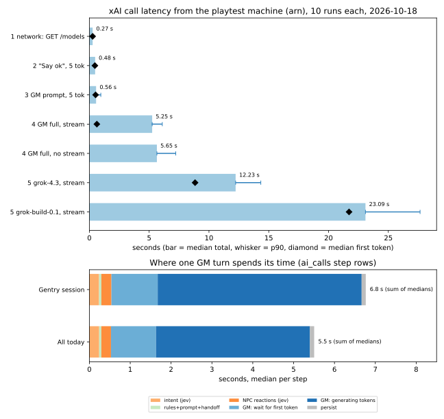

# Why a GM reply takes 5-10 s (LLM latency, 2026-10-18)

Measure only. No app code was changed, and no turns were played for this.

## Method

- **Where:** the `tales-forge-playtest` machine (`d89905da19e408`, region `arn`, the
  same region as production). Scripts ran inside the release with
  `/app/bin/ex_tales_forge rpc`, copied over with `flyctl ssh sftp`.
- **Client and config:** the app's own Req client, base URL
  (`:xai_api_base`, default `https://api.x.ai/v1`), model (`TalesForge.LLM.tier2_model/0`
  = `grok-4.20-0309-non-reasoning`) and the `XAI_API_KEY` of the machine. The GM
  calls use the same body as `LLM.complete_turn/5`: temperature 0.7, strict
  `json_schema` (`narration_schema(:full)`, the playtest variant), `x-grok-conv-id`,
  `max_tokens` = `TIER2_MAX_TOKENS` 700 + 100 for `gm_notes` = 800.
- **The real GM prompt:** built with `TalesForge.Prompt.Assemble.gm_messages/3` from
  Gentry's session `643b8031-...` (read in a `READ ONLY` transaction), with the last
  turn's player action and mechanical resolution. 5 messages, 51.9k characters,
  13,360 input tokens. Real turns of that session had 12.1k-13.7k, so the size matches.
- **Not recorded:** the experiment calls went straight through Req, so they wrote no
  `ai_calls` rows. Cost comes from the provider's `cost_in_usd_ticks`.
- **Timing:** monotonic clock around each call. TTFT = first non-empty
  `delta.content` in the stream. TTFB = first byte of the response body. 10 runs per
  row, run one after another. p90 is interpolated.
- **Turn split:** the step rows the app already writes to `ai_calls`
  (`call_type` `"function"`, purpose `turn.<step>`, `TalesForge.AICalls.Steps`) plus
  the `llm`/`jev` call rows, read in a `READ ONLY` transaction. All 97 complete
  playtest turns of today (6 sessions, 08:27-15:22 Stockholm time), with Gentry's
  15:20-15:22 session shown on its own.

Scripts: [`2026-10-llm-latency-scripts/`](2026-10-llm-latency-scripts/). Raw data:
[`2026-10-llm-latency.csv`](2026-10-llm-latency.csv) (experiments, one row per call)
and [`2026-10-llm-latency-turns.csv`](2026-10-llm-latency-turns.csv) (one row per turn).

## Results: API experiments (10 runs each, median / p90, ms)

| # | Call | TTFT | Total | In tokens | Out tokens | Cached |
|---|------|------|-------|-----------|------------|--------|
| 1 | Network: cold HTTPS `GET /models` (DNS+TCP+TLS 12 / 14) | - | 274 / 300 | - | - | - |
| 1 | Same, warm Req pool | - | 209 / 225 | - | - | - |
| 2 | "Say ok", `max_tokens` 5, stream | 463 / 503 | 482 / 509 | 186 | 1 | 128 |
| 3 | Real GM prompt, `max_tokens` 5, stream | 520 / 942 | 561 / 957 | 13,360 | 5 | 13,312 (run 1: 128) |
| 4 | Real GM prompt, normal settings, stream | 627 / 770 | 5,252 / 6,097 | 13,360 | 382 / 462 | 13,312 (2 of 10: 128) |
| 4 | Same, no stream | - | 5,646 / 7,221 | 13,360 | 407 / 429 | 13,312 |
| 5 | Same as 4s on `grok-4.3` | 8,840 / 11,421 | 12,230 / 14,335 | 13,368 | 218 / 255 | 13,312 (2 of 10: 128) |
| 5 | Same as 4s on `grok-build-0.1` (alias `grok-code-fast-1`) | 21,716 / 24,836 | 23,089 / 27,654 | 13,362 | 287 / 321 | 13,312 (1 of 10: 128) |

What this says:

- **The network is not the problem.** DNS+TCP+TLS to `api.x.ai` is 12 ms from `arn`.
- **The input size is not the problem either** while the prompt cache hits: 186 vs
  13,360 input tokens moves TTFT from 463 to 520 ms. The one cold (uncached) run
  had 920 ms.
- **Output tokens are the problem.** A full GM reply takes ~5.3 s, of which ~0.6 s
  is waiting for the first token and the rest is generation: about **12-14 ms per
  output token** (fit over exp 4 and the 97 real turns: 12.1 ms/token in real turns,
  14.4 ms/token in exp 4), so ~70-80 tokens/s.
- **No faster model is on our key.** `/v1/models` lists the 4.20 family, `grok-4.3`,
  `grok-4.5`-`4.7` and `grok-build-0.1`; no `fast`/`mini` variant. Both models tried
  reason before they answer and were 2-4x slower (and up to 1.5x the cost), so
  `grok-4.20-0309-non-reasoning` is the fastest option today.
- **Streaming vs not:** about the same total (5.25 vs 5.65 s median), but only the
  stream shows text early.
- **Prompt cache:** hits were 13,312 of 13,360 tokens in the experiments (the same
  prompt repeated). The first call of each new `conv-id` missed (cached 128).

## Results: real turns (from `ai_calls`, median / p90, ms)

| Step | Gentry 643b8031 (10 turns) | All today (97 turns) | Kind |
|------|------|------|------|
| Intent parse (`turn.intent`, 1 Jev call) | 237 / 279 | 240 / 281 | LLM (Jev) |
| Hand-off intent -> turn job | 28 / 35 | 26 / 33 | ours |
| Rules (`turn.rules`) | 10 / 12 | 10 / 14 | ours |
| NPC reactions (`turn.npc_reactions`, 1-3 Jev calls in parallel) | 246 / 304 | 236 / 282 | LLM (Jev) |
| Premise check | 0 / 0 | 0 / 0 | ours |
| Prompt build (`turn.prompt`) | 18 / 22 | 17 / 21 | ours |
| GM: wait for first token | 1,134 / 1,498 | 1,103 / 1,335 | LLM (Grok) |
| GM: whole call (`gm`, includes the line above) | 6,126 / 6,810 | 4,871 / 6,032 | LLM (Grok) |
| Persist (`turn.persist`) | 101 / 124 | 103 / 133 | ours (DB) |
| **Turn wall time** (intent start -> persist end) | **6,772 / 7,511** (5.3-9.5 s) | **5,624 / 6,695** | |
| GM output tokens | 344 / 388 | 352 / 391 | |
| GM input tokens (cached) | 12,830 (9,536) | 12,587 (10,368) | |

**LLM calls per turn:** always **1 Grok call** (`gm`, streamed) and **1 + 1-3 Jev
calls** (`intent`, then `npc_reaction`; Jev is `api.typesafe.ai`, not Grok). The NPC
reactions run in parallel with each other (step time ~= the slowest call, not the
sum: e.g. 247 ms for 3 calls of 205-235 ms). Everything else is sequential:
intent -> rules -> NPC reactions -> prompt -> GM -> persist. 2 of 97 turns also had a
`thought` call. `memory.compress` (Jev) and `scene` (Grok) run outside turns.
Today: 65 turns with 1 NPC reaction, 10 with 2, 22 with 3.

Not covered: the time before `turn.intent` (LiveView submit) and after persist
(PubSub broadcast, render). The 5.7-9.9 s seen by players includes these, so they
are likely a few hundred ms. The playtest log buffer no longer had these turns.

## Where the time goes

In Gentry's turns, **90% of the wall time is the one Grok GM call** (6.1 of 6.8 s);
across all of today's turns it is 88%. Of that call, ~1.1 s is waiting for the first
token and ~5 s is generating ~350 output tokens at ~12-14 ms each. Our own pipeline
(rules, prompt, DB persist, hand-off) is ~160 ms. The two Jev calls before the GM
(intent, NPC reactions) add ~0.5 s. The player sees the first narrative text about
1.7 s after the turn starts (0.55 s pipeline + 1.1 s TTFT), but the turn only
finishes when the whole JSON is done. Text length: the stored narratives are 87k
characters for 34.6k output tokens, so roughly 60% of the output is the narrative
and ~40% (~140 tokens, ~1.7 s) is `gm_notes`, the other structured fields and JSON
(estimate, at ~4.2 characters per token of English prose).

One open point: real turns wait 1.1 s for the first token, but the same prompt in
exp 4 waited 0.6 s. Cache misses do not explain it (today's 28 turns with
`cached_tokens` 128 had the same median TTFT as the 69 hits, 1.09 vs 1.11 s; misses
cost ~2-3x per call, though).

## Options to cut it (ranked)

1. **Fewer output tokens per GM reply.** Each token costs ~12-14 ms. Dropping the
   bookkeeping tail (e.g. the `:lean` variant production already uses: no `gm_notes`,
   100 fewer tokens of budget) plus a shorter narrative target (e.g. ~200 instead of
   ~350 output tokens) saves **~1.8-2.0 s per turn (~30%)**. Each 100 tokens cut
   ~= 1.2-1.4 s.
2. **End the turn for the player when the narrative is done.** `narrative` is the
   first field in the schema, so the player can get the input back once its string
   closes, while the structured tail finishes in the background. Expected gain:
   **~1.5-1.7 s of perceived wait** (the ~140-token tail), with no change to the model
   output.
3. **Start the GM call earlier.** Intent (240 ms) and NPC reactions (240 ms) run one
   after the other before the GM. Running the NPC reactions next to the rules/intent
   where their inputs allow, or giving them a tighter timeout, saves **at most
   ~0.25 s (~4%)**. A faster model is not an option today (see exp 5); network and
   input size give nothing to win.

## Cost of this run

60 model calls (no turns): **$0.32** total by the provider's own cost field
(exp 2 $0.001, exp 3 $0.041, exp 4 $0.102, exp 5 $0.175). `/models` calls are free.
