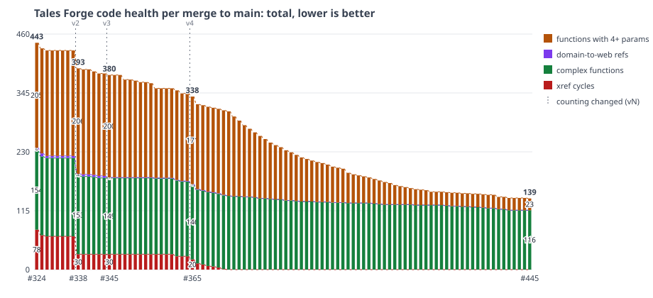

# Code health ratchet

The ratchet measures only code we write, which is `lib/`. It never
measures `deps/` or generated framework code, and framework-dictated shapes
are exempt: `@impl` callbacks are not counted for parameters, and the `~p`
edges into the router are not counted as cycles (#338), nor
application.ex starting the web endpoint, telemetry and presence as
domain -> web references (#345).

`mix health.check` (CI, and `mix precommit`) measures the code and
compares it with the same numbers at the base commit (`--base REF`,
default `origin/main`; CI passes the merge's first parent). It checks the
base out in a temporary git worktree and runs that commit's own
`mix health.check --out FILE` there. No baseline is committed: the base's
debt is the allow-list, so parallel PRs never conflict on it, and a PR
that pays debt down needs no extra file. The numbers:

- `cycles`: every `mix xref graph --format cycles` cycle (`all`, without
  `lib/ex_tales_forge_web/router.ex`) and every `--label compile-connected`
  cycle (with the router), with its size and member files. Every LiveView
  links to the router with `~p` and the router names every LiveView, so
  with the router every page would be in a cycle with every other.
- `web_references`: each `lib/ex_tales_forge/` file that references a
  `lib/ex_tales_forge_web/` file in the xref graph, and the files it references.
  `lib/ex_tales_forge/application.ex` starting the endpoint, telemetry and
  presence does not count: Phoenix generates that supervision tree, and the
  app has to start them somewhere. `online.ex` -> `presence.ex` counts.
- `complex_functions`: each function over the Credo limits (cyclomatic
  complexity 9, ABC size 30) with its scores. A score is that function's
  ceiling; a missing score means the limit is its ceiling.
- `live_view_references`: each LiveView (`use TalesForgeWeb, :live_view` or
  `:public_live_view`) that references another LiveView in the xref graph,
  and the LiveViews it references (none on 2026-10-17). The router no
  longer shows pages that render each other; this list does.
- `counting`: the version of how the numbers are counted (2 since the
  router left the `all` cycles, 3 since application.ex's web children left
  the domain -> web references).
- `wide_functions`: each `def`/`defp` head with 4 or more parameters
  (counted from the AST, `@impl` callbacks skipped), with its file and count.

It fails when the code is worse than the base: more cycles, a cycle that
is new or bigger than every base cycle, a new domain -> web reference, a
new LiveView -> LiveView reference, a new function over a limit, a score
above its ceiling, a new function with 4+ parameters, a listed one that
gained parameters, or a raised Credo limit. A rule that is new in the PR
has nothing at the base to compare with, so it starts from the PR's own
numbers. Until 2026-10-17 the numbers were committed in `baseline.json`
and every PR rewrote it; a base that still has that file is compared with
it. `mix health.check --out FILE` writes the numbers as JSON.

## History

`history.csv` has one row per merge to main since #324 (the ratchet): date,
PR, xref cycles, largest cycle, compile-connected cycles (count and largest),
domain -> web references, functions over the complexity limits,
functions with 4+ parameters and `counting` (blank is 1). A bar where
`counting` changes is marked "counting changed": the router left the `all`
cycles at that merge (65 → 30 on the same code), and application.ex's
web children left the domain -> web references at #345 (4 → 1),
not refactors. Lower is
better. `mix health.snapshot` measures HEAD, puts its row in the CSV and
redraws `trend.svg`: one stacked bar per merge (xref cycles + complex
functions + domain -> web refs + functions with 4+ parameters, total on
top). After each merge to main,
`.github/workflows/health-snapshot.yml` runs it and pushes the row to the
branch `health-history`, with one open PR for it; merging that PR adds the
rows to main. GitHub holds every pull_request run on a PR that
github-actions[bot] opened until a human approves it, so CI skips that PR's
pull_request runs (it changes only the two history files) and the snapshot
workflow dispatches CI on the branch instead. GitHub does not count a
dispatched run's own checks on a PR, so that run sets commit statuses
named Test and Dialyzer on the branch head with its results (job "Report
dispatched checks"): the required checks pass with no approval. The first rows are the merges that changed the then committed
`baseline.json` (#324, #325, #326), measured again at each merge commit. The 4+ parameter
counts up to #334 were measured on each merge commit's `lib/` too. When
main changes the history files, the snapshot workflow merges main with
main's side (`-X theirs`) and passes the branch's old file to
`mix health.snapshot --keep`, so no row is lost. The workflow has no
concurrency group (GitHub cancelled all but one pending run in a group,
which dropped rows when merges came close together): each run measures
its own merge with `--out`, rebuilds the branch from the latest main
(only the two history files differ from main), adds the row with `--row`
and retries the push when main moved or another run pushed first.
GITHUB_TOKEN may not push workflow files that differ from main's, so a
run never pushes an older main (#345's row was lost so, and added back). A row goes in merge
order, also when the runs finish in the other order.

`lib/ex_tales_forge -> ExTalesForgeWeb` is measured with xref (real compile, export and
runtime references), not grep: module names in docs and strings do not count.
