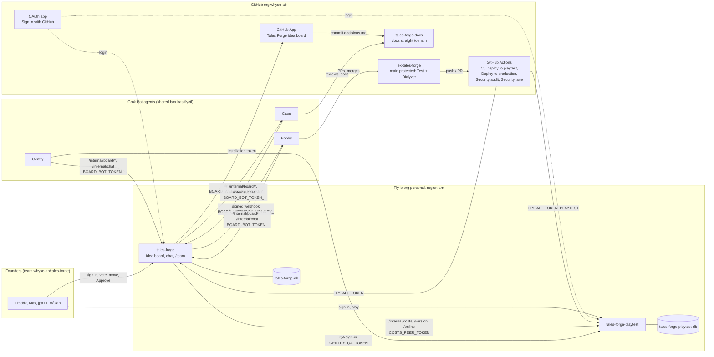

# Infrastructure setup and rebuild from scratch

This document tells you how the Tales Forge integration is connected. It also tells you how to build it again from nothing.

**Rule:** This document contains no secret values. It gives the name of each secret, where the value comes from, and who owns it. Do not add a value to this document, to a commit, to a log or to a chat message.

**Facts in this document** were read on 2026-10-12 at about 07:00 Stockholm time (CEST) from these sources, with read-only commands:

- `whyse-ab/ex-tales-forge`, `main` at `774bf15` (this is also the tag `deployed/production`).
- `whyse-ab/tales-forge-docs`, `main` at `6100a8b`.
- `flyctl` on the shared Grok Bot box (`~/.fly/bin/flyctl`).
- The GitHub REST API through `gh api`.

Each fact has a confidence label where it is not read directly from a source:

- **Verified:** read from code, config, Fly or the GitHub API on 2026-10-12.
- **Documented:** written in a doc or a decision, not checked against a live system.
- **Reported:** given by Fredrik or Case in the task brief, not visible in the repos.
- **To confirm:** low confidence. Section 6 lists these items.

## Related documents (source of truth)

This document is the source of truth for **how the parts connect and how to rebuild them**. It does not copy the documents below. When a fact here and a fact there are different, the document below is the source of truth for its topic. Update both.

| Topic | Source of truth |
|---|---|
| Asset list, costs, and who holds each login | [infrastructure.md](infrastructure.md) |
| Environments, deploy lanes, and what needs a founder OK | [environments.md](environments.md) |
| How to set each Fly secret (dashboard and CLI) | [fly-secrets.md](fly-secrets.md) |
| First deploy of a Fly app, Postgres and custom domain | ex-tales-forge [docs/DEPLOY-FLY.md](https://github.com/whyse-ab/ex-tales-forge/blob/main/docs/DEPLOY-FLY.md) |
| Board states, moves, gates and wake-ups | [design-board-states.md](design-board-states.md) |
| Why the idea board exists and how it works | [design-idea-board.md](design-idea-board.md) |
| Decisions (lanes, playtest first, security lane, approvals, auto-Done, language) | [decisions.md](decisions.md) |
| Which files are on the admin (fast) lane | ex-tales-forge [.github/deploy-lanes.txt](https://github.com/whyse-ab/ex-tales-forge/blob/main/.github/deploy-lanes.txt) |

---

## 1. Overview

Tales Forge has two Fly apps in the Fly organization `personal`, region `arn` (Stockholm):

- **`tales-forge`** (production). It has the game for players, the admin pages, the founders' pages on `/team`, the idea board, the team chat, the surveys and the costs page.
- **`tales-forge-playtest`** (playtest). It gets every merge to `main` first. The persona bots, Gentry and the playtest admin pages run here.

Each app has its own self-run Fly Postgres app. GitHub Actions in `whyse-ab/ex-tales-forge` tests each change and deploys it. The founders sign in with GitHub. Only active members of the team `whyse-ab/tales-forge` get in.

Three Grok Bot agents work with the founders:

- **Case:** refinement, reviews and coordination.
- **Bobby:** development and devops. Bobby builds, merges and ships.
- **Gentry:** adversarial QA, mainly on playtest.

The idea board (production) wakes a bot with a signed webhook. The bot then calls the board's bot API with its own bearer token. When a founder moves a card to Building, the board writes an entry in `docs/decisions.md` through the GitHub App "Tales Forge idea board".



---

## 2. Component inventory

### 2.1 Fly apps (Verified, `flyctl` 2026-10-12)

| App | Role | Machine | Size | Release (2026-10-12) | IPs | Volume | Config |
|---|---|---|---|---|---|---|---|
| `tales-forge` | Production (`AppRole.role/1` = `:production`) | `83779ef7912dd8`, arn, 1 health check (`GET /health`) | shared-cpu-1x, 1024 MB | v150, updated 06:43 CEST | dedicated IPv6, shared IPv4 | none | `fly.toml` |
| `tales-forge-playtest` | Playtest (name contains "playtest") | `801e9ef6136178`, arn, 1 health check | shared-cpu-1x, 512 MB, 512 MB swap | v156, updated 06:42 CEST | dedicated IPv6, shared IPv4 | none | `fly.playtest.toml` |
| `tales-forge-db` | Postgres for production | `287eee7f920e68`, primary, `flyio/postgres-flex:18.1` | see infrastructure.md | — | private | `pg_data`, 1 GB, encrypted | `fly postgres create` |
| `tales-forge-playtest-db` | Postgres for playtest | `d8d1116b5d1918`, primary, `flyio/postgres-flex:18.1` | see infrastructure.md | — | private | `pg_data`, 1 GB, encrypted | `fly postgres create` |
| `fly-builder-crimson-raindrop-2162` | Fly remote builder (Fly creates it automatically) | — | — | — | — | — | — |

Both app configs set: `primary_region = "arn"`, `release_command = "/app/bin/migrate"`, `internal_port = 4000`, `force_https = true`, `auto_stop_machines = "off"`, `min_machines_running = 1`, health check `GET /health` every 15 s. `[env]` sets `PHX_HOST`, `PORT=4000` and `ECTO_IPV6=true`. Playtest also sets `INN_WORLD=on`, `WORLD_ANTAGONIST=on` and `CODE_HEAT_MAP=on`.

The `Dockerfile` builds a release with Elixir 1.18.4 and OTP 27.3.4.16 on Debian bookworm. It takes the build argument `GIT_SHA` and sets it as the env var `GIT_SHA`. Auto-Done and `/internal/version` use it. The start command is `/app/bin/server`.

**What runs where** (`TalesForge.AppRole`, Verified):

| Area | Home app | On the other app |
|---|---|---|
| Idea board, bot API, team chat, collab (`:board`, `:collab`) | production | Redirect to production |
| Surveys (`:surveys`) | production | Redirect to production |
| Playtest runs and persona runner (`:playtest_runs`) | playtest | Redirect to playtest |
| Game, `/team`, `/admin/operate/costs`, PR feed | both | — |
| Code heat map (`CODE_HEAT_MAP`) | playtest only | Off on production, also when set |

### 2.2 Internal HTTP APIs (Verified, `router.ex`)

| Path | Apps | Auth | Purpose |
|---|---|---|---|
| `GET /health` | both | none | Fly health check |
| `GET /internal/costs` | answers on playtest | `Bearer COSTS_PEER_TOKEN` (404 when unset, 401 when wrong) | Production's costs page reads playtest's aggregated AI spend |
| `GET /internal/version` | both | `Bearer COSTS_PEER_TOKEN` | The other app's running commit, for the live PR feed on `/team` |
| `GET /internal/online` | playtest | `Bearer COSTS_PEER_TOKEN` | Founders online on playtest, for production's `/team` |
| `GET /internal/board/ideas`, `GET /internal/board/ideas/:id` | production | `Bearer BOARD_BOT_TOKEN_<BOT>` | Bots read cards |
| `POST /internal/board/ideas/:id/refinement` | production | same | Case writes the refinement |
| `POST /internal/board/ideas/:id/move` | production | same | Bot moves a card (gates in `TalesForge.Board.Transitions`) |
| `POST /internal/board/ideas/:id/links`, `.../comments` | production | same | Bots add links (PR, playtest run) and comments |
| `POST /internal/board/prs` | production | same | Bobby links a PR to a card (approval request) |
| `GET /internal/chat`, `POST /internal/chat` | production | same | Team chat for bots |
| `GET /internal/images/:id` | production | same | Bots open images on cards and in chat |

### 2.3 GitHub repos (Verified, `gh api` 2026-10-12)

| Repo | Visibility | `main` protection | Rulesets | Actions secrets (names) | Actions variables | Environments |
|---|---|---|---|---|---|---|
| `whyse-ab/ex-tales-forge` | public | Classic branch protection: required checks `Test` and `Dialyzer`; no required reviews; admins not enforced | none | `FLY_API_TOKEN`, `FLY_API_TOKEN_PLAYTEST` | none (`FLY_USE_DEPOT` is read but not set) | `production`, no protection rules, no branch policy |
| `whyse-ab/tales-forge-docs` | private | none (commits go straight to `main`) | none | none | none | none |

Repo access: `fpahlen` is admin on ex-tales-forge. `maxpahlen`, `jpa71` and `Hawkan-Fredriksson` have read access as direct collaborators. The team `tales-forge` has no repo grant of its own.

**Org team `whyse-ab/tales-forge`** (Verified): privacy `closed`. Members: `fpahlen`, `maxpahlen`, `jpa71`, `Hawkan-Fredriksson`. The app's sign-in (`TalesForge.AdminAuth.GitHub`) checks `GET /orgs/whyse-ab/teams/tales-forge/memberships/<login>` with `GITHUB_DOCS_TOKEN`. The Fly secret `ADMIN_GITHUB_TEAM` names the team (`org/team-slug`). Only an active member gets in. When `ADMIN_GITHUB_TEAM` is unset, nobody gets in.

### 2.4 Workflows and triggers (Verified, `.github/workflows/`)

| File | Name | Trigger | Jobs | Secrets |
|---|---|---|---|---|
| `ci.yml` | CI | `pull_request`; `push` to `main` | `Test` (Postgres 18 service; includes `mix deploy.check_boundaries`), `Dialyzer`, `Dependency warnings` (report only, `continue-on-error`) | none |
| `playtest.yml` | Deploy to playtest | `workflow_run` of CI, `completed`, branch `main`, only when CI passed for a `push`; `workflow_dispatch` (inputs `sha`, `force`) | `deploy` (tip-of-main guard, `fly deploy -c fly.playtest.toml`), `lane` (`.github/scripts/deploy_lane.exs`), `smoke` (security lane, `smoke_check.py`), `Production (admin lane)`, `Production (security lane)`, `Notify Bobby (security lane)` | `FLY_API_TOKEN_PLAYTEST`, `FLY_API_TOKEN`, `SECURITY_LANE_WEBHOOK_URL`, `SECURITY_LANE_WEBHOOK_KEY` |
| `deploy-production.yml` | Deploy to production | `workflow_dispatch` (input `sha`); `workflow_call` from `playtest.yml` (lane `admin` or `security`) | `verify` (full 40-char sha, on `main`, `Test` and `Dialyzer` green), `deploy` (environment `production`, moves tag `deployed/production`) | `FLY_API_TOKEN` |
| `security-audit.yml` | Security audit | `schedule` `17 * * * *` (every hour at :17 UTC); `workflow_dispatch` | `audit` (`mix hex.audit`, `mix deps.audit`, opens a `security:` PR) | `SECURITY_BOT_APP_ID`, `SECURITY_BOT_APP_PRIVATE_KEY` or `SECURITY_BOT_TOKEN` |
| `security-lane.yml` | Security lane | `workflow_run` of CI, `completed` (for `pull_request` runs); `workflow_dispatch` (input `pr`) | `classify` (`security_lane.exs`), `merge` (`gh pr merge --squash --match-head-commit`) | same bot secrets as Security audit |

"Dependency warnings" is a job in `ci.yml`, not a separate workflow. It compares warnings with `.github/dep-warnings-known.txt`.

### 2.5 Deploy lanes (Verified, `.github/deploy-lanes.txt` and `playtest.yml`; decisions 2026-10-09 and 2026-10-11)

| Lane | When | Path | Founder OK |
|---|---|---|---|
| admin (fast) | Every file in the merge, and every file changed since tag `deployed/production`, is on `[admin]` | CI → playtest → production automatically (same "Verify commit" job, tip-of-main guard) | No |
| security | Only `mix.lock` (and version pins in `mix.exs`) change, same major version, label `security` or title prefix `security:`, an advisory id (CVE, GHSA, EEF-CVE), CI green | Security lane merges → CI → playtest → smoke check → production → note to Bobby | No (founders get a note after) |
| normal | Anything else (game, shared, CI, docs, unknown, mixed) | CI → playtest automatically. After Gentry passes, Bobby starts `deploy-production.yml` for that sha. No founder deploys by hand | Yes (Approve merges the PR) |

`mix deploy.check_boundaries` (CI `Test` job) fails when game or shared code depends on an `[admin]` file. `[wiring]` lists the shared files that may mount admin modules.

### 2.6 Secrets by name, source and owner

Owner means the person who holds the login to the source today. For all current secrets this is Fredrik ([infrastructure.md](infrastructure.md)). "Same value" means the Fly digests on both apps are equal (Verified 2026-10-12).

**Fly secrets** (Verified names with `fly secrets list`; purpose Verified from `config/runtime.exs`):

| Name | Prod | Playtest | Source of the value | Owner |
|---|---|---|---|---|
| `DATABASE_URL` | yes | yes | `fly postgres attach` writes it (one per app) | Fredrik |
| `SECRET_KEY_BASE` | yes | yes | `mix phx.gen.secret`, one per app | Fredrik |
| `PHX_HOST` | yes (also in `fly.toml` `[env]`) | no (in `fly.playtest.toml`) | The app host name | Fredrik |
| `ADMIN_EMAILS` | yes | yes (same value) | Founders' e-mail list. No current code reads it (see section 6) | Fredrik |
| `ADMIN_GITHUB_TEAM` | yes | yes (same value) | The team slug `org/team-slug` | Fredrik |
| `GITHUB_OAUTH_CLIENT_ID`, `GITHUB_OAUTH_CLIENT_SECRET` | yes | yes (different values) | GitHub OAuth app under `whyse-ab` (Settings → Developer settings → OAuth Apps). Callback `https://<PHX_HOST>/admin/auth/github/callback` | Fredrik |
| `GITHUB_DOCS_TOKEN` | yes | yes (same value) | Fine-grained PAT: Contents read on `tales-forge-docs`, org Members read | Fredrik |
| `GITHUB_FEED_TOKEN` | yes | yes (same value) | Fine-grained PAT, read-only on `ex-tales-forge`: Pull requests, Contents and Actions read | Fredrik |
| `COSTS_PEER_TOKEN` | yes | yes (same value, required) | `openssl rand -hex 32` | Fredrik |
| `COSTS_PEER_URL` | yes | yes | The other app's URL. No current code reads it; `AppRole` has the URLs (see section 6) | Fredrik |
| `XAI_API_KEY` | yes | yes (different values) | xAI console, one key per environment | Fredrik |
| `TYPESAFE_INTENT_API_KEY` | yes | yes (different values) | TypeSafe account | Fredrik |
| `TYPESAFE_API_KEY` | no | yes | TypeSafe account (Jev scoring, playtest only) | Fredrik |
| `INTENT_JEV` | yes | yes | Feature flag, not a credential | Fredrik |
| `NPC_REACTIONS` | no | yes | Feature flag, not a credential | Fredrik |
| `PLAYTEST_RUNNER_ENABLED` | no | yes | Feature flag (persona runner) | Fredrik |
| `AI_CAP_DAY_USD`, `AI_CAP_SESSION_USD` | no | yes | Spending caps in USD, not credentials | Fredrik |
| `GENTRY_QA_TOKEN` | yes | yes (same value) | Gentry's read-only `/team` login (ex-tales-forge PR [#175](https://github.com/whyse-ab/ex-tales-forge/pull/175)). Name only; no value here. See [fly-secrets.md](fly-secrets.md#gentrys-qa-sign-in-gentry_qa_token) | Fredrik / Gentry |
| `GITHUB_APP_ID`, `GITHUB_APP_INSTALLATION_ID` | yes | no | GitHub App "Tales Forge idea board": App ID 5260951, installation 169881712 (Verified in the org installation list). These two are identifiers, not secrets | Fredrik |
| `GITHUB_APP_PRIVATE_KEY` | yes | no | The App's settings page → "Generate a private key" (PEM) | Fredrik |
| `BOARD_WEBHOOK_URL_CASE`, `BOARD_WEBHOOK_KEY_CASE` | yes | no | Case's webhook trigger in Grok Bot (routine "Idea board wake-up") | Fredrik / Case |
| `BOARD_BOT_TOKEN_CASE` | yes | no | `openssl rand -hex 32`; Case keeps a copy in its own secret store | Fredrik / Case |
| `BOARD_WEBHOOK_URL_BOBBY`, `BOARD_WEBHOOK_KEY_BOBBY` | yes | no | Bobby's webhook trigger in Grok Bot (routine "Tales Forge board wake-ups") | Fredrik / Bobby |
| `BOARD_BOT_TOKEN_BOBBY` | yes | no | `openssl rand -hex 32`; Bobby keeps a copy | Fredrik / Bobby |
| `BOARD_WEBHOOK_URL_GENTRY`, `BOARD_WEBHOOK_KEY_GENTRY`, `BOARD_BOT_TOKEN_GENTRY` | **not set** | no | Gentry's webhook trigger and a generated token | To confirm with Gentry |

Optional names that the code reads but no app has today: `RESEND_API_KEY`, `MAIL_ADAPTER`, `MAIL_API_KEY`, `MAILGUN_API_KEY`, `MAILGUN_DOMAIN`, `POSTMARK_API_KEY`, `OPENAI_API_KEY`, `ANTHROPIC_API_KEY`, `AI_CAP_PERSONA_RUN_USD`, `QA_ALLOW_WRITES`, `TALES_FORGE_DOCS_PATH`, `POOL_SIZE`, `DNS_CLUSTER_QUERY`, `LLM_PROVIDER`, `XAI_MODEL`, `TIER1_MODEL`, `TIER2_MODEL`, `OLLAMA_API_BASE`, `GAME_VARIANT`, `WORLD_AGENTS`, `INTENT_JEV_TIMEOUT_MS`. Fly sets `FLY_APP_NAME` and `FLY_IMAGE_REF`. The image sets `GIT_SHA`.

**GitHub Actions secrets in ex-tales-forge** (Verified names with `gh api`):

| Name | Set | Source | Owner |
|---|---|---|---|
| `FLY_API_TOKEN` | yes (updated 2026-10-06 14:08 CEST) | `fly tokens create deploy -a tales-forge` | Fredrik |
| `FLY_API_TOKEN_PLAYTEST` | yes (updated 2026-10-06 15:02 CEST) | `fly tokens create deploy -a tales-forge-playtest` | Fredrik |
| `SECURITY_BOT_APP_ID`, `SECURITY_BOT_APP_PRIVATE_KEY` | **no** | A GitHub App on `ex-tales-forge` only: Contents, Pull requests and Issues write | To create |
| `SECURITY_BOT_TOKEN` | **no** | Fallback: fine-grained PAT with the same permissions | Optional |
| `SECURITY_LANE_WEBHOOK_URL`, `SECURITY_LANE_WEBHOOK_KEY` | **no** | Bobby's webhook trigger in Grok Bot | To create |

### 2.7 GitHub Apps and OAuth apps

| App | Type | Where | Permissions | Used by | Status |
|---|---|---|---|---|---|
| Tales Forge idea board (`tales-forge-idea-board`) | GitHub App, App ID 5260951, installation 169881712 | Org `whyse-ab`, selected repositories (`tales-forge-docs`, Reported and Documented) | Contents write, Metadata read (Verified); webhook off (Documented) | `TalesForge.Board.Workers.LogDecision` on production | Verified installed |
| Tales Forge Admin | OAuth app | Org `whyse-ab` | Sign in with GitHub (the team check uses `GITHUB_DOCS_TOKEN`, not the OAuth token) | Sign-in on both apps | Documented; playtest has a different client id (section 6) |
| Security bot | GitHub App | `ex-tales-forge` | Contents, Pull requests, Issues write | `security-audit.yml`, `security-lane.yml` | **Not created** |

### 2.8 Bot tokens and webhooks (Verified from code; delivery details from `notify.ex`)

| Bot | Webhook URL secret | Webhook key secret | API token secret | Wakes on |
|---|---|---|---|---|
| Case | `BOARD_WEBHOOK_URL_CASE` (set) | `BOARD_WEBHOOK_KEY_CASE` (set) | `BOARD_BOT_TOKEN_CASE` (set) | `idea.to_refining`, `idea.back_to_refining`, `question.answered` (card in Refining), `mention` |
| Bobby | `BOARD_WEBHOOK_URL_BOBBY` (set) | `BOARD_WEBHOOK_KEY_BOBBY` (set) | `BOARD_BOT_TOKEN_BOBBY` (set) | `idea.to_building`, `pr.approved`, `pr.changes_requested`, `mention`; also `security_lane.deployed` from Actions when `SECURITY_LANE_WEBHOOK_URL` is set |
| Gentry | `BOARD_WEBHOOK_URL_GENTRY` (not set) | `BOARD_WEBHOOK_KEY_GENTRY` (not set) | `BOARD_BOT_TOKEN_GENTRY` (not set) | `mention` only (no move wakes Gentry) |

Each delivery is a JSON `POST` with these headers: `Authorization: Bearer <key>`, `X-Board-Event`, `X-Board-Delivery` (a UUID, the same on each retry), `X-Board-Timestamp` (Unix seconds) and `X-Board-Signature: sha256=<hex HMAC-SHA256 of "<timestamp>.<body>">`. Any 2xx ends the job. Oban retries up to 8 times (1 min, doubling, up to 4 h). The bot must check the signature, refuse a timestamp older than 5 minutes, and drop a delivery id that it has seen.

### 2.9 Grok Bot routines (Reported; Bobby and Case mention sweep confirmed 2026-10-12)

All three agents share one Grok Bot box. `flyctl` is at `~/.fly/bin/flyctl` on that box and is signed in. Fredrik's Mac has no Fly CLI. Each agent has its own desktop, but the files and the logins on the box are shared.

| Agent | Routine | Trigger | What it does |
|---|---|---|---|
| Case | Idea board wake-up | Webhook (`BOARD_WEBHOOK_URL_CASE`) | Refines a card, answers a mention, reads answered questions |
| Case | Stuck card check | Hourly | Looks at Building. When a card has no PR after more than one hour, Case reminds Bobby (also Documented in team-page/content.md) |
| Case | Pragmatic review on merge | GitHub PR merge trigger | Reviews each merged PR |
| Case | Daily branch prune | Weekdays 08:02 Stockholm time | Removes merged branches |
| Case | Hourly Bobby & Gentry update | Hourly | Reports what Bobby and Gentry did |
| Case | Unanswered mention sweep | Every 15 minutes | Finds unanswered `@Case`, `@Bobby`, `@Gentry` and `@devops` mentions on the board and in chat. Replies or nudges. State is in `/workspace/mention-sweep/state.json` on the box |
| Bobby | Tales Forge board wake-ups | Webhook (`BOARD_WEBHOOK_URL_BOBBY`) | Picks up Building cards ("Picked up by Bobby. ETA ..."), links PRs, merges after `pr.approved` |
| Bobby | Tales Forge hourly Fly log check | Hourly at :51 | Runs read-only `flyctl` on the box. Stays silent unless something is wrong |
| Bobby | Tales Forge security-lane deploys | Webhook from CI after a security-lane production deploy | Notes founders after a security deploy. Inactive until the security webhook secrets are set |
| Gentry | All routines (playtest QA, smoke checks) | To confirm with Gentry | — |

---

## 3. Flows

### 3.1 A change through the lanes

1. Bobby opens a PR on `ex-tales-forge`. `ci.yml` runs `Test`, `Dialyzer` and `Dependency warnings`.
2. For a normal-lane PR, Bobby links it to the board card (`POST /internal/board/prs`). The card gets the badge "PR waiting for approval".
3. A founder clicks Approve. The board wakes Bobby with `pr.approved`. Bobby merges with the approved head sha.
4. The push to `main` starts `ci.yml` again.
5. When CI passes, `playtest.yml` starts. It deploys the CI-tested sha to `tales-forge-playtest`, but only when that sha is still the tip of `main`.
6. The `lane` job compares the merge, and every file since tag `deployed/production`, with `.github/deploy-lanes.txt`. It writes the lane to the run summary.
7. The lane decides the next step:
   - **admin:** `Production (admin lane)` calls `deploy-production.yml` at once.
   - **security:** `smoke` runs `smoke_check.py` against playtest. When it passes, `Production (security lane)` calls `deploy-production.yml`. Then `notify` posts `security_lane.deployed` to Bobby.
   - **normal:** the run stops after playtest. Gentry and the persona batch check the build. When Gentry passes, Bobby starts `Deploy to production` for that sha:

     ```bash
     gh workflow run deploy-production.yml -R whyse-ab/ex-tales-forge -f sha=<full 40-char sha>
     ```

     No founder deploys by hand. The admin lane and a qualifying security bump deploy to production by themselves.

8. `deploy-production.yml` runs `verify`, then `deploy` in the environment `production`. After a deploy it moves tag `deployed/production` to the sha.
9. Production boots. Auto-Done and the PR backfill jobs start 30 seconds after boot.

**Security lane in detail:** `security-audit.yml` runs every hour. For an advisory it runs `mix deps.update <package>`. It keeps the bump only when every package keeps its major version. It opens a PR `security: <advisory id> …` with the label `security`. CI runs on the PR. `security-lane.yml` checks the four rules and squash-merges the PR as the bot. A merge with `GITHUB_TOKEN` does not start CI, so the bot must be a GitHub App or a PAT. Today no bot secret is set, so the audit only reports, and a qualifying PR waits for a founder's Approve.

### 3.2 Board events to bot wake-ups

1. A founder moves a card, answers a question, or writes `@case`, `@bobby` or `@gentry` in a comment or in the chat.
2. `TalesForge.Board.Transitions` checks the move. Votes never wake a bot.
3. The board queues `TalesForge.Board.Workers.Notify` (Oban queue `:board`) for the bot in the "Wakes" column.
4. The job signs the body and posts it to `BOARD_WEBHOOK_URL_<BOT>`. When that URL is not set, the job is cancelled and that bot is not woken.
5. The Grok Bot routine for that webhook starts. The bot reads the card with `GET /internal/board/ideas/:id` and `Bearer BOARD_BOT_TOKEN_<BOT>`.
6. The bot does its work and writes back (refinement, move, comment, link, PR).

| Move | Wakes |
|---|---|
| idea → refining | Case |
| refining → founder_check | founders (badge) |
| founder_check → building | Bobby (and the decision log commit) |
| founder_check → refining | Case |
| building → refining | Case |
| building → done | founders (badge) |

### 3.3 Approvals

- **Founder OK on the idea:** any founder moves a card from Founder check to Building. The gate: every open question has an answer or is deferred. No founder may have a downvote on the card.
- **Approval of the PR:** a normal-lane PR waits on the card. Any founder clicks Approve or Request changes. Approve wakes Bobby (`pr.approved`). Request changes wakes Bobby (`pr.changes_requested`) with the comment. The card stays in Building.
- **Approve once:** when Bobby links a new commit, the approval stays for the new head sha. A link with `player_change: true`, or a Request changes, asks the founders again.
- **Admin-lane and security-lane PRs** need no Approve.
- **GitHub environment `production`** has no required reviewer today. When you add one, every production deploy (also the admin and security lanes) waits for that reviewer.
- `TalesForge.Board.Workers.PrBackfill` marks old plain `pr` links on Building cards as waiting, after each production boot and when a link comes. It needs `GITHUB_FEED_TOKEN`.

### 3.4 Auto-Done

1. Each production deploy boots the app. 30 seconds later `TalesForge.Board.Workers.AutoDone` runs (production only).
2. For each Building card with a linked PR, it checks with GitHub that the PR's merge commit is in the running release (`GIT_SHA`).
3. It moves that card to Done as `bot:board`. The note names the sha and the Fly image (`FLY_IMAGE_REF`). Done wakes no bot.
4. When GitHub does not answer, or `GIT_SHA` is unknown, the cards stay. Oban tries again (1 min, doubling, up to 4 h).
5. Bobby can still move a card to Done by hand.

### 3.5 Decision logging

1. A founder moves a card to Building.
2. The board queues `TalesForge.Board.Workers.LogDecision` (unique per card).
3. `TalesForge.Board.GitHubApp` signs an RS256 JWT with `GITHUB_APP_PRIVATE_KEY` and exchanges it for an installation token (about 1 hour) at `POST /app/installations/169881712/access_tokens`.
4. The job reads `docs/decisions.md` on `main` of `tales-forge-docs` and writes one commit through the Contents API. It names the file's blob sha, so a parallel change gets 409 and the job tries again. It never force-pushes.
5. The entry ends with `<!-- board:idea:<id> -->`. When that marker is already in the file, the job commits nothing.
6. The card stores the commit sha, the decision slug and a "Decision log" link.
7. When the App is not configured, the job is cancelled and the card gets a comment that says so.

---

## 4. Rebuild from scratch

Do these steps in sequence. Run Fly commands on the shared Grok Bot box with `~/.fly/bin/flyctl` (written `fly` below). Run `gh` commands on the same box.

**Rule for secrets in these steps:** never type a value on the command line and never `echo` it. Generate it into a file with mode 600, or paste it into a prompt. Pipe it to `fly secrets import` or `gh secret set`. Delete the temporary file after use.

### Step 1. GitHub organization, team and repos

1. Create or open the org `whyse-ab`: <https://github.com/organizations/whyse-ab/settings/profile>.
2. Create the team `tales-forge` (privacy closed): <https://github.com/orgs/whyse-ab/new-team>. Add `fpahlen`, `maxpahlen`, `jpa71`, `Hawkan-Fredriksson`.
3. Restore the repos `whyse-ab/ex-tales-forge` (public) and `whyse-ab/tales-forge-docs` (private) from a clone or a backup.
4. Give the founders access: <https://github.com/whyse-ab/ex-tales-forge/settings/access>. Today Fredrik is admin and the others have read.

### Step 2. Branch protection on `ex-tales-forge`

1. Open <https://github.com/whyse-ab/ex-tales-forge/settings/branches>.
2. Protect `main`. Require the status checks `Test` and `Dialyzer`. Do not require reviews. Do not enforce for admins.

   Same with the API:

   ```bash
   gh api -X PUT repos/whyse-ab/ex-tales-forge/branches/main/protection --input - <<'JSON'
   {"required_status_checks":{"strict":false,"contexts":["Test","Dialyzer"]},
    "enforce_admins":false,"required_pull_request_reviews":null,"restrictions":null}
   JSON
   ```

3. Do not protect `main` on `tales-forge-docs`. Docs go straight to `main` (decision 2026-10-07). When you protect it later, add the idea board App to the bypass list.

### Step 3. Fly apps and Postgres

1. Sign in on the box: `fly auth login` (account owner: Fredrik, Fly org `personal`).
2. Create the apps:

   ```bash
   fly apps create tales-forge --org personal
   fly apps create tales-forge-playtest --org personal
   ```

3. Create the databases (self-run Postgres, region `arn`, single node, 1 GB volume). See DEPLOY-FLY.md section 2 for size options.

   ```bash
   fly postgres create --name tales-forge-db --region arn --initial-cluster-size 1 --volume-size 1
   fly postgres create --name tales-forge-playtest-db --region arn --initial-cluster-size 1 --volume-size 1
   ```

   Do not save the superuser password that the command shows.

4. Attach each database. This sets `DATABASE_URL` on the app.

   ```bash
   fly postgres attach tales-forge-db -a tales-forge
   fly postgres attach tales-forge-playtest-db -a tales-forge-playtest
   ```

5. Allocate IPs (dedicated IPv6, shared IPv4) when the first deploy does not do it:

   ```bash
   fly ips allocate-v6 -a tales-forge && fly ips allocate-v4 --shared -a tales-forge
   fly ips allocate-v6 -a tales-forge-playtest && fly ips allocate-v4 --shared -a tales-forge-playtest
   ```

### Step 4. GitHub OAuth app (sign-in)

1. Open <https://github.com/organizations/whyse-ab/settings/applications/new>.
2. Create one OAuth app for each host. Homepage `https://tales-forge.fly.dev`. Callback `https://tales-forge.fly.dev/admin/auth/github/callback`. For playtest use `https://tales-forge-playtest.fly.dev/admin/auth/github/callback`.
3. Generate a client secret. Keep the client id and the secret for step 6.

### Step 5. Fine-grained tokens

Create each token at <https://github.com/settings/personal-access-tokens/new>, resource owner `whyse-ab`:

| Secret | Repository access | Permissions |
|---|---|---|
| `GITHUB_DOCS_TOKEN` | `tales-forge-docs` | Contents read; Organization → Members read |
| `GITHUB_FEED_TOKEN` | `ex-tales-forge` | Pull requests, Contents, Actions read |

### Step 6. Fly secrets (both apps)

Put the values in a file with mode 600, one `NAME=value` per line. Import them. Delete the file.

```bash
umask 077
$EDITOR /tmp/tf-secrets.env      # type or paste the values here, never in the shell
fly secrets import -a tales-forge < /tmp/tf-secrets.env
shred -u /tmp/tf-secrets.env
```

For a generated value, write it straight into the import:

```bash
printf 'SECRET_KEY_BASE=%s\n' "$(openssl rand -base64 48 | tr -d '\n')" | fly secrets import -a tales-forge
printf 'SECRET_KEY_BASE=%s\n' "$(openssl rand -base64 48 | tr -d '\n')" | fly secrets import -a tales-forge-playtest
```

Set the shared peer token once and give both apps the same value:

```bash
umask 077; f=$(mktemp); printf 'COSTS_PEER_TOKEN=%s\n' "$(openssl rand -hex 32)" > "$f"
for a in tales-forge tales-forge-playtest; do fly secrets import -a "$a" < "$f"; done
shred -u "$f"
```

Secrets for **both apps:** `SECRET_KEY_BASE` (one per app), `ADMIN_GITHUB_TEAM` (`whyse-ab/tales-forge`), `GITHUB_OAUTH_CLIENT_ID`, `GITHUB_OAUTH_CLIENT_SECRET` (from step 4, one pair per app), `GITHUB_DOCS_TOKEN`, `GITHUB_FEED_TOKEN`, `COSTS_PEER_TOKEN`, `XAI_API_KEY` (one key per app), `TYPESAFE_INTENT_API_KEY`, `INTENT_JEV`, `GENTRY_QA_TOKEN` (see [fly-secrets.md](fly-secrets.md#gentrys-qa-sign-in-gentry_qa_token)).

**Playtest only:** `TYPESAFE_API_KEY`, `PLAYTEST_RUNNER_ENABLED`, `NPC_REACTIONS`, `AI_CAP_DAY_USD`, `AI_CAP_SESSION_USD`.

**Production only:** the idea board secrets in steps 7 and 8.

Use `--stage` with `fly secrets import` before the first deploy, so the app does not restart for each secret.

### Step 7. GitHub App "Tales Forge idea board"

1. Open <https://github.com/organizations/whyse-ab/settings/apps/new>.
2. Name "Tales Forge idea board". Homepage `https://tales-forge.fly.dev/team`. Turn the webhook off.
3. Repository permissions: Contents read and write. Nothing else. "Only on this account".
4. Create the App. Note the App ID. Click "Generate a private key". The browser downloads a PEM file.
5. Install the App: <https://github.com/organizations/whyse-ab/settings/installations>. Choose "Only select repositories" → `tales-forge-docs`. The installation URL ends with the installation id.
6. Set the secrets on production. The PEM goes from the file, not from the screen:

   ```bash
   umask 077; f=$(mktemp)
   printf 'GITHUB_APP_ID=%s\nGITHUB_APP_INSTALLATION_ID=%s\n' '<app id>' '<installation id>' > "$f"
   fly secrets import -a tales-forge < "$f"; shred -u "$f"
   fly secrets set -a tales-forge GITHUB_APP_PRIVATE_KEY=- < ~/Downloads/<app>.private-key.pem
   shred -u ~/Downloads/<app>.private-key.pem
   ```

   `NAME=-` reads the value from stdin, so the key does not show in the process list. The App ID and the installation id are identifiers, not secrets. Today they are 5260951 and 169881712. A new App gets new numbers.

### Step 8. Grok Bot webhooks and bot tokens

Do this for each bot: `CASE`, `BOBBY` and, when Gentry needs wake-ups, `GENTRY`.

1. In Grok Bot, open the bot's webhook routine (Case: "Idea board wake-up"; Bobby: "Tales Forge board wake-ups"). Create or open its webhook trigger. Copy the webhook URL and the key that Grok Bot gives.
2. Generate the API token on the box and give the same value to the bot's secret store:

   ```bash
   umask 077; f=$(mktemp)
   printf 'BOARD_BOT_TOKEN_CASE=%s\n' "$(openssl rand -hex 32)" > "$f"
   ```

3. Add the webhook URL and key to the same file with your editor (`BOARD_WEBHOOK_URL_CASE=…`, `BOARD_WEBHOOK_KEY_CASE=…`). Import it and delete it:

   ```bash
   fly secrets import -a tales-forge < "$f"; shred -u "$f"
   ```

4. Make sure that the bot's routine checks `X-Board-Signature` with the key, refuses old timestamps and drops repeated `X-Board-Delivery` ids.
5. Test: write `@case hello` in a card comment. Case must wake within 1 minute.

### Step 9. GitHub Actions secrets and environment

1. Create the deploy tokens and store them as Actions secrets. The token goes through a pipe and does not show:

   ```bash
   fly tokens create deploy -a tales-forge | gh secret set FLY_API_TOKEN -R whyse-ab/ex-tales-forge
   fly tokens create deploy -a tales-forge-playtest | gh secret set FLY_API_TOKEN_PLAYTEST -R whyse-ab/ex-tales-forge
   ```

   Settings page: <https://github.com/whyse-ab/ex-tales-forge/settings/secrets/actions>.

2. Create the environment `production`: <https://github.com/whyse-ab/ex-tales-forge/settings/environments>, or:

   ```bash
   gh api -X PUT repos/whyse-ab/ex-tales-forge/environments/production
   ```

   Today it has no required reviewer.

3. Optional, for the security lane: create a GitHub App on `ex-tales-forge` with Contents, Pull requests and Issues write. Store `SECURITY_BOT_APP_ID` and `SECURITY_BOT_APP_PRIVATE_KEY`:

   ```bash
   gh secret set SECURITY_BOT_APP_ID -R whyse-ab/ex-tales-forge            # paste at the prompt
   gh secret set SECURITY_BOT_APP_PRIVATE_KEY -R whyse-ab/ex-tales-forge < <app>.private-key.pem
   ```

   Then set `SECURITY_LANE_WEBHOOK_URL` and `SECURITY_LANE_WEBHOOK_KEY` from Bobby's webhook trigger. The bot must be able to merge into `main` without a review.

4. Optional: set the Actions variable `FLY_USE_DEPOT` at <https://github.com/whyse-ab/ex-tales-forge/settings/variables/actions>. Today it is not set.

### Step 10. First deploy

1. Deploy playtest from the box, or start the workflow:

   ```bash
   cd ex-tales-forge
   fly deploy -c fly.playtest.toml -a tales-forge-playtest --build-arg GIT_SHA=$(git rev-parse HEAD)
   # or
   gh workflow run playtest.yml -R whyse-ab/ex-tales-forge
   ```

2. Deploy production with the same sha:

   ```bash
   gh workflow run deploy-production.yml -R whyse-ab/ex-tales-forge -f sha=$(git rev-parse HEAD)
   ```

   The deploy moves tag `deployed/production`. The admin lane needs this tag. When you deploy production by hand with `fly deploy`, create the tag yourself:

   ```bash
   git tag -f deployed/production <sha> && git push -f origin refs/tags/deployed/production
   ```

3. The release command `/app/bin/migrate` runs the migrations on each deploy.

### Step 11. Check the rebuild

```bash
fly status -a tales-forge && fly status -a tales-forge-playtest      # 1 machine started, 1 check passing
curl -fsS https://tales-forge.fly.dev/health
curl -fsS https://tales-forge-playtest.fly.dev/health
fly secrets list -a tales-forge                                       # names and digests only
gh api repos/whyse-ab/ex-tales-forge/branches/main/protection --jq .required_status_checks.contexts
```

Then check by hand:

1. A founder signs in with GitHub on both apps. A non-member gets refused.
2. `/admin/operate/costs` on production shows playtest's spend (the peer token works).
3. `/team` shows "on playtest" and "on prod" commits in the PR feed.
4. Move a test card to Refining. Case wakes.
5. Move a test card to Building. A new entry shows in `docs/decisions.md`, and Bobby wakes.
6. Gentry signs in on `/team/qa-login` with `GENTRY_QA_TOKEN`.

---

## 5. Rotation and recovery

**General rules:**

- `fly secrets set` and `fly secrets import` restart the app's machines. Add `--stage` to apply the value at the next deploy.
- After a rotation, compare digests with `fly secrets list`. When two apps must share a value, the digests must be equal.
- Revoke the old value at the source after the new value works.

| Secret | How to rotate | What breaks when it is missing or wrong |
|---|---|---|
| `DATABASE_URL` | `fly postgres detach` and `fly postgres attach`, or change the user password in Postgres and set the new URL | The app does not boot. The release command fails. Full outage of that app |
| `SECRET_KEY_BASE` | New `openssl rand -base64 48` value with `fly secrets import` | Missing: the app does not boot. Changed: every session cookie is invalid, all users sign in again |
| `PHX_HOST` | Change `[env]` in the fly.toml file and the secret on production together | Wrong URLs in links and the OAuth callback; sign-in fails |
| `ADMIN_GITHUB_TEAM` | Set the new `org/team-slug` | Nobody can sign in |
| `GITHUB_OAUTH_CLIENT_ID`, `GITHUB_OAUTH_CLIENT_SECRET` | OAuth app settings → "Generate a new client secret", set it, then delete the old secret | The sign-in button is hidden. Nobody can sign in |
| `GITHUB_DOCS_TOKEN` | New fine-grained PAT (step 5). Set it on both apps with the same value. Revoke the old one | The team check fails, so nobody can sign in. Docs import from `tales-forge-docs` fails |
| `GITHUB_FEED_TOKEN` | New fine-grained PAT. Set it on both apps | `/team` shows "Live feed unavailable". `PrBackfill` and the PR status on cards stop. Auto-Done can stall when GitHub calls fail |
| `COSTS_PEER_TOKEN` | New `openssl rand -hex 32`. Import the same file into both apps (step 6) | `/internal/costs`, `/internal/version` and `/internal/online` answer 404 (unset) or 401 (different values). The costs page has no playtest section. The PR feed has no "on playtest"/"on prod". Production's `/team` has no playtest presence |
| `XAI_API_KEY` | New key in the xAI console for that environment. Set it. Delete the old key | The GM uses mock narration or fails. Playtest runs stop |
| `TYPESAFE_API_KEY`, `TYPESAFE_INTENT_API_KEY` | New key in the TypeSafe account | Jev scoring is skipped. Intent scoring falls back or fails |
| `GENTRY_QA_TOKEN` | Procedure in [fly-secrets.md](fly-secrets.md#gentrys-qa-sign-in-gentry_qa_token). Same value on both apps | `/team/qa-login` answers 404. Gentry cannot check `/team` |
| `GITHUB_APP_PRIVATE_KEY` | App settings → "Generate a private key". Set the new PEM. Then delete the old key on the App page | No decision log commit. The card gets a comment that the entry was not written |
| `GITHUB_APP_ID`, `GITHUB_APP_INSTALLATION_ID` | Change only when you create or install the App again | Same as the private key |
| `BOARD_WEBHOOK_URL_<BOT>`, `BOARD_WEBHOOK_KEY_<BOT>` | Rotate the trigger key in the bot's Grok Bot routine. Set the new key (and URL) on production in one import | URL missing: that bot is not woken (the job is cancelled). Key wrong: the bot refuses the signature, and Oban retries up to 8 times |
| `BOARD_BOT_TOKEN_<BOT>` | New `openssl rand -hex 32`. Give it to the bot first, then set it on production | That bot gets 401 on `/internal/board/*`, `/internal/chat` and `/internal/images/*` |
| `FLY_API_TOKEN` | `fly tokens create deploy -a tales-forge \| gh secret set FLY_API_TOKEN …`. Then revoke the old token with `fly tokens list` and `fly tokens revoke` | No production deploy (by hand, admin lane or security lane) |
| `FLY_API_TOKEN_PLAYTEST` | Same, with `-a tales-forge-playtest` | No playtest deploy. The lanes after it do not run |
| `SECURITY_BOT_APP_ID`, `SECURITY_BOT_APP_PRIVATE_KEY`, `SECURITY_BOT_TOKEN` | New private key or PAT, `gh secret set` | The audit only reports. No `security:` PR and no automatic merge. A fix waits for a founder (state today) |
| `SECURITY_LANE_WEBHOOK_URL`, `SECURITY_LANE_WEBHOOK_KEY` | Rotate in Bobby's webhook trigger, then `gh secret set` | No note to Bobby after a security deploy. Founders get no note (state today) |

**Recovery cases:**

| Problem | Do this |
|---|---|
| Production runs a bad release | `fly releases -a tales-forge`, then start `deploy-production.yml` with the last good sha. To skip the checks in an emergency: `fly deploy -a tales-forge --image <older image ref>`, then move tag `deployed/production` |
| Playtest runs a bad release | `gh workflow run playtest.yml -R whyse-ab/ex-tales-forge -f sha=<older sha> -f force=true` |
| An older commit was deployed over a newer one | The tip-of-main guard prevents this. Start `playtest.yml` for the tip of `main` |
| A Postgres machine fails | `fly status -a tales-forge-db`, `fly machine restart <id> -a tales-forge-db`. Restore from a volume snapshot: `fly volumes snapshots list <vol id>` |
| Bots do not wake | Check `fly secrets list -a tales-forge` for the `BOARD_WEBHOOK_*` names. Check the Oban `:board` queue in LiveDashboard (`/admin/operate/telemetry`). Check the routine in Grok Bot |
| Decision log entries stop | Check the App installation at <https://github.com/organizations/whyse-ab/settings/installations>. Check that `main` on `tales-forge-docs` has no protection that blocks the App |
| Founders cannot sign in | Check team membership, `ADMIN_GITHUB_TEAM`, `GITHUB_DOCS_TOKEN` and the OAuth callback URL |
| The shared box is lost | Install `flyctl` on a new box (`curl -L https://fly.io/install.sh \| sh`) and run `fly auth login`. Install and authenticate `gh`. Create `GENTRY_QA_TOKEN` again and set it on both apps |

---

## 6. Open items and unknowns

Each item has a confidence label. "To confirm" means that no source in the repos, on Fly or in the GitHub API shows it.

1. **Gentry has no board secrets (Verified gap).** `BOARD_WEBHOOK_URL_GENTRY`, `BOARD_WEBHOOK_KEY_GENTRY` and `BOARD_BOT_TOKEN_GENTRY` are not set on `tales-forge`. An `@gentry` mention does not wake Gentry, and Gentry cannot call the bot API. To confirm with Gentry whether this is intended.
2. **Gentry's routines (To confirm with Gentry).** Bobby's three routines are confirmed in section 2.9 (board wake-ups, hourly Fly log check, security-lane deploys). Gentry's routines are not in the repos.
3. **Case's routines (Reported).** The routine names and schedules come from the task brief (including Unanswered mention sweep every 15 minutes). The repos do not show them.
4. **Security lane is not active (Verified).** No `SECURITY_BOT_*` and no `SECURITY_LANE_WEBHOOK_*` secrets are set. The workflows and fly-secrets.md say "add the App as a bypass actor in the `main` ruleset", but `ex-tales-forge` has no ruleset. It has classic branch protection with no required review. An App with Contents write can probably merge after green checks, with medium confidence. Confirm when the App is created.
5. **Normal-lane production deploy (Confirmed).** A founder's Approve on the board merges the PR. CI deploys to playtest by itself. After Gentry passes, Bobby starts `Deploy to production` for that sha. No founder deploys by hand. The admin lane and a qualifying security bump deploy to production by themselves. Aligned in section 2.5, section 3.1 and `team-page/content.md`.
6. **Two OAuth client ids (Verified difference).** `GITHUB_OAUTH_CLIENT_ID` has different digests on the two apps. infrastructure.md names one OAuth app, "Tales Forge Admin". There is probably a second OAuth app for playtest. Confirm the name in the org's OAuth app list.
7. **Unused secrets (Verified).** `ADMIN_EMAILS` and `COSTS_PEER_URL` are set on both apps, but no code in `lib/` or `config/` reads them. infrastructure.md still describes `COSTS_PEER_URL`. Decide if you remove them.
8. **`PHX_HOST` twice on production (Verified).** It is a Fly secret and also in `fly.toml` `[env]`. The secret takes priority. Keep the two values the same, or remove the secret.
9. **GitHub App repository list (Medium confidence).** The org installation list shows "selected repositories" and Contents write. The read-only API call cannot list the repos without an installation token. The task brief and DEPLOY-FLY.md say `tales-forge-docs` only.
10. **Environment `production` has no reviewer (Verified).** This matches the lane design (the founder OK is on the board). Add a reviewer only if you want a second gate.
11. **No backup plan for Postgres (To confirm).** Both databases are single-node self-run Postgres with one 1 GB volume. This document does not describe a backup or snapshot schedule beyond Fly's default volume snapshots.
12. **Secrets have no shared vault (Documented).** infrastructure.md marks the shared password vault as "Not chosen". Today Fredrik holds every source login.
13. **Delivery path for bot webhook URLs (Medium confidence).** The task brief says each bot's webhook is a Grok Bot routine trigger. The exact place in Grok Bot where the URL and the key show is not in the repos.

