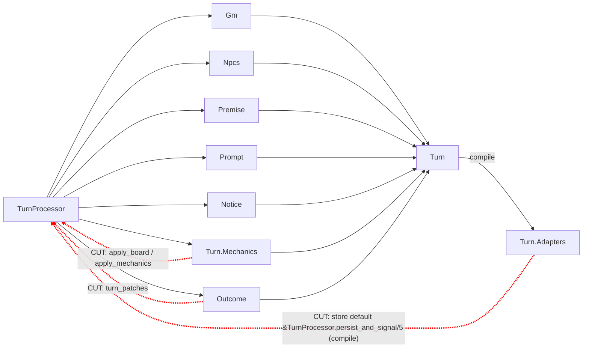
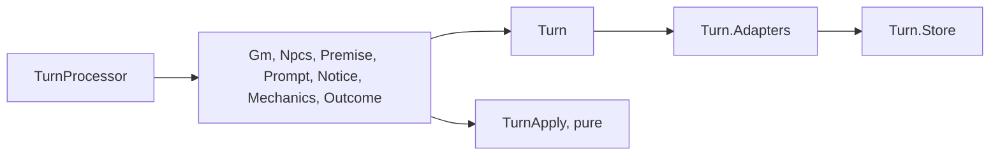
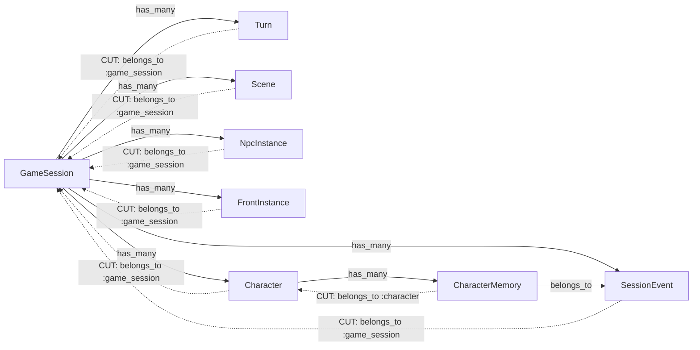
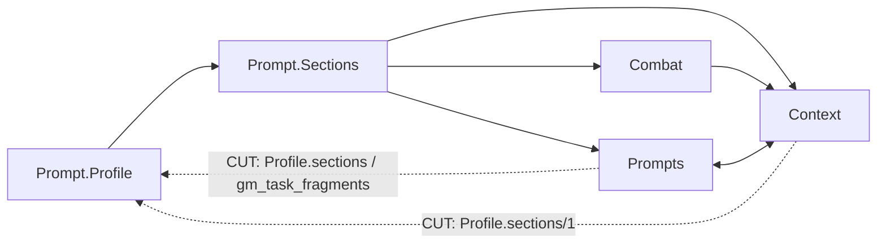
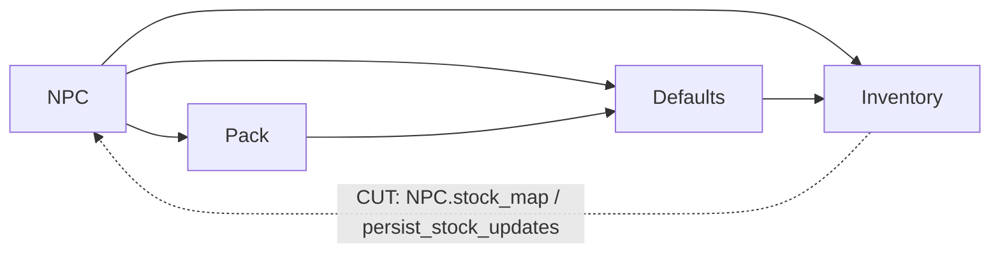
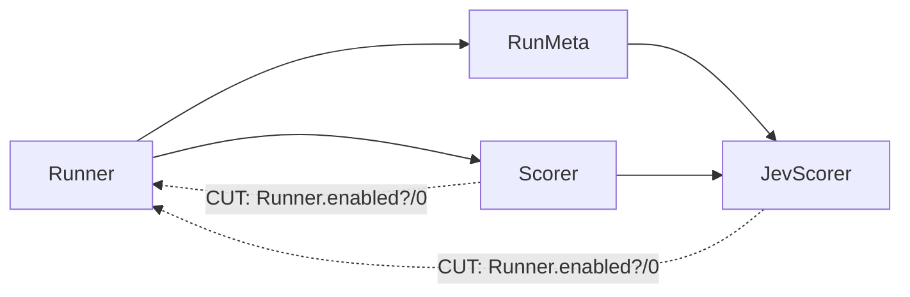
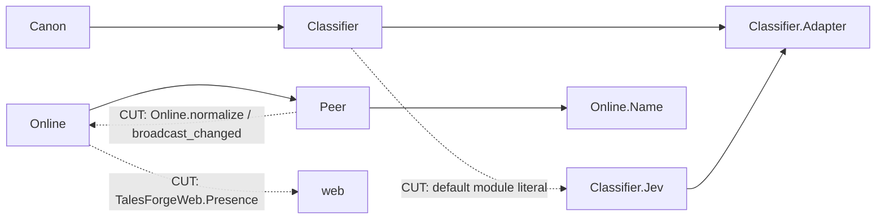

# Tales Forge refactoring round: plan (approved 2026-10-17 17:56, with two changes)

**For:** Case and Fredrik. **Author:** Grok Bot, 2026-10-17.
**Measured on:** ex-tales-forge `main` 6e225d9, with the same counting as WF
(`mix health.check` collect, counting v3, router excluded).
Playtesting stays paused. Nothing in this round is user-visible except where
a step says so.

**Fredrik's changes at approval (17:56):**
1. Ecto `belongs_to`/`has_many`/`has_one`/`many_to_many` back-references
   stay, because they're framework idiom. Step 2 is no longer a code change.
   Instead, a gate PR in **both** repos exempts association edges between
   schemas from the cycle count, as the `~p` router edges are exempt, with
   counting 4 and a "counting changed" mark: WF #136 and TF #365 (see step 2).
   The targets below are recomputed from that new baseline.
2. GameCharacter 10e and 10f (user-visible GM and NPC behaviour) go
   **last**. Each one gets a one-off playtest comparison before and after,
   which Gentry runs on request. 10a–10d stay in their slot.

## 0. Where we start, and the targets

| Metric | Today | Target | How the plan gets there |
|---|---|---|---|
| xref cycles (`all`) | 26, and **20** under counting 4 (associations exempt) | ≤ 10 | Steps 1 and 3–7 remove all 20 |
| Largest strongly connected group | **11** (the turn pipeline) | ≤ 4 | Step 1 (11 → 0), step 3 (5 → 0). The 8-file schema group is association edges, exempt under counting 4 |
| Largest single xref cycle | 4 | ≤ 4 | Already met, and it goes to 0 |
| Compile-connected | 1 cycle, 3 files (Turn, Turn.Adapters, TurnProcessor) | largest ≤ 5 | Step 1 removes it |
| Domain → web refs | **1** (`Online` → `TalesForgeWeb.Presence`) | 0 | Step 6 |
| Complex functions | 146 | ≈ 125 | Steps 1, 8 and 9 |
| Functions with 4+ params | 171 | ≈ 102 | Steps 1, 5 and 8 |
| **Stacked score** (cycles + complex + web refs + 4+ params, as in WF's trend.svg) | 344, and **338** under counting 4 | **≈ 225 (−⅓ of 338)** | WF went 297 → 198 today |

The "30 cycles, largest 11" figures we had came from the history row for
#364 and from the size of the strongly connected group. The 26 cycles are
grouped into 11 strongly connected groups:

| # | Group (files) | Cycles it holds | The edge that closes it |
|---|---|---|---|
| 1 | Turn pipeline (11) | 8 | `Turn.Adapters` defaults → `TurnProcessor.persist_and_signal/5`, and the steps calling `TurnProcessor.apply_board/apply_mechanics/turn_patches` |
| 2 | Schemas (8) | 6 | `belongs_to` back to `GameSession` and `Character` |
| 3 | Prompt (5) | 2 | `Context` / `Prompts` → `Prompt.Profile` (assembly lives in the text modules) |
| 4 | NPC / Inventory / Pack / Defaults (4) | 1 | `Inventory` → `NPC.stock_map/2`, `NPC.persist_stock_updates/2` |
| 5 | Playtest (4) | 2 | `Scorer` and `JevScorer` → `Runner.enabled?/0` |
| 6 | Canon (3) | 2 | Config key named `TalesForge.Canon` and default `Classifier.Jev` inside `Classifier` (the WF #128 pattern) |
| 7–11 | 2-cycles (2 each) | 5 | A child calling a parent helper: AdminAuth.normalize, Online.broadcast_changed/normalize, Costs.app_name, Prompt.separator, WorkflowClient (behaviour and default in one module) |

## Playbook (the same as WF)

- **Framework first.** Ecto associations, Multi, PubSub, Oban and
  Phoenix.Presence. Delete any hand-rolled duplicates we find on the way.
- **Cut the one edge that closes the loop.** Don't reshuffle the whole group.
- **No forwarders.** Every caller moves in the same PR.
- **A struct as the pipeline accumulator** (`%Turn{}` already is one). 4+
  params become structs.
- **A pure turn pipeline, with effects at the edges.** IO goes through
  `Turn.Adapters` and the persist step.
- **Proof of no behaviour change** for every PR: the golden GM-prompt tests
  stay byte-identical, the full suite and dialyzer pass, and `mix
  health.check` is no worse. Steps 1 and 10 also replay a recorded session
  turn by turn and diff the persisted world_state.
- **CI.** One PR per step, base `main`, one push per PR, merge main in, never
  force-push.

---

## Step 1: the turn pipeline (11 files, 8 cycles, compile-connected 1 → 0)

Today, every step module (`Turn.Gm`, `Turn.Npcs`, …) uses the `%Turn{}`
struct, which is fine. But the group is closed by two kinds of edge:

1. `Turn.Adapters` sets its default `store:` to
   `&TurnProcessor.persist_and_signal/5`. That's a compile edge, and
   `%Turn{}` defaults to `%Adapters{}`.
2. `Turn.Mechanics` and `Turn.Outcome` call
   `TurnProcessor.apply_board/1`, `apply_mechanics/3` and `turn_patches/3`.

**Change:**
- Move `persist_and_signal/5` and `persist_turn_multi/5` to a new
  `Game.Turn.Store`. It is the effect edge and takes a `%Turn.Persist{}`
  struct, so the 5-param functions go away.
- Move `apply_board/1`, `apply_mechanics/3` and `turn_patches/3` (plus their
  private helpers) into the existing `Game.TurnApply`, which is pure.
- `TurnProcessor` keeps only `run`, `simulate!` and the step order.

**After:**

**Health:** cycles −8, compile-connected 1 → 0. 4+ params −7
(`run/4` takes `%Turn.Request{}`, plus `finish/4`, `build_entries/4`,
`maybe_emit_turn_signals/4`, `store_thought/4`).
**Proof:** the golden prompts, plus a turn replay that diffs the persisted
world_state and the turn rows.

## Step 2: schemas (8 files, 6 cycles). REPLACED by the gate PR

**Changed at approval:** the associations stay. The TF gate PR adds
`Mix.Tasks.Health.Check.Schemas` (the same module as WF #136) and goes to
counting 4. Measured on the same code: cycles 26 → 20, largest cycle still 4.
Only the six schema cycles leave; every other cycle stays. The text below is
the original proposal, kept for the record and **not** to be built.

**Change:**
- Each child declares `field :game_session_id, :binary_id` instead of
  `belongs_to`.
- `CharacterMemory` declares `field :character_id`, and its
  `assoc_constraint(:character)` becomes `foreign_key_constraint`.
- `has_many` and every `Repo.preload([:turns, :scenes])` keep working,
  because Ecto only needs the FK field.
- Checked: no code preloads `:game_session` or `:character` from the child
  side, and nothing uses `build_assoc`.

**After:** GameSession → children, Character → CharacterMemory →
SessionEvent. No back edges.
**Health:** cycles −6. **Proof:** no migration (the columns and FKs stay),
plus the full suite.

## Step 3: prompt assembly (5 files, 2 cycles)

`Prompt.Sections` renders sections by calling text in `Context`, `Prompts`
and `Combat`. That direction is fine. But `Context.sections` (line 218) and
`Prompts.gm_turn`, `build_gm_context` and `format_gm_prompt` call back into
`Prompt.Profile`, which lists the Sections.

**Change:**
- A new `Prompt.Assemble` takes over the assembly functions: build the GM
  context, format the prompt, `gm_turn`.
- `Context` and `Prompts` keep only text and data. `Prompts.load_rules`
  stays where it is.

**After:** Assemble → Profile → Sections → {Context, Prompts, Combat} →
Context.
**Health:** cycles −2. **Proof:** the golden prompts are byte-identical.

## Step 4: Inventory / NPC / Pack / Defaults (4 files, 1 cycle)

**Change:**
- `Inventory` becomes pure. The caller loads the NPC stock into the
  `%Transaction{}` it already builds (`npc_stock:`).
- The stock writes go back as data, which the turn's persist step writes.
  This is the effects-at-the-edge rule.

**Health:** cycles −1, a step towards one inventory for every character
(step 10).

## Step 5: playtest (4 files, 2 cycles)

**Change:** `enabled?/0` moves to `TalesForge.Config.playtest_runner?/0`.
That is one function and two callers.
**Health:** cycles −2. The `Runner` 4+ params (4 of them) become a
`%Runner.Opts{}`.

## Step 6: Canon, WorkflowClient, Online and the web ref (cycles −4, web refs −1)

**Change:**
- **Canon:** use the WF #128 pattern. Move the behaviour to
  `Canon.Classifier.Adapter`. Read the config as
  `config :ex_tales_forge, :canon_classifier`, an atom key and not a module.
  The default comes from config, not from a module literal in `Classifier`.
- **WorkflowClient:** do the same with `WorkflowClient.Adapter`.
- **Online:** `Peer` gets `normalize/1` from a small leaf module
  (`Online.Name`). `broadcast_changed/0` becomes a PubSub broadcast in
  `Peer`, which is framework first.
- **Presence:** move `TalesForgeWeb.Presence` to `TalesForge.Presence`.
  Phoenix.Presence isn't web-specific; it's started by the same supervisor.
  That makes web refs 1 → 0.

## Step 7: the last 2-cycles (cycles −3)

- `AdminAuth.Github` → `AdminAuth.normalize/1`: move `normalize` to the leaf
  it needs.
- `Costs.PlaytestRuns` → `Costs.app_name/0`: use `Config`.
- `Prompt.Section` → `Prompt.separator/0`: make it a constant in `Section`.

**Total after steps 1–7:** 0 cycles (target ≤ 10), largest group 0, web
refs 0.

## Step 8: 4+ params as structs, by file (fillers between steps)

Ordered by count:
- `LLM` (11): a `%LLM.Request{messages, schema, model, opts, call_meta}`
  through `complete_turn`, `complete_json`, `dispatch*`, `request`,
  `record_call`, `spend_capped`, `post` and `stream`.
- `GameSessions` (8): `%TurnRequest{}` for `enqueue_turn`, `resolve_*` and
  `maybe_shadow`.
- `IntentJev` (8): `%Decision{}`.
- `NpcSignals` (7): a `%Signal{}`, which can later be a PubSub payload.
- `Mechanics` (6): `%Roll{}`.
- `Intent` (6): `%Parse{text, world, present, …}`.
- `Survey.Definition` (7), `Progression` (5) and `Turn.Combat` (4):
  `%Exchange{}`.

Estimate: 171 → ≈ 102.

## Step 9: complex functions (fillers)

- `CharacterCreation` (8), `Playtest.CharacterChanges` (8), `Pack` (5),
  `LLM` (5) and `Characters.Defaults` (4): split each one by its call graph,
  one clause per case.
- Estimate: 146 → ≈ 125.

**Projected score (counting 4):** 0 cycles + 0 web refs + ≈ 102 params +
≈ 123 complex ≈ 225, which is −⅓ of 338. Complex needs about 2 more than the
step 9 estimate: one more file split from the list.

---

## Step 10: one GameCharacter (PC and NPC differ only at intention input)

**Today, the PC and the NPC are two shapes, and the code branches on them in
these places.** `Schemas.Character` (with `controller`) exists and is
double-written after each turn (#51), but no game logic reads it.

| Where | Player branch | NPC branch |
|---|---|---|
| **Storage** | `world_state["character"]` map: read or written in 20 files (TurnProcessor ×16, Context, Mechanics, Inventory, Notice, Pack, PremiseCheck, World, Prices, Events, OutcomeRecord, Catalogue, IntentEval, Admin, …) | `npc_instances.runtime_state` plus `world_state["npc_state"]` and `"npc_moods"` (21 files) |
| **Turn input** | `GameSessions` → `Intent` / `JevIntent` → `PlayerAction` → `TurnProcessor.run/4` | `NpcReactions.react/1` (a Jev mood reaction), `NpcInitiative`, the `NPCAgent` actions (`Actions.NPC.*`) and `WorldSim`. None of these go through the turn |
| **Mechanics** | `Mechanics.apply_character_vitality/4`: wounds and death only for `world["character"]` | NPCs have no vitality path; combat takes a separate `NPC.combat_profile/2`, or a minor foe |
| **Combat** | Attacker default `"player"` (combat.ex:253) | `{:npc, id}` / `{:foe, …}` targets, `Turn.Combat.new_foe/4` |
| **Inventory** | `inventory` + `coins` on the PC map | NPC `stock` with `price_copper` via `NPC.stock_map` and `persist_stock_updates` |
| **Training** | The PC learns (`Train.apply/5`) | The NPC is only a trainer (`npc_def`) |
| **Memory and thought** | `Characters.Memory` and `Thought` find the PC by `controller != "gm"` (memory.ex:166, 193, 245; thought.ex:160) | GM characters filtered by location |
| **Process** | `PlayerSessionAgent` | `NPCAgent` (one per present NPC), `NPCRegistry`, `NPCRecovery` |
| **Prompt** | `Context.character_sheet` (PC only) | `Prompt.Sections.Npcs` / `NpcReactions` sections |
| **Playtest** | `character_changes.ex:194–199, 489, 572, 619` split by `controller` | |

**Target:**
- **One `%GameCharacter{}`** is the in-turn struct, loaded from and saved to
  `Schemas.Character`. It holds stats, skills, OCEAN, Maslow, concerns,
  inventory with optional prices, coins, wounds and vitality, mood,
  relationships and location.
- **One `%Intention{character_id, by: :human | :gm | :system, action}`** is
  the only place where controllers differ:
  - **human:** the player's text runs through `Intent` → `Intention`. The
    persona runner (`bot`) uses this path too.
  - **gm and system:** NPC reactions, initiative and WorldSim produce an
    `Intention` instead of writing state directly.
- **One turn pipeline:** `Turn.run(%Intention{})` → the same steps for
  everyone → `Turn.Store`. Mechanics, Combat, Inventory, Train and Memory
  take a `%GameCharacter{}` and never ask who controls it. The GM prompt
  shows the acting character's sheet. A lint (credo check or `rg` in CI)
  forbids `controller ==` outside `Intention` and the input adapters.

**Steps** (each one is its own PR, after steps 1–4; each with byte-identical
golden prompts, plus the replay diff):

- **10a. Read switch.**
  - `%GameCharacter{}` with `from_schema/1` and `to_sheet/1`.
  - `Characters.load_present/1` replaces the `world_state["character"]`
    reads in `Context`, `Mechanics`, `Inventory`, `Notice` and `World`.
  - Still double-written; behind `CHARACTERS=on` on playtest first (the plan
    in docs/plan-unify-character.md, phase 2).
- **10b. Writes in the Multi.**
  - `Turn.Store` writes the GameCharacters in the turn Multi; this replaces
    the after-turn `Characters.mirror/1`.
  - Then drop the writes to `world_state["character"]`, `npc_state` and
    `npc_moods`.
  - Split (2026-10-18): **10b-1** moves the writes into the Multi (#422).
    **10b-2** drops the world_state writes, after the playtest
    `CHARACTERS=on` drift run (#424).
  - **Condition from Case and Fredrik (2026-10-18): `runtime["sheet"]` is
    only a bridge.** 10a keeps what the columns can't hold there (`extra`
    and `missing`). Before 10b-2 drops the world_state writes, a separate
    PR (**10b-1.5, sheet promotion**) promotes those keys to real
    `%GameCharacter{}` fields and schema columns or embed fields with defaults:
    `class`, `creation`, `reflecting`, `improved_since_rest`, float skill
    and learning values (keep the number type), extra inventory item keys,
    and any other key the drift run finds in `extra`. After that,
    `runtime["sheet"]` is empty for every row, or removed. 10b-2 is not
    opened until the promotion is merged. Its PR description repeats this
    condition and shows that the blob is empty (a query count or a
    backfill report).
  - Status (2026-10-18): the playtest drift run (v313, main 90a0ec2,
    `CHARACTERS=on`; 2 scripted sessions of 10 turns covering buy, equip,
    fights with wounds, moves and sleep; $0.24) logged 0 `characters read
    drift` and 0 `characters read: no row`, so no drift keys. The only
    `extra` key on playtest rows was `class`. 10b-1.5 is #432 (columns
    `class`, `creation`, `reflecting`, `improved_since_rest`; skill numbers
    kept as they are; the bridge is no longer written when empty). The run
    also found a memory compression crash, which is fixed in #433.
    The playtest backfill brought `runtime["sheet"]` rows from 4 to 0
    (prod: 0 of 28). 10b-2 is #435.
  - Decision (Fredrik, 2026-10-18): 10b-2 drops only
    `world_state["character"]`. The `npc_state` and `npc_moods` copies are
    dropped in 10e/10f, when NPCs get their single write path.
- **10c. One vitality and combat path.**
  - Every fighter is a `%GameCharacter{}`, and a minor foe is a transient
    one.
  - `apply_character_vitality` works on any character.
  - The `"player"` attacker default goes away.
- **10d. One inventory.**
  - NPC stock becomes inventory items with `price_copper`.
  - `Inventory` trades between two GameCharacters, without `npc_stock`.
  - Status (2026-10-18): `NPC.traders/2` gives the present NPCs as
    GameCharacters whose inventory is their stock (each item with
    `price_copper`), and `Inventory.apply_transaction/3` trades between the
    acting character (`world_state["character"]` as a `%GameCharacter{}`)
    and those traders. It returns the traders whose inventory changed, which
    `NPC.put_inventories/2` saves. `NPC.stock_map/2` and
    `persist_stock_updates/2` are gone. The stock stays stored where it is
    (`npc_instances.runtime_state["stock"]`, mirrored to the NPC's
    `characters.inventory` each turn), so no migration or backfill; the
    stored copy moves to the row with 10f, when `npc_instances` goes. A sold
    item or a trade's give leg still goes to no one, and NPC coins still
    don't change; making the NPC side keep them is user-visible and not part
    of 10d.
  - Merged 2026-10-18 as #438 (merge commit `8c64549`). The replay on main
    and the branch is identical (buy, haggled buy, sell, haggled sell, NPC
    trade, out-of-stock buy; with `JEV_CATALOGUE_V2` off and on). Playtest
    v319 (image `GH_SHA=fa7d6b5`, which includes `8c64549`): a buy takes
    the ale out of the innkeep's stock on both `npc_instances` and the
    characters row (99 → 98), and a sell pays the player. The logs show no
    errors. The haggle path is not reachable on playtest, because
    `JEV_CATALOGUE_V2` is off there.
- **10e. Intention input.**
  - `%Intention{by: …}`.
  - `NpcReactions`, `NpcInitiative` and `Actions.NPC.*` emit Intentions; the
    turn applies them.
  - `Memory` and `Thought` stop filtering on `controller`.
  - With 10f: drop the `world_state["npc_state"]` and `"npc_moods"` copies
    (decision 2026-10-18).
  - Status (2026-10-18): `TalesForge.Intention` (`by: :human | :gm |
    :system`). The turn carries the player's Intention; `NpcReactions` gives
    `{:feel, mood}` Intentions that the NPC stage applies; `NPCSignals` and
    `Actions.NPC.*` give `{:wait, _}`, `:speak_up`, `{:remember, _}` and
    `{:warm, _}` Intentions for the present NPCs, which the turn transaction
    applies (`Turn.Intentions`) after the characters write, and the
    initiative broadcasts after the commit. The NPC agents get no signals
    any more (10f PR 2 deletes them). `Memory` and `Thought` take the actor
    from the turn's Intention, not from `controller`. The Gentry 10e script
    replays identically on main and the branch.
  - Follow-up (2026-10-18): the NPCs' tick delta compares the session as
    the turn loaded it with the world after the turn. Before, it compared
    the saved session with itself, so the delta was always 0: no concern
    built and no NPC spoke up on its own.
- **10f. One process.**
  - The per-world process from the 2026-10-08 note replaces `NPCAgent` and
    `PlayerSessionAgent` (using PubSub and Oban, not a hand-rolled registry
    sync).
  - Design for Case's review, before any code:
    [design-gc-10f-one-process.md](design-gc-10f-one-process.md).
  - PR 1, Serialize (2026-10-18): `World.Instance`, one GenServer per active
    session (registered in `World.Registry`, started on demand under
    `World.Supervisor`, stopped after 15 idle minutes), runs the session's
    turns one at a time, each in a Task under `World.TaskSupervisor`.
    `ProcessTurn` goes through it, and the turn transaction takes a
    `pg_advisory_xact_lock` on the session as a backstop. No NPC or
    `npc_state` change; the replay on main and the branch is identical.
  - PR 2, Retire the NPC agents (2026-10-18): `NPCAgent`, `NPCRegistry`,
    `NPCRecovery` and the NPC helpers only they used are deleted, so nothing
    starts NPC processes at create, submit, after a turn or at boot. The
    turn's payload carries its `:npc_initiatives`, and `World.Instance`
    broadcasts them once the turn has committed, after `{:turn_completed, _}`.
    The Gentry, 10d and 10b-2 replays give the same state after every turn.
  - Then drop `npc_instances` with the row-check pattern from #47 (plan
    phases 3 and 4).

10a–10d need no product decision and stay in their slot. **10e and 10f
change what the GM and NPCs do, so they're user-visible and go LAST**, after
every other PR in this round. Each one gets a one-off playtest comparison
before and after: I tell Case when each one is ready, and Gentry does one
run per comparison. General playtesting stays paused.

## Order and size

| PR | Step | Δ cycles | Δ score (est.) | Risk |
|---|---|---|---|---|
| 1 | Turn pipeline | −8 (cc −1) | −15 | medium (the turn path; replay diff) |
| 2 | Gate: association edges exempt (counting 4) | −6 (counting) | baseline 344 → 338 | low, no app code |
| 3 | Prompt assembly | −2 | −3 | low (golden prompts) |
| 4 | Inventory pure | −1 | −2 | low |
| 5 | Playtest | −2 | −6 | low |
| 6 | Canon, WorkflowClient, Online, Presence | −4, web −1 | −5 | low |
| 7 | 2-cycles | −3 | −3 | low |
| 8, 9 | Params and complexity fillers | | ≈ −75 | low, one file per PR |
| 10a–d | GameCharacter: read switch, Multi writes, one combat path, one inventory | | | medium |
| 10e, 10f | Intention input; one process (user-visible) | | | **last**; a playtest comparison before and after each |

## Noted for after the round (not started)

- **Conservation in trades** (Fredrik's rule, 2026-10-18). Items and coins
  always change place and are never created or destroyed.
  - **Buy:** the coins go from the player to the NPC, and the item goes from
    the NPC to the player.
  - **Sell and trade:** the reverse. A sold item joins the NPC's inventory,
    and so does a trade's give leg.
  - **Today (after 10d):** the NPC's coins never change, and a sold item or a
    trade's give leg goes to no one.
  - This is its own PR, after 10e/10f. It is user-visible: an NPC can sell
    back what it bought, and its purse runs down.
  - **Open question:** what happens when the NPC can't afford a sale. Case
    suggests that it refuses, the same way `Catalogue.refuses_trade?/1`
    refuses a trade today.

- **NPC concern card** (Fredrik, 2026-10-18). It also covers telling the GM
  about speak-ups.
  - **Intensity and growth rate.** Each concern carries an intensity and a
    growth rate. An intense concern crosses the threshold in a turn or two;
    others smoulder and build over days of game time. A concern decays when
    it is addressed.
  - **Data and tick.** The data lives on the concern struct, and the tick is
    a pure function (concern and elapsed game time in, concern out).
  - **Every character has concerns.** There is only GameCharacter, so player
    characters carry the same concern struct as NPCs. Only the intention
    input differs:
    - a gm-controlled character's threshold crossing becomes an
      `%Intention{}` (for example a speak-up);
    - a human-controlled character's crossing becomes a GM prompt hint (the
      character feels it), never an action.
  - Not built now.

- **Kaizen practice** in both repos' `docs/principles.md`: every feature PR
  must leave the files it touches at least one health point better (cycles,
  complexity, 4+ params, web refs), on top of the never-worse ratchet. Docs-
  and config-only PRs are exempt.
- **A CI check, if feasible:** `mix health.check --base origin/main
  --touched` compares the per-file numbers of the changed `lib/` files and
  fails when none improved. Feature vs docs/config would be told apart by
  the same changed-files filter CI already uses.
