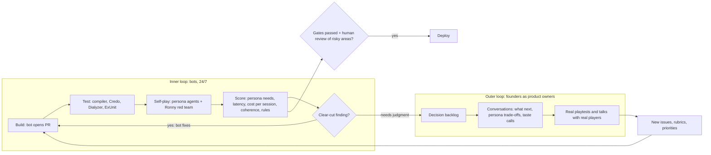

# Tales Forge — Roadmap Oct 2026 – Dec 2027

*Rev. 3, 2026-10-05, based on the founders' decisions of the same day. Proposals are marked **(P)** and assumptions **(A)**.*
*Documentation lives in the Google Drive folder <https://drive.google.com/drive/folders/1tlNoL8WZJPgbFQVT4SipKi9odGnQM_PB>. The Markdown sources are kept in `/workspace/tales-forge-plan/` on Case's computer.*

> **Team norm:** this plan assigns no tasks, owners or responsibilities to anyone. People self-assign. The founders are mentioned only as a group. Capacity is planned in **decisions per week**, not hours.

## 1. Goal and north star

**North star (agreed by all founders): the first paying customer we don't personally know.** Everything in this plan is ordered by how much it brings that customer closer.

Tales Forge is an online RPG where an AI game master runs the game, the world keeps living between sessions, and every action gets a response in **≤ 3 s**. It's built on the Elixir rewrite (`whyse-ab/ex-tales-forge`). The old app (`tales-forge-new`) stays live until the new one beats it.

**Settled on 2026-10-05**
- **Pricing:** no monthly subscription. Players buy **modules** (one-off; an author revenue share comes later) and pay for what they use with **prepaid credits** that never auto-renew. Credits are sold as **sessions or hours, not tokens**. Development is funded from the platform's margin. Probably a free first session or starter module, and a small first purchase.
- **Content:** the team creates the first world and modules; an **author marketplace** opens later. **Fantasy first (Tin Valley)**; other genres only once the game is proven. **Core, genre packs and worlds are kept separate in code from day one** (GURPS-style; see *Design: Game data vs sessions*).
- **Acquisition:** RPG forums (r/rpg, r/osr and similar, joining as fellow players), then word of mouth. Built into the product: shareable **session chronicles** from the event log, the **character museum**, a **free session you can send to a friend**, and **referral credits**.
- **AI budget:** unknown, so we measure it. **Cost per session is on the self-play scorecard from the first run**, and prices are set from measured data.

## 2. The two loops

Development isn't limited by human hours. It runs in two loops:

- **Inner loop (bots, around the clock).** Bots build, test, self-play with persona agents (Hawk, Paul, Lotta, Lars, plus Ronny as red team), score each build, and fix clear-cut findings themselves.
- **Outer loop (founders as product owners).** Conversations, like the ones with Case, about what to build next, persona trade-offs and taste calls. Findings that need judgment are escalated here.

Human time goes to **decisions, reviewing risky changes, monthly real playtests and talking to real players.** The founders' pace of decisions sets the pace of the project. Working assumption: **3–5 decisions per week (A)**, with the backlog below ordered so the next decision is always the most valuable one.

**Persona scorecards** (from [`personas.md`](personas.md); turning them into measurable criteria is decision #2):

| Persona | Scored on |
|---|---|
| Hawk | Every serious harm or death is foreshadowed in-fiction; a meaningful choice existed; no instant death from one unseen roll |
| Paul | Intent correctly inferred from in-character speech; no mechanics leak when rolls are hidden; NPCs answer in character; bluff quality matters |
| Lotta | Underdog arc tracked (humble start → growth through failure → recognition); NPC attitudes shift; details and choices remembered |
| Lars | Actions visibly and lasting change the world (factions, NPC plans, places), and the world refers back to them |
| Ronny (red team) | Exploits, GM sweet-talking/prompt injection, economy gaming and death negotiation fail, ideally resisted in-fiction |
| All builds | p50/p95 time to first token and to full response (3 s limit), **cost per session**, gibberish/coherence, rule correctness |

## 3. Decision backlog (ranked)

One list, most important first. Each item gives the decision, why it matters for the first paying stranger, what it unblocks, and the options on the table.

1. **Confirm the Elixir rewrite as the foundation.**
   *Why:* every later investment lands on one stack; splitting effort delays the first sale. *Unblocks:* CI, deploy, harness, bots. *Options:* commit to `ex-tales-forge` with a go/no-go at end of Dec 2026 (see *Why Elixir*); keep extending the old app; hybrid (new engine behind the old frontend).
2. **Define the persona scorecards, including cost per session and latency.**
   *Why:* a stranger pays only if the game delights the people it's for, and we can't price without knowing the cost. *Unblocks:* self-play scoring, release gate, pricing data. *Options:* LLM-judge rubrics vs. deterministic checks vs. a mix; pass/fail on key needs vs. weighted scores; which thresholds block a release.
3. **Choose a coding-bot platform and set the guardrails.**
   *Why:* the inner loop is our development capacity. *Unblocks:* round-the-clock building and fixing. *Options:* hosted cloud coding agents vs. self-hosted agents in CI vs. a mix by bot role; guardrails as in §5.
4. **Set the AI spend ceiling.**
   *Why:* 24/7 bots plus self-play can burn money before the first sale. *Unblocks:* turning the inner loop on safely. *Options:* one monthly cap vs. split caps (runtime / self-play / coding bots); hard stop vs. throttling at the cap.
5. **The free first experience and the first paid offer.**
   *Why:* this is the moment a stranger decides to pay. *Unblocks:* starter module scope, the conversion funnel, the beta plan. *Options:* free first session vs. free starter module; the first purchase as a small credit pack vs. the full Tin Valley module vs. a bundle; whether the free session can be gifted.
6. **The payment provider and credit design.**
   *Why:* no payment, no paying customer. *Unblocks:* checkout, credits, receipts, referral credits. *Options:* Stripe vs. Paddle/Lemon Squeezy (merchant of record handling EU VAT) vs. others; credit unit (session vs. hour); pack sizes; expiry (none vs. long); refunds.
7. **Company, terms and tax for taking money.** *(A: not settled yet.)*
   *Why:* we need a legal seller, terms of service and VAT handling before the first sale. *Unblocks:* turning live payments on. *Options:* existing company vs. new company; merchant of record vs. handling VAT ourselves.
8. **The Tin Valley starter scope.**
   *Why:* the first thing a stranger buys must feel finished. *Unblocks:* content work, the first module's price. *Options:* one tight adventure arc vs. an open sandbox with fronts; how much of fronts/WorldSim must be in v1.
9. **The growth loop in v1.**
   *Why:* forums bring the first players; sharing brings the next ones. *Unblocks:* chronicle/museum features, referral credits. *Options:* which of chronicles, character museum, send-a-free-session and referral credits ship before the beta and which after; privacy/consent defaults for sharing.
10. **Death and revival in fantasy.**
    *Why:* it touches Hawk's stakes, Lotta's attachment and possible revenue. *Unblocks:* the fantasy genre pack's death rules, the museum. *Options:* in-fiction revival with a cost and an uncertain outcome; paid revival; museum only. Tension: paid revival vs. "if a rule feels gamey it's wrong".
11. **Migration and cutover from the old app.**
    *Why:* existing users are friendly testers and potential referrers; the cutover must not lose them. *Unblocks:* shutting down Supabase/Netlify. *Options:* import password hashes vs. magic-link "claim your account" vs. Supabase Auth as a temporary OIDC provider.
12. **Closed beta design.**
    *Why:* the beta is where the first strangers show up. *Unblocks:* recruitment on forums. *Options:* size (dozens vs. hundreds); invite-only vs. waitlist; paid from day one vs. free credits that convert.

**Later (not before the game is proven):** when to open the author marketplace and on what revenue share; the second genre; scaling and hosting beyond one region; the ElixirConf 2027 talk.

## 4. Timeline: target outcomes, Oct 2026 – Dec 2027

These are target outcomes, not assignments. The whole timeline is a **proposal (P)**. A real playtest happens every month.

| Month | Target outcomes |
|---|---|
| **Oct 2026** | Decisions 1–4 made. CI with gates on `ex-tales-forge`; a real Fly staging deploy. Eval harness v0: the first self-play run produces a scorecard with **latency and cost per session**. |
| **Nov 2026** | Inner loop running 24/7 on staging; all five persona agents scoring every build; first bot PRs merged through gates. Core / genre pack / world separated in code; Markdown game-data import; event log + snapshots. |
| **Dec 2026** | Core loop at parity with the old app; streamed GM text; p95 ≤ 3 s in self-play. A free first session playable in Tin Valley. **Go/no-go on the rewrite.** Decisions 5–7 made. |
| **Jan 2027** | Existing users migrated; DNS cut over; old app read-only. Payments and credits working in test mode. |
| **Feb 2027** | Living NPCs and the world clock wired into play (async, no effect on latency). Session chronicles and the character museum. The founders start taking part in RPG forums as players. |
| **Mar 2027** | **Closed beta (P)**, recruited from forums. Live payments for the starter offer. |
| **Apr 2027** | **★ First paying customer we don't personally know (P): the headline milestone.** Send-a-free-session and referral credits live. First prices adjusted from measured cost per session. Fronts/WorldSim in Tin Valley. |
| **May 2027** | Conversion funnel tuned from beta data; Tin Valley module complete and sellable; old app decommissioned after final export. Launch go/no-go. |
| **Jun 2027** | **Public launch (P).** |
| **Jul 2027** | Iterate on the first session and conversion; a second paid fantasy module. |
| **Aug 2027** | Margin per session understood and improving (model mix, caching, shorter prompts); scaling check. |
| **Sep 2027** | ElixirConf 2027 talk, if the founders want it **(A: check dates)**. Author tooling explored. |
| **Oct 2027** | Decision: when to open the author marketplace. Decision: second genre, only if fantasy is proven. |
| **Nov 2027** | Hardening; review of LLM-judge drift vs. real-player behaviour. |
| **Dec 2027** | Year review; 2028 plan. |

## 5. Guardrails

- **Spend ceiling:** a monthly AI cap with an alert at 80 % and a hard stop (decision #4). Cost per session is visible on every scorecard.
- **Bots can't merge to `main`.** Every merge needs passing gates (compiler with warnings as errors, format, Credo, Dialyzer, ExUnit, the smoke self-play suite, no scorecard regression beyond thresholds).
- **Human review for risky areas:** auth, payments and credits, data migrations and schema, infra/deploy and secrets, prompt changes that affect every session, the core rules, and the eval harness and gate thresholds themselves.
- **Hidden test scenarios** the coding bots never see, so they can't tune to the test. Bots can't weaken tests or change gates without human sign-off.
- **Real playtests outrank bot scores.** If self-play and real players disagree, real players win and the rubric gets fixed.
- Bots run sandboxed with scoped tokens and no production credentials. Production deploys are triggered by a human, with rollback ready. Every bot action is logged (bot, model, prompt version).

## 6. Risks

| Risk | Mitigation |
|---|---|
| We build a lot but nobody pays | North star ordering; free → small paid step tested early; talk to forum players before building more |
| AI cost per session exceeds what players will pay | Measure from the first run; price from data; optimise the model mix; credits sold as sessions/hours give room to adjust |
| ≤ 3 s missed | Measured on every build; streaming; fast intent step; prompt caching; async world work |
| Self-play overfitting (pleasing LLM judges, not people) | Different judge vs. GM models, hidden scenarios, rubric rotation, human spot checks, monthly playtests |
| Bot code quality drift or gaming of tests | Static gates, test/gate changes need human sign-off, held-out scenarios, periodic human refactor passes |
| Decision bottleneck in the outer loop | Ranked backlog; bots fix clear-cut issues alone; capacity tracked in decisions per week |
| Forum outreach seen as spam | Join as genuine players; share chronicles people enjoy reading; follow each community's rules |
| Paid revival or other monetisation feels gamey | Persona scorecards (Hawk, Lotta) and Ronny red team check every monetised mechanic |
| Content bottleneck before the marketplace | Markdown game data that bots and humans can both write; reviewed in git |
| Single LLM provider | Provider abstraction; a fallback model tested in the harness |

## 7. Open questions

1. How do we define "a customer we don't personally know" (e.g. not a friend of a founder or of a friend)?
2. How do founders log and track decisions (format, cadence), and where do escalated findings land?
3. Rough pricing: what should one session and the Tin Valley module cost (pending cost data)?
4. Author revenue share level when the marketplace opens?
5. Where is the line between core and genre pack, and how are core changes approved (see the ADR)?
6. Hosting: Fly.io only, or managed Postgres elsewhere?
7. Observability tooling (dashboards, error tracking)?
8. Is the ElixirConf 2027 talk a goal or optional?
9. Company structure and compensation for part-time founders?
