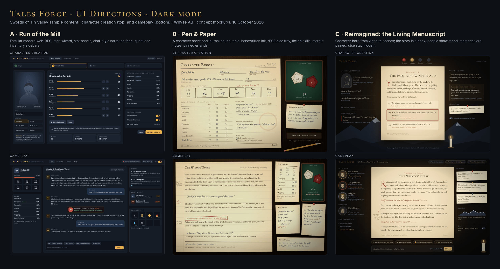

# Player UI directions (2026-10-16)

These are three UI directions for the player-facing game, A, B and C. Each has two screens: character creation and gameplay. Each screen comes in a light and a dark mode. Today's UI is scaffolding, so these mockups ignore it. They are static PNGs, 1600×1000, rendered from HTML/CSS in headless Chrome. No AI image generation was used.

This doc describes the options and the reasoning behind each one. It does not choose between them.



Light mode overview: [images/overview-light.png](images/overview-light.png)

| Screen | Light | Dark |
| --- | --- | --- |
| A1 Run of the mill, creation | [a1-light](images/a1-light.png) | [a1-dark](images/a1-dark.png) |
| A2 Run of the mill, gameplay | [a2-light](images/a2-light.png) | [a2-dark](images/a2-dark.png) |
| B1 Pen and paper, creation | [b1-light](images/b1-light.png) | [b1-dark](images/b1-dark.png) |
| B2 Pen and paper, gameplay | [b2-light](images/b2-light.png) | [b2-dark](images/b2-dark.png) |
| C1 Living Manuscript, creation | [c1-light](images/c1-light.png) | [c1-dark](images/c1-dark.png) |
| C2 Living Manuscript, gameplay | [c2-light](images/c2-light.png) | [c2-dark](images/c2-dark.png) |

## What every direction must show

All three are built on the same game facts:

- Six traits: STR, DEX, CON, INT, WIS, CHA.
- Skills are rolled under on d100. A failed roll can teach and later raise a skill.
- There is no XP and there are no levels.
- Dice visibility is a player setting: show or hide.
- NPCs have personalities and remember the player.
- The player speaks in character.

The sample content is day 1 of [Swords of Tin Valley](../../adventures/swords-of-tin-valley.md), the evening at the Drover's Rest in Ferrow:

- Elin Harrow, 16, carries the widows' purse under her coat. Two sellswords have already laughed at her.
- Tin Valley has 11 families, about 34 people since the cave-in. Elin's line is "Eleven families, and the guild says the mine owes them nothing."
- The pass closes with the first heavy snow, about a month away on day 1.
- The Miners Guild and Silky Joss, the card sharp, also appear.

Some details are invented for the mockups: the player character (Corin Ashby, a sellsword, and his numbers), the pot-boy, and the prologue scenes in C1. Persona and driver codes below refer to [personas.md](../../personas.md) and to the [forum research](../../research/2026-10-15-persona-forum-research.md): archetypes A1 to A8 and enjoyment drivers D1 to D12.

---

## A. Run of the mill

**Concept.** A familiar modern web RPG. Creation is a step wizard with point-buy traits and visible skill percentages. Play has a chat-style narration feed in the centre, the character's traits and skills on the left, and quests, people nearby and inventory on the right.

### A1. Character creation

- **Who it serves.** Lars (clear setup with few surprises), the Build Tinkerer and the Rules-Literate Tactician. For the Tinkerer and Tactician, every number is on screen and editable (A7, A4, D9 build-craft). Hawk wants granular control and dislikes hidden mechanical consequences ([character-creation-persona-prefs.md](../../character-creation-persona-prefs.md)).
- **Key choices.**
  - Origin, then traits and skills, then gear, then voice, as four steps.
  - Background bonuses are labelled on each skill.
  - The six traits use sliders, with an option to roll them.
  - A note in the panel explains "no XP, no levels: you grow by failing", so the rule is taught where it applies.
  - The "show dice rolls" and "show skill numbers" switches are set at creation, because dice visibility is a player setting.
- **Trade-offs.** Fast to learn and cheap to build. Paul says sliders and spreadsheets put him off. Lars may see four steps as "too many screens before the adventure". Voice and backstory are a late step, not the heart of creation.

### A2. Gameplay

- **Who it serves.**
  - Lars: quests with a progress bar give visible progress and a goal (D4, D9).
  - The Short-session Returner: everything needed to resume is on one screen (A1, D11).
  - Hawk and the Stakes Seeker: HP and the roll card make risk and failure visible (A2).
  - The Tactician: the roll card shows target, roll and result (A4).
- **Key choices.**
  - Rolls show inline as cards. A failed roll is marked as a lesson ("Perception may rise when you next rest").
  - Suggested actions are chips above the input box.
  - NPC attitude is a tag such as Wary or Hostile.
- **Trade-offs.** Clear and predictable. The look is close to many AI chat games, which is weak against the AI Skeptic's "generic" complaint (A8). Immersion is thin (D5). NPC emotion is reduced to a one-word tag (D2), and Paul is annoyed by visible mechanics. Chips can drift towards option lists, which the Agency Guardian dislikes (A5).

### A, light and dark

Both modes use the same layout with a different palette. Dark is the base, for evening play. Light is a white-card, daytime app look. In light mode the gold accent is darkened so the text keeps its contrast, and status colours (failure red, lesson green) are toned for white backgrounds.

---

## B. Pen and paper

**Concept.** The character sheet and journal on a table. Labels are printed, and the player's entries are handwritten in ink. There are margin notes, a d100 dice tray (a tens die and a ones die) and pinned index cards. The GM writes in print and the player writes in ink.

### B1. Character creation

- **Who it serves.**
  - The core users, lapsed RPG veterans without a group ([personas.md](../../personas.md)): the paper sheet is a direct memory of the table.
  - The Build Tinkerer and the Tactician: the whole sheet is visible at once (A7, A4, D9). Base and current values are shown side by side, and the Sellsword bonuses can be read from the numbers.
  - Hawk: nothing about the build is hidden.
- **Key choices.**
  - Roll 3d6×5 or assign the values. A crossed-out reroll (CON 45 → 48) shows that the sheet is the player's own.
  - The "Learned?" column with tick boxes makes "failing teaches, no XP" a physical habit.
  - The "Who I am, in my own words" field gives Paul and Lotta a voice on the form (D5).
  - "Roll in the open" or "GM rolls behind the screen" is a checkbox on the sheet.
- **Trade-offs.** It is a dense page. Handwriting fonts are slower to read and weaker for accessibility. Skeuomorphic layouts adapt poorly to phones. Paul's dislike of spreadsheets applies here too, although the sheet is charming.

### B2. Gameplay

- **Who it serves.**
  - The Tactician: the stamp "Perception 52, rolled 67, failed, tick the box" shows the arithmetic (A4).
  - Hawk: the failure is shown plainly (A2).
  - The Continuity Auditor and the Mystery Explorer: "People I've met", "Errands" and the margin notes keep the thread and the clues (A3, D1, D6).
  - Fantasy and atmosphere through the journal itself (D5).
- **Key choices.**
  - The story is a ruled journal page. GM text is typeset and the player's lines are handwritten.
  - The input box is "write on the line". A prefix of ( ) marks an aside to the GM.
  - The dice tray stays on the table. The setting is a toggle between "dice in the open" and "behind the screen".
- **Trade-offs.**
  - Mechanics stay visible by design, which works against Paul unless he switches the dice to behind the screen.
  - NPC emotion lives in notes the player writes, not in the NPCs (D2 is weaker).
  - Many paper elements compete for space.
  - Some notes would need the player or the GM to write them, which could add work.

### B, light and dark

- **Light** is daylight on a light oak table.
- **Dark** is a lamp-lit desk at night: dark walnut, a warm lamp pool from the top left, and a soft vignette.
- In both modes the paper stays light with dark ink, because handwriting on a dark page is hard to read. Only the room and the colour of the light change.
- The night vignette is capped so the text near the edges keeps its contrast.

---

## C. Reimagined: the Living Manuscript

**Concept.** The story is a book that writes itself as you play.

- You build a character by playing short prologue scenes, not by filling in forms.
- People in the scene are portraits whose faces show their mood.
- Memories are cards pinned at the side.
- The world reacts in a status strip at the top.
- Suggested actions are in-fiction gestures.
- Dice are hidden by default, and a switch shows the numbers.

### C1. Character creation

- **Who it serves.**
  - Lotta: being someone else, and shaping who the character is through her choices (D5).
  - Paul: he prefers a dramatic entrance to piecemeal forms ([character-creation-persona-prefs.md](../../character-creation-persona-prefs.md)) and speaks in character from the first screen.
- **Key choices.**
  - Four vignettes, shown as wax seals: The Road, The Pass, The Debt, The Name.
  - Each scene offers three gestures, each with a short hint about what it shapes ("Strength · stubbornness · loss"), plus "Or tell it in your own words". The free text is there because Lotta and the Agency Guardian want to keep control of identity (A5).
  - The choices quietly set the six traits and the starting skills.
  - "Who you are becoming" shows plain phrases, not numbers. "Your voice, so far" quotes the player's own words.
  - The first memory card is pinned during creation, so the memory system is taught before play starts.
  - The name comes last.
- **Trade-offs.**
  - Hawk, the Build Tinkerer and the Tactician lose direct control, and mechanical consequences are hidden. Hawk is put off by exactly that, and the Tinkerer wants to explore builds deliberately (A7).
  - Four scenes take longer than a form. Lars may feel delayed.
  - The "Show the numbers" switch softens this but does not replace a full sheet. The "Build by the numbers" door below is one idea for that.

### C2. Gameplay

- **Who it serves.**
  - The strongest research drivers:
    - D1, consequences that come back: memory cards say who remembers ("Elin remembers this").
    - D2, emotional payoff with NPCs: portraits with a mood line and a "How Elin sees you" trail ("a stranger at the door → another sellsword → someone who listened"), with no numbers.
  - Lotta: her quit trigger is "the world does not react to her person", so the people panel and the world strip react to her.
  - Paul: hidden dice and no mechanics in the prose. The ✶ margin mark ("Fate turned. Something slipped past you") shows that a hidden roll happened, so hidden does not look made up.
  - The Continuity Auditor and the Mystery Explorer: pinned memories double as clues (A3, D6).
- **Key choices.**
  - The player's lines appear in the book in red ink, marked "you said".
  - Gestures ("Cover the purse with your hand", "Watch the yard door") stay suggestions next to a free-text "Speak as Corin" box.
  - Marit Harrow appears faded under "Elsewhere" ("Will know you by Elin's telling"), which shows that reputation travels.
  - A pass panel and world chips ("The guild has noticed you") make the clock and the world state visible without numbers.
- **Trade-offs.**
  - Less at-a-glance information: no inventory or quest list on screen, so it would need drawers. Lars's clear goals and the Returner's "where was I" rest on chapter titles, the pass panel and memories.
  - Hawk's risk reading relies on foreshadowing in the prose, because the ✶ mark comes after the roll.
  - It is the most expensive direction to build. Mood portraits need an art pipeline, and NPC mood and memory cards must come from real engine state, not from prose.
  - The new-player dice default in the personas doc leans towards "ask at start". The mockup shows hidden, which is Paul's choice.

### C, light and dark

- **Dark** is a candlelit manuscript at night: a warm glow on the page, a candle and a dark vignette. It suits long, immersive sessions.
- **Light** is daylight parchment on pale stone, with snowy peaks.
- The book page is the same in both modes. Only the surroundings change.
- The side-panel text, gold accents and buttons are remapped in light mode to keep the contrast, for example a dark gold Write button with light text.

---

## An idea under consideration: a "Build by the numbers" door

The forum research shows a real group that wants to tinker with numbers: the Build Tinkerer (A7, DDO's main stated reason players stay) and the Rules-Literate Tactician (A4). It also shows strong drivers for immersion and NPC emotion (D2, D5). The creation-prefs interviews found that four of five personas want control section by section.

One idea is to offer two doors into character creation:

- **The prologue** (C1-style vignettes).
- **"Build by the numbers"**, which opens a full sheet (B1-style) with every trait and skill editable.

Both doors would produce the same character data: six traits, skills and the same rules. The player could move between them, and the dice and numbers switches would work the same whatever door was chosen.

The door a player picks could be read as a *first, weak persona hint*. The sheet would lean towards the Build Tinkerer or Hawk, and the prologue towards Lotta or Paul. Observed play would then refine the hint. It would never become a fixed label, and it would never lock the player into a style.

This is an idea to discuss, not a decision.

## How the directions compare (summary, not a ranking)

| | A Run of the mill | B Pen and paper | C Living Manuscript |
| --- | --- | --- | --- |
| Leans towards | Lars, Returner, Tactician | Tinkerer, Tactician, Hawk, veterans | Lotta, Paul, Continuity Auditor |
| Strongest drivers | D4, D9, D11 | D9, D5 (nostalgia), A4 transparency | D1, D2, D5, D6 |
| Dice | Visible inline, switch | Tray on the table, open or behind the screen | Hidden with a ✶ mark, switch |
| Main cost | Generic look, thin immersion | Density, handwriting legibility, mobile | Build cost, less at-a-glance information |

## Rebuilding the images

The sources are in [src/](src/). `c1.py` and `c2.py` generate `c1.html` and `c2.html`, which use `faces.py` for the SVG portraits. `build.py` writes the light and dark variants of every screen to `src/build/` and renders the PNGs and both overviews to `images/` with headless Chrome. `optimize.py` shrinks the PNGs: lossless for A, palette reduction with libimagequant for the textured B and C screens, then oxipng.

```sh
cd src
python3 c1.py && python3 c2.py
python3 build.py              # or: python3 build.py a2 c2
pip install pyoxipng imagequant && python3 optimize.py
```

The fonts must be installed locally: Inter, Lora, Cinzel, Cinzel Decorative, Cardo, IM Fell English SC, IM Fell French Canon, Caveat, Shadows Into Light Two, EB Garamond and Cormorant SC (all Google Fonts).
